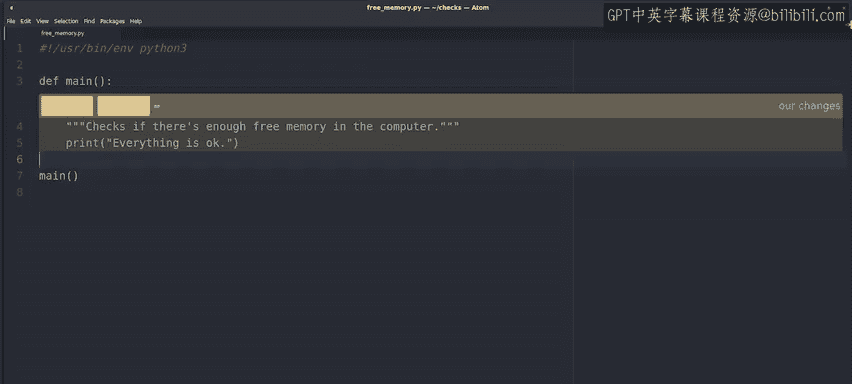
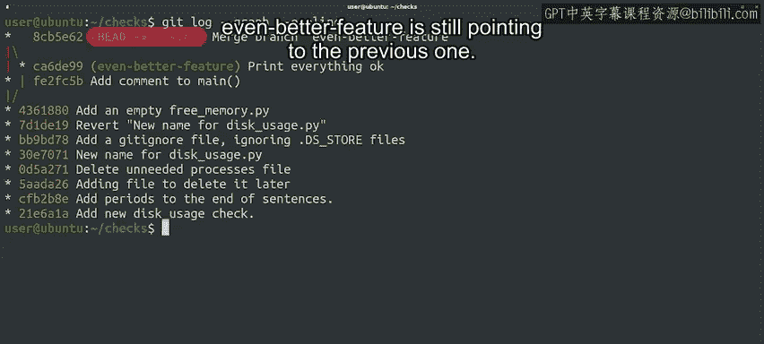

# 谷歌《用Python进行IT自动化办公3、4、5、6课（Git、debug、云端、实践）Google IT Automation with Python》中英字 - P29：28_合并冲突.zh_en - GPT中英字幕课程资源 - BV1LW4y1F7XW

From time to time， we might find that both the branches we're trying to merge have edits to the same part of the same file。

This will result in something called a conflict。Normally， Git can automatically merge files for us。

 but when we have a merge conflict， it will need a little help to figure out what to do。

To see how this would look， let's edit the free memoryory P file in the master branch and replace the past statement with a comment about what the main function should do。

Cool， we made the change so let's save it and commit it back to our master branch。Next。

 let's check out the even better feature branch and make a change in the same place。 In this case。

 we'll replace the call to pass with a call to print， saying that everything is okay。

Now we'll save this other change and commit it to this branch。

We are primed for chaos with our file all set up for Em conflict。

Let's check out the master branch again and try to merge the even better feature back into it。

Gt tells us it tried to automatically merge the two versions of the free memory file。

 but it didn't know how to do it。We can use Git status to get more information about what's going on。

As usual， Git status gives us a lot of additional information。

It tells us that we have files that are currently unmerged and that we need to fix the conflicts or abort the merge if we decide it was a mistake。

It also tells us that we need to run Git add on each unmerged file to mark that the conflicts have been resolved。

So let's get to work。To fix the conflict， let's open up free memory pie in our text editor。

Thankfully， Git has added some information to our files to tell us which parts of the code are conflicting。

The unmerged content of the file at head， remember， in this case head points to master。

 is the doc string stating what the main function should do。

And the unmerged content of the file in the even better feature branch is the call to the print function。

So it's up to us to decide which one to keep， or if we should change the contents of the file altogether。

In this case， we'll keep both statements and delete the merger markers。

Now that we fix the conflict， we'll mark it as resolved by running Git addd on the file and then call the Git status to see how our merge is doing。

See how Git now tells us that all conflicts have been resolved。W。

 we just need to call Git commitit to wrap up the merch。

The comments that Git commit shows us look different than other commits。

That's because this is a merge， and Git tells us so。It also tells us which file had conflicts。

 which have now been resolved。 The commit already has a description saying that it's merging the other branch。

This description was automatically created when we called the Gi merge command。

But we can add on to this description if we want。For example。

 we can say that we're keeping the lines from both branches and then just save an exit as usual。

And the merge conflict is resolved。To see what the commit history looks like now。

 we'll use a couple of handy options to the Git log command dash graph for seeing the commits as a graph and dash dash1 line to only see one line per commit。

This format helps us better understand the history of our commits and how mergers have occurred。

We can see the new commit that was added and also the two separate commits that we merged。

 one coming from the master branch and the other coming from the even better feature branch。

We can also see that master is pointing to the merge commit。

 but even better feature is still pointing to the previous one。

In our example， resolving the conflict was straightforward and easy。 But in the real world。

 this won't always be the case。 mergege conflicts can sometimes be tricky。

 complicated and spread across multiple files。If you want to throw the merge away and start over。

 you can use the git mergege dash dash abort command as an escape hatch。

This will stop the me and reset the files in your working tree back to the previous commit before the merge ever happened。

 So by now， you know how to create， delete and switch between branches and get。

 You've also seen that each branch represents a pointer to a commit and a sequence of independent snapshots。

And you know how to merge these commits back into the main trunk by using the Git mergege command。

Amazing work。Seriously， this isn't easy stuff。Up next。

 you'll find a cheat sheet summarizing all of these branching techniques。

 followed by a quiz to consolidate these concepts。