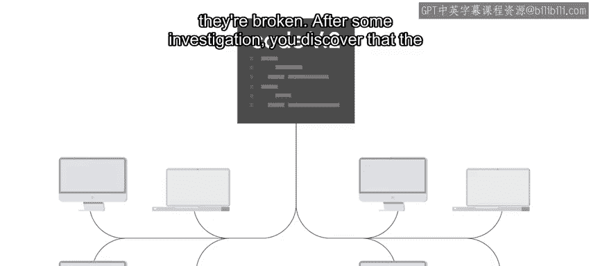
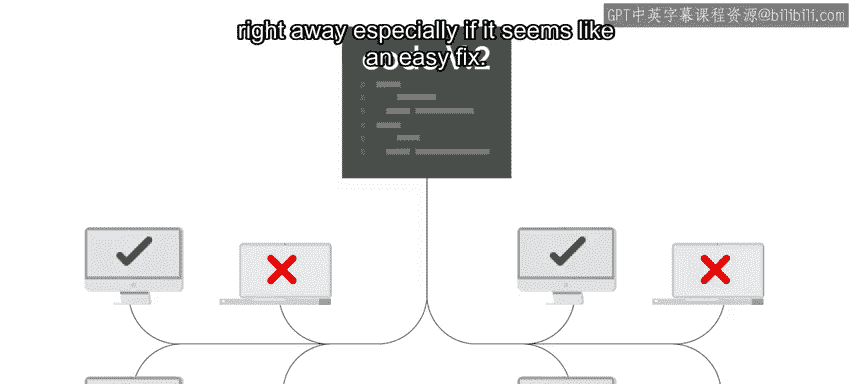
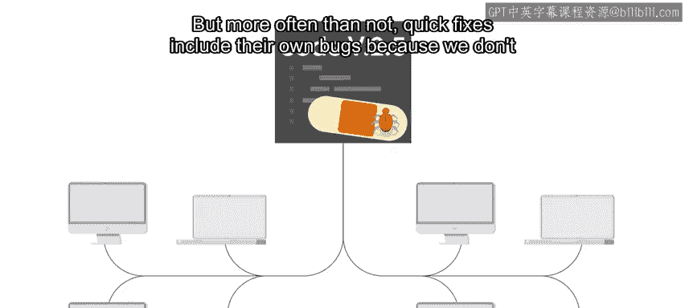
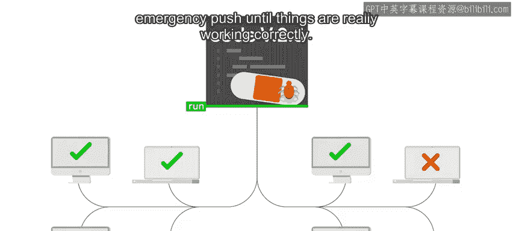
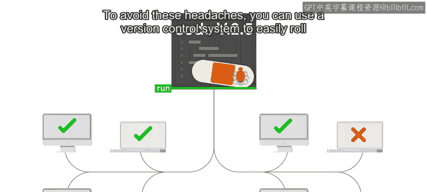
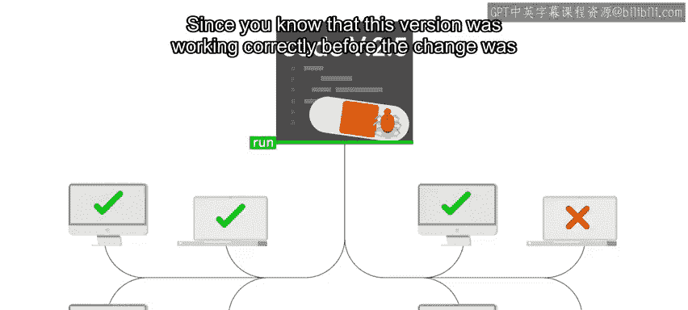
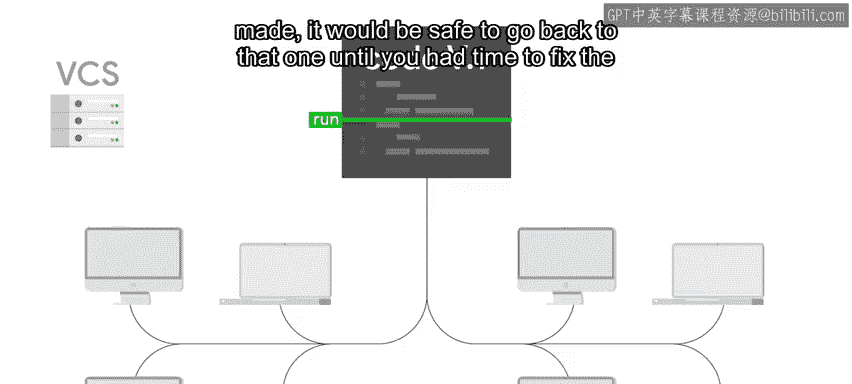
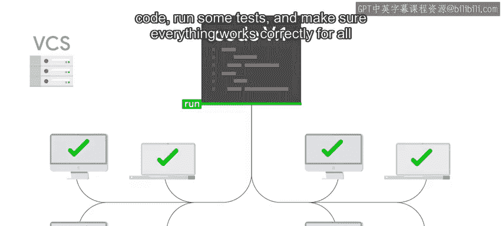
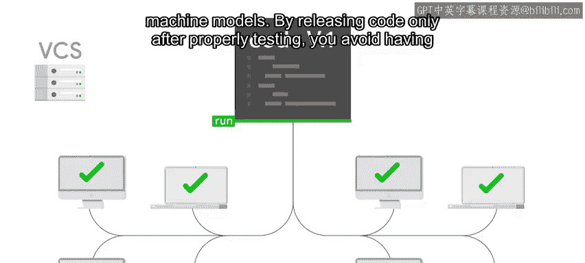

# 谷歌《用Python进行IT自动化办公3、4、5、6课（Git、debug、云端、实践）Google IT Automation with Python》中英字 - P2：1_模块 1 版本控制介绍.zh_en - GPT中英字幕课程资源 - BV1LW4y1F7XW

🎼。う。

When you work in IT， you manage information across a lot of different files。

You write automation scripts that might evolve over time。For example。

 you might add new features to your script or take into account additional conditions or modify the scope of systems where the script will be executed。

You also manage configuration related to your infrastructure。

 like the default settings on an application or the IP addresses assigned to the computers in your fleet。

This information changes over time as the security requirements increase。

 the fleet grows or new versions of software gets deployed。When trying to manage change in IT。

 it's super important to have detailed historical information for your organization's configuration files and automation code。

This lets the administrator see what was modified and when。

 which can be critical to troubleshooting it also provides a documentation trail that will let future IT specialists know why the infrastructure is the way it is。

And it provides a mechanism for undoing a change， completely。This way。

 we don't have to undo changes from memory and there's less chance of human error。

We'll see this in action when we talk about rollbacks。Imagine this。

 your team has added a new feature to a script that checks the health of all the computers that you're responsible for。

The new check verifies that the firmware of the computer， also known as the UEFI。

 is updated to the latest version。

When you roll this out， you suddenly realize that half the computers now say they're broken。

After some investigation， you discover that the check needs to take into account different computer models。

You might be tempted to do a quick code fix， push it to the affected machines right away。

 especially if it seems like an easy fix， but more often than not quick fixes include their own bugs because we don't take the time to test the new code properly。

 so after the first fix， you might end up doing a second or even third emergency push until things are really working correctly。

To avoid these headaches， you can use a version control system to easily roll back your code to the previous version。

Since you know that this version was working correctly before the change made。

 it would be safe to go back to that one until you've had time to fix the code， run some tests。

 and make sure everything works correctly for all machine models。

By releasing code only after properly testing， you avoid having to push Quick fix after Quick fix。

Viersion control systems let us do this and much more。

 they're crucial to maintaining a healthy code base for all kinds of IT resources。

And for letting multiple people collaborate on the same coding projects together。

We're now going to take our first steps to learning this new tool。

Which will let us keep track of the changes that we make to our scripts。

 our configuration files and any other kind of documents that need to be tracked。

We'll start by looking at what people tend to do when they don't know about version control and then check out some related tools like Dff and Patch。

Once we have a clear idea of why we need proper version control。

 we'll jump into our first Git experience。 We'll talk about what Git is and how it does。

 what it does。To follow along， you'll need to install Git locally on your machine and learn how to use it from the command line。

If this sounds a bit scary， don't panic。 We'll guide you along the way。

 and you'll be using it in no time。Once you have Git installed in your computer。

 we'll do an overview of the basic Git workflow， which will let you start keeping track of your scripts。

So are you ready to start taking control of your code？Here we go。

