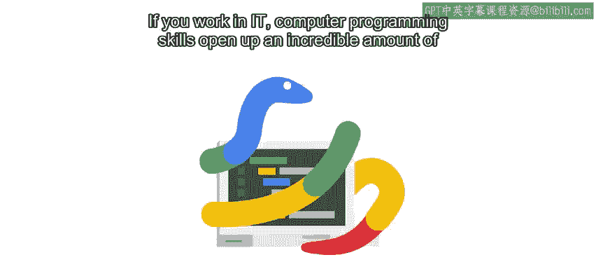
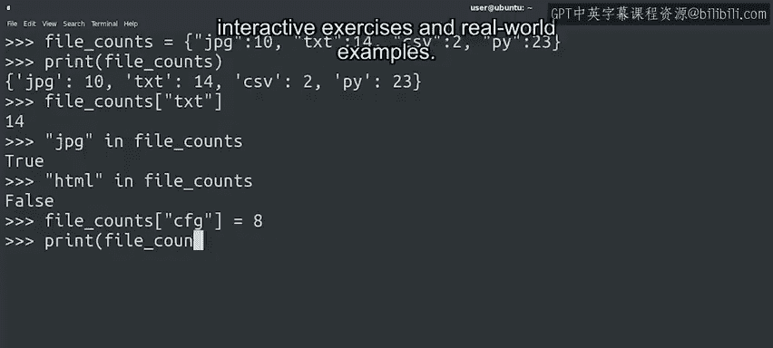
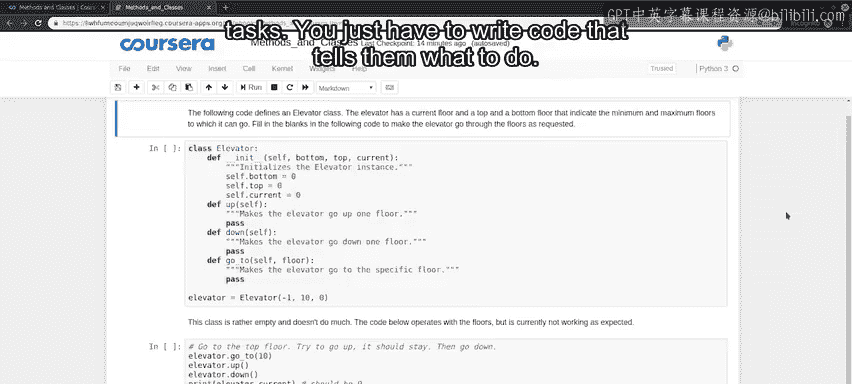
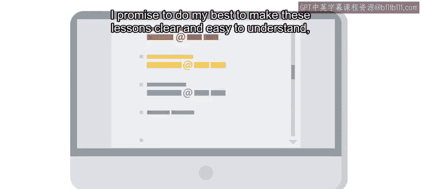

# 谷歌《用Python进行IT自动化办公1、2课（Python、控制操作系统）｜Google IT Automation with Python》中英字幕 - P2：1_课程介绍.zh_en - GPT中英字幕课程资源 - BV1gw411E7E1

。

If you work in I T， computer programming skills open up an incredible amount of opportunity。

 Being able to write scripts and programs that tell your computer to perform a task equips you with an invaluable tool。

 Not only does it make your work easier and more efficient。

 It can help you grow faster and advance further in your I T career。

 but how do you even start to learn a programming language like Python。

 how do you recognize when to tell a computer to perform a task。

 And how do you then write a program to actually get your computer to complete the task you want it to do。

 The thought of learning to write a program in Python can make you feel a whole bunch of emotions。

 excitement， anticipation， that feeling of wanting to dive right in and get going。 and also fear。

 you might ask yourself， can I really learn how to code or do I have it in me， I'm here to tell you。

 Yes， you can absolutely do this， Learn how to program can be scary and intimidating。

 but at the same time， it's really fun and really exciting。 Encoding， as in life。😊。

If we're going to get philosophical， the most rewarding work is usually a bit challenging。

 but ultimately well worth the effort。 Of course， I'm able to say all this from experience。

 especially the cheesy parts。😊，My name is Christine Raffel， I am Asist administrator at Google。

 and I'm going to be your instructor and guide in this course。

The role of assistss admin can vary a lot from company to company。

 And even within different teams in the same company。

 I happen to work in the corporate identity and access management operations team。

 which is a really long way of saying that we make sure that everyone is represented correctly。

 And if they need to access certain resources， they can。

 What I love the most about being as admin is that the role has so many diverse functions。

 We handle loads of unique problems and edge cases from tinkering with different systems to collaborating with other teams。

 I am always learning something new。 So it's really hard to get bored。

 It all starts with knowing how to automate。 If you're an I T support specialist。

 a systems administrator or in a role somewhere in between。

 knowing how to get computers to do the hard work for you will set you apart from others in similar I T roles and make your life much easier。

 Think about it。 Would you rather manually deploy 100 computers on your own or tell your computer to do it all for you all at once。

 No brainer， right， having a coding skill set can help you grow into more specialized roles。😊。

Systems administrator， cloud solutions engineer， Devop specialist， site reliability engineer。

 or who knows maybe even web developer or data analyst。 The point is。

 being able to write a program is an essential tool in your I T toolki。

 And more and more employers are looking for these skills in the people they hire。

 If you've ever learned a new skill， like playing a musical instrument， speaking of foreign language。

 knitting or skateboarding。 You know， that getting good at something new requires a lot of practice。

 for me， I love to learn new languages， And I'm proud to say I speak Spanish， Arabic， French。

 and I even know 10 words in Russian。 Our world is shaped by the words and the language as we speak。

 And while some words may be unique to one language。

 you can always find similarities that help you learn and understand。😊。

Being able to connect the dots between cultures allows me to see things。

 Others might not Kia sounds like this applies to I T programming。 My point is。

 whether you're learning French or Python， It's never easy。 You have to start small。

 Learn the basics and practice those until you master them。

 Only then can you move on to more complex and impressive stuff。

 And I'm here to help you along that path along with my colleagues who you'll meet in later courses。

 We'll start slow。 master the foundations together and you'll soon be ready for more challenging stuff。

 So are you wondering why we filmed this course in a cabin on a lake in Canada。 The truth is。

 we're actually in a game room at one of the Google offices in Sunnyvale， California。

 We chose a different themed office space for each course of the program just to mix things up。

 And I think I scored with this one。 I should warn my manager that I'll be hanging out in this one well after the course ends because it's super comfy。

 By the end of this course， you'll understand the benefits of programming and I T rules。

 You'll be able to write simple programs using Python。 Figure out how。😊。

The building blocks of programming fit together and combine all this knowledge to solve a complex programming problem。

 That's right。 By the end of this course， you're going to write a program in Python that's designed to solve a real world I T problem。

 Super exciting， right， We'll start off by diving into the basics of writing a computer program。

 You'll get handson experience with programming concepts through interactive exercises and real world examples。

 You'll quickly start to see how computers can perform a multitude of tasks。

 You just have to write code that tells them what to do。 along the way。

 will'll be talking about automation， which is the process of getting computers to automatically do a task that us humans normally have to do by hand。

 Now， some of this stuff can get a little complex and confusing。

 I promise to do my best to make these lessons clear and easy to understand。

 But if you get stuck at any point， please feel free to rewatch the videos。

 Pra as much as you like and take the time you really need to understand these topics。

 The goal of this course isn't to teach you everything there is to know about。😊。

Software engineering， because Yikes， that would be a long course。 Instead。

 we're going to introduce you to some of the key concepts of programming and scripting that will empower you to spot opportunities for automation in real life。

😊，You're about to learn a skill that can help you take your career to whole new levels。

 Are you excited。 I'm excited。 So let's jump in。😊。