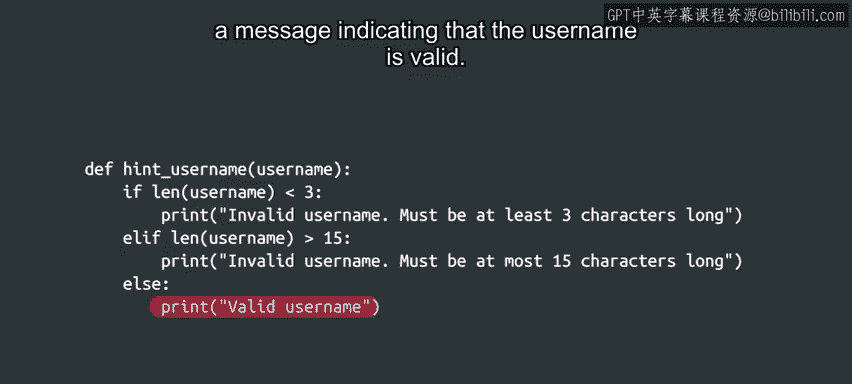

# 谷歌《用Python进行IT自动化办公1、2课（Python、控制操作系统）｜Google IT Automation with Python》中英字幕 - P30：29_elif 语句.zh_en - GPT中英字幕课程资源 - BV1gw411E7E1

The if and else blocks allow us to branch execution。

 depending on whether a condition is true or false。

 But what if there are more conditions to take into account， This is where the L if statement。

 which is short for else， if comes into play。But before we jump into how to use it。

 let's take a look at why we need it in the first place。

 Let's go back to our trusty username validation example。Now。

 what if your company also had a rule that usernames longer than 15 characters aren't allowed？

How could we let the user know if their chosen username was too long， We could do it like this。

In this case， we're adding an extra if block inside the else block。 This works。

 But the way the code is nested makes it kind of hard to read。

To avoid unnecessary nesting and make the code clearer， Python gives us the LF keyword。

 which lets us handle more than two comparison cases。 Take a look。

The L if statement looks very similar to the if statement。

 It's followed by a condition and a colon and a block of code indented to the right that forms the body。

The condition must be true for the body of the Elf block to be executed。

 The main difference between Eif and if statements is we can only write an elf block as a companion to an if block。

That's because the condition of the L if statement will only be checked if the condition of the if statement wasn't true。

 So in this example， the program first checks whether the username is less than three characters long and prints a message if that's the case。

If the username has at least three characters， the program then checks if it's longer than 15 characters。

 if it is， we get a message to tell us that。Finally， if none of the above conditions were met。

 the program prints a message indicating that the username is valid。

There's no limit to how many conditions we can add， and it's easy to include new ones。 For example。

 say the company decided that the username shouldn't include numbers。

 We could easily add an extra L condition to check for this。 Cool， right。

You now know how to compare things and use those comparisons for your if， EF and else statements。

 and you are using all of them inside functions， using branching to determine your program's flow opens up a whole new realm of possibilities in your scripts。

 You can use comparisons to pick between executing different pieces of code。

 which makes your script pretty flexible。 branching also helps you do all kinds of practical things like only backing of files with a certain extension or only allowing login access to a server during certain times of the day。

 Any time your program needs to make a decision， you can specify its behavior with a branching statement。

 Are you starting to notice tasks in your day to day that could be made more efficient with scripting。

😊，There's so many possibilities， and we're only just getting started with all the cool stuff programming can help you do。

 Wow， we've covered a lot in these last few videos。

 remembering all these concepts can take some time， and the best way to learn them is to use them。

 So we've put together a cheat sheet for you in the next reading。

 You'll find all these operators and branching blocks listed there in one handy resource。

 It's super useful when you need a quick refresher。 So no skipping the reading。😊。

