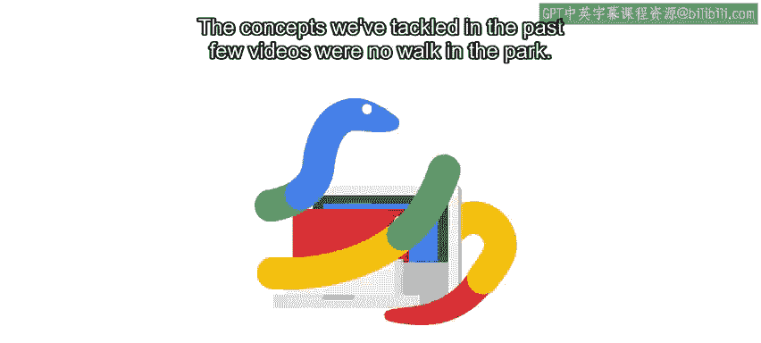

# 谷歌《用Python进行IT自动化办公3、4、5、6课（Git、debug、云端、实践）Google IT Automation with Python》中英字 - P30：29_模块 2 总结 - 在本地使用 Git.zh_en - GPT中英字幕课程资源 - BV1LW4y1F7XW

🎼。う。

Well done， making it all the way here。 The concepts we've tackled in the past few videos were no walk in the park。

 but you've powered through them with flying colors。

We've learned a lot more about how to interact with Git。We started with some advanced commands。

 like skipping the staging area， getting additional info about our commits。

 and being able to delete and rename files in our repository。After that。

 we dove into one of the main concepts of version control， the ability to undo things。

We looked at how to revert unstd and stage changes， how to amend commits。

 and how to perform rollbacks， whether from the latest commit or an older one。Finally。

 we cut through the entangled world of branching。 We learned how to create。

 switch to and delete branches。 We looked into how to merge branches and how to solve pesky merge conflicts when they cause trouble。

 There's an assessment coming up to help you put all of your new skills into action。

 Remember that you can spend as much time as you need reviewing any of the content we've covered。

 until you feel ready to take on the assessments head on。

 I'll meet you in the next video where we'll check out how to use and manage remote repositories。

 We'll also learn how to use Git in the context of a collaborative environment。😊，史孙。

