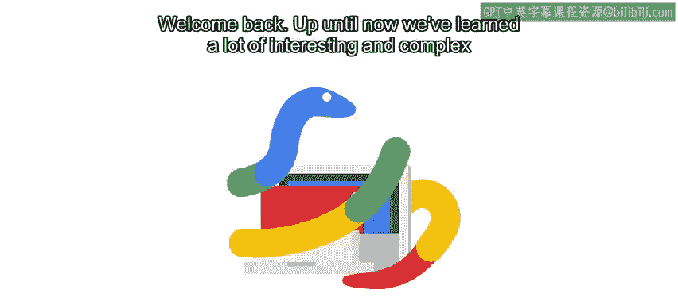

# 谷歌《用Python进行IT自动化办公3、4、5、6课（Git、debug、云端、实践）Google IT Automation with Python》中英字 - P31：30_模块 3 使用远程仓库介绍.zh_en - GPT中英字幕课程资源 - BV1LW4y1F7XW

🎼。う。

Welcome back Up till now we've learned a lot of interesting and complex techniques on how to use Git locally。

 we started with the very basic Git workflow for modifying files， staging the changes。

 and then committing them。We then looked at other things we can do with Git。

 like deleting or renaming files， getting more information about commits。

 or skipping the staging area altogether。Next， we saw how to undo staged。

 unstd or committed changes in our git repositories， and finally。

 we learned a bit about how to work with different branches。

 like how to merge changes from separate branches。That's a lot of complex stuff。

 And it's natural that it might seem scary。But it can also be very satisfying once you start to understand what's going on。

And just think of how valuable these new skills will be as you advance your IT career。

So remember that you can review the material as many times as needed and that the best way to master it is to keep practicing on your own。

And if something is still unclear after that， don't forget you can use the discussion forums to ask for help in this module。

 we'll learn a load of new things related to Gitthub and remote repositories。

We'll first talk about what GitHub is and why it matters。

 and then we'll dive into how to work with GitHub and other remote repositories。

Being able to use remote repositories allows us to effectively collaborate with others。

Our collaborators can be sitting in the same office as we are。

 or they can be thousands of miles away on a different continent， working at a different time of day。

Using a version control system like Git lets us incorporate the work of different people no matter where they are or when they're working I've personally had a bunch of interesting experiences collaborating through a version control system。

One that stands out was a debugging session a friend and I had while at work。

I was working on some tricky code and I couldn't figure out the best way to implement a function。

I was stuck and ready to give up completely。 My colleagues suggested that I work on another piece of the file further down while he figured out the optimal solution for the code that I was having trouble with。

This was a super seamless experience and was only possible because of a VCS。

And the superpower of teamwork， of course。By the end of the module。

 you'll be able to collaborate with friends and colleagues just like I did。Let's get to it。

