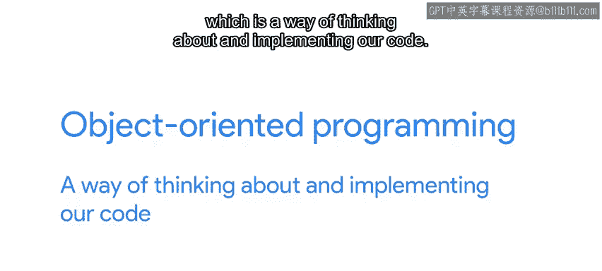

# 谷歌《用Python进行IT自动化办公1、2课（Python、控制操作系统）｜Google IT Automation with Python》中英字幕 - P31：30_面向对象编程介绍（可选）.zh_en - GPT中英字幕课程资源 - BV1gw411E7E1

Let's take a second to review what you've accomplished so far。

 We've now gone over all the basics syntax of Python and then checked out the most common data structures。

 strings， lists and dictionaries。 These letter scripts do a bunch of cool things like processing text。

 iterating through elements to do an operation on each。

 finding out the frequency of an element and a whole lot more In the next videos。

 We're going focus on a bunch of new concepts。 We're going to dive into object oriented programming。

 which is a way of thinking about and implementing our code。😊。

We'll discuss how to create our own objects and how to use many of Python's interesting capabilities。

 We're going to learn a lot of new terminology， too。 Okay。

 ready for your orientation on object oriented programming。 There's a lot to cover。

 So let's jump right in。😊。