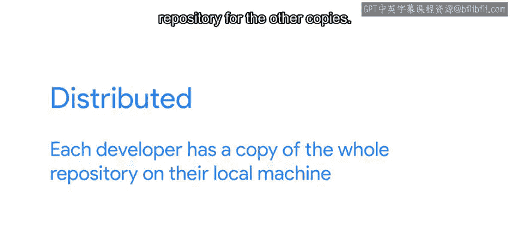
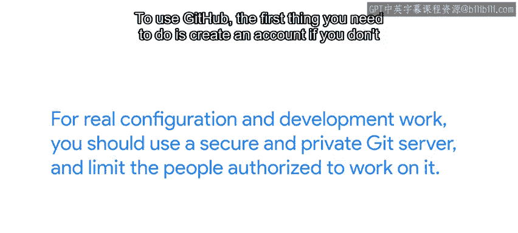

# 谷歌《用Python进行IT自动化办公3、4、5、6课（Git、debug、云端、实践）Google IT Automation with Python》中英字 - P32：31_什么是 GitHub.zh_en - GPT中英字幕课程资源 - BV1LW4y1F7XW

🎼。う。

In earlier videos， we called out that Git is a distributed version control system。

Distributed means that each developer has a copy of the whole repository on their local machine。

Each copy is a peer of the others， but we can host one of these copies on a server and then use it as a remote repository for the other copies。

This lets us synchronize work between copies through this server。

 Any of us can create a git server like this one。And many companies have similar internal services。

But if you don't want to set up a Git serverver yourself and host your repositories。

 you can use an online service like GitHub。GitHub is a web based Git repository hosting service。

On top of the version control functionality of Git， GitHub includes extra features like bug tracking。

 Wikiis， and task management。GitHub lets us share and access repositories on the web and copy or clone them to our local computer so we can work on them。

GitHub is a popular choice with a robust feature set， but it's not the only one。

Other services that provide similar functionality are BiBet and GitLb。For the rest of this course。

 we'll be using GitHub for our examples， but feel free to use a tool that best fits your needs。

GitHub provides free access to a Git server for public and private repositories。

It limits the number of contributors for the free private repositories and offers an unlimited private repository service for a monthly fee。

We'll be using a free repository for our examples， which is fine for educational use。

 small personal projects or open source development。

A word of caution on how you can manage these reos， though。

If hackers get hold of information about your organization's IT infrastructure。

 they can use it to try and break into your network。

So make sure you treat this information as confidential。For real configuration and development work。

 you should use a secure and private Git server and limit the people authorized to work on it。

To use GitHub， the first thing you need to do is create an account if you don't have one already。

Signing up online is free and relatively simple。 Once you've done that。

 you can either create your own reos or contribute to repos from other projects。

If you don't have a GitHub account yet， now is a good time to create one。Visit Github。

com to sign up for their service。Once you've done that。

 maybe me over the next video where we'll go over some basic interactions with GitHub。

