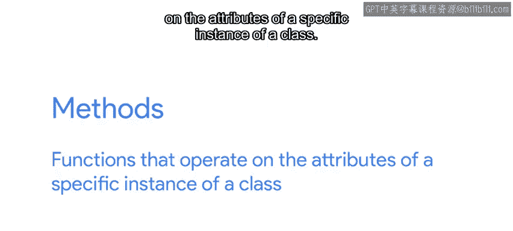
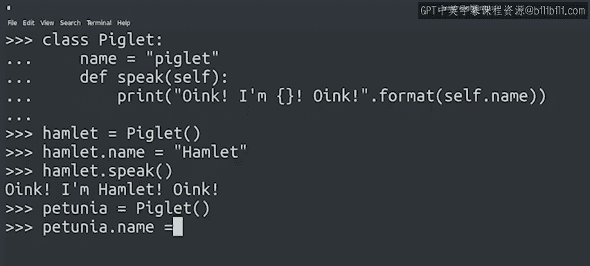
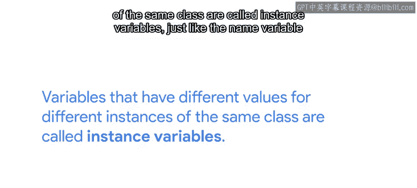
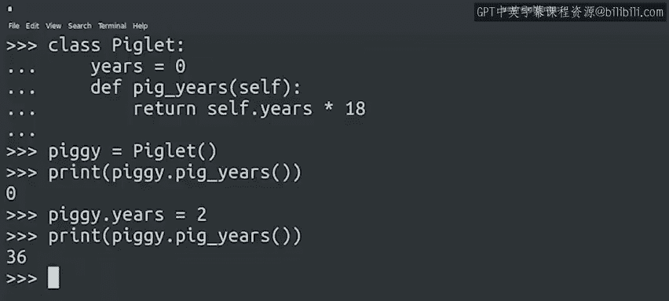

# 谷歌《用Python进行IT自动化办公1、2课（Python、控制操作系统）｜Google IT Automation with Python》中英字幕 - P32：31_实例方法（可选）.zh_en - GPT中英字幕课程资源 - BV1gw411E7E1

So how are you doing so far， Is everything making sense。

 Are all those Apple examples making you hungry。Feel free to pause and grab a snack。

 if that's what you need。 We called out earlier that we use methods to get objects to do stuff。

 We've seen several methods in our example so far， like lower for strings。

 append for lists or values for dictionaries。😊，The key to understanding methods is this Meth are functions that operate on the attributes of a specific instance of a class。

When we call the append method on a list， we're adding an element to the end of that specific list and not to any other lists。

 When we call the lower method on a string， we're making the contents of that specific string lowercase。

 How exactly does this happen。 Let's take a closer look by defining our own methods。 First。

 we need to define a class and create an instance of it like we've done before。😊，Nice。

 we've created a piglet class。 While our new piglet might be cute。 it can't do a whole lot right now。

What if we wanted to give it a voice for objects to perform actions， they need methods。

 And as we called out before， a method is a function that operates on a single instance of an object。

 Let's add a method to our class。You can see here that we start defining a method with the de keyword。

 just like we would for a function。 and see how the line with the deaf keyword is indented to the right inside the piglet class。

 That's how we define a function as a method of the class。

 This function is receiving a parameter called self。😊。

This parameter represents the instance that the method is being executed on。Okay。

 let's try this out and see what happens。Hamlet equals piglet， Hamlet dot speak。

 And the piglet goes onk， ink。It sure does。 but this makes the piglet say the same thing for all instances of the class。

 Boring。 Let's make the method do something different， depending on the attribute of the instance。

This time， we've started the body of the class by defining an attribute called name with a default value of piglet。

 We can change that value later， but it's a good idea to set it now to make sure our variable is initialized。

😊，If you look closely at how we wrote the new speak method。

 you'll see that it's using the value of self dot name to know what name to print。

 This means that it's accessing the attribute name from the current instance of piglet。

Let's try this out。So we'll set hamlet equals piglet。Then we can say hamlet。t name。

And we'll set the name to a string。Hamlet。And then we can call。Do't speak on Hamlet。Meet Hamlet。

 our Python pig。What， you didn't know pigs could talk。 Well， they can in Python。 In this example。

 the speak method printed the name Helet， which was the name attribute that we set。

 What if we create a new instance of the same class， but with a different name。

It should generate a different output。 Okay， let's try this out。 I think Hamlet needs a friend。

We've now created two instances of the piglet class， each of them with their own name。

 When calling the speak method， each of them prints their name and not the other。

Variables that have different values for different instances of the same class are called instance variables。

 just like the name variable in this example。

Since methods are just functions that belong to a specific class。

 they can work as any other function so they can receive more parameters and return values if needed。

 Let's check out what a method returning of value looks like。In this case。

 we've created a method that converts the age of our piglet to pig years。

 So the value that the method returns should change when we change the year's attribute of our instance。

Let's create an instance and check how this method works。 Piggy is two years old in human years。

 How old is he in pige years。So as the value of the year's attribute changes。

 the return value of the pig year's method changes too。

Coming up， we're going to learn about a few special types of methods。

 including one in particular called constructor。