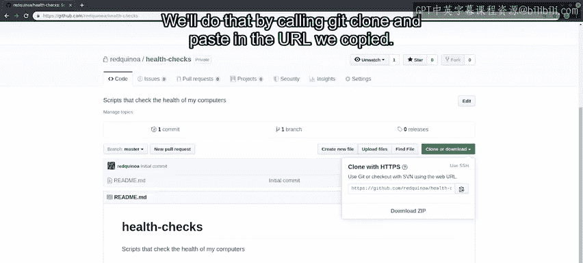
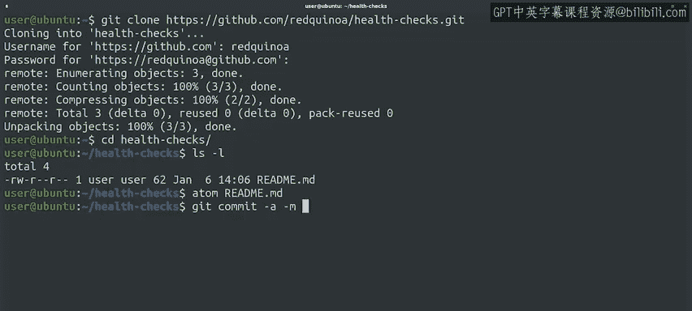
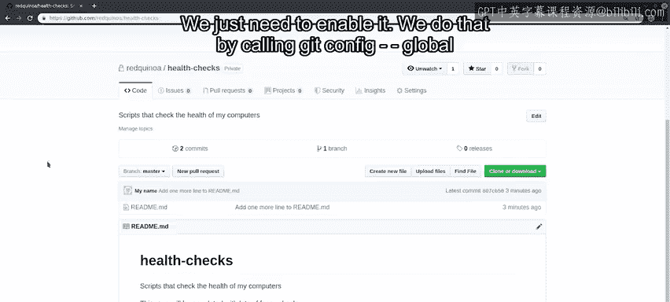
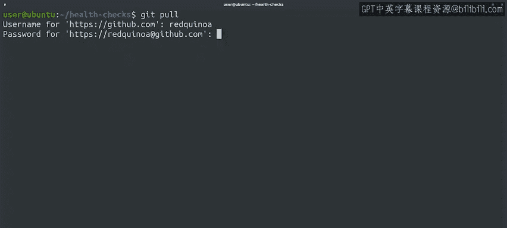

# 谷歌《用Python进行IT自动化办公3、4、5、6课（Git、debug、云端、实践）Google IT Automation with Python》中英字 - P33：32_与 GitHub 的基本交互.zh_en - GPT中英字幕课程资源 - BV1LW4y1F7XW

As we called out， GitHub is an online service and to use it。

 you first need to create an account on the site。Once you have your account。

 you're ready to create your brand new repository on Gitthub。 Let's do this now， going step by step。

We'll start by clicking the Create a repository link on the left。

This will take us to the Repo creation Wizard。The wizard is pretty straightforward。

 The first thing we need to do is give a name for our repo。 We'll call this repo health checks。

After that comes a description of what the repo will be used for。

We'll say that it'll be used for scripts that check the health of our computers。

 then we need to select whether we want the repo to be public or private。

We'll go with private for now， and finally， the wzard can help us get started with some few initialization files like a Readme。

 a gi ignorere， or a license file。We'll go with just the Readme for now and then create the repo。Yea。

 using the wizard， we created the repo and have a fresh remote repository ready to go。

 just like magic。 Let's get to work。😊，First step is to create a local copy of the repository We'll do that by using the Git clone command followed by the URL of the repo。

GitHub conveniently lets us copy the URL from our repo from the interface so that we don't have to type it。

We're now ready to clone the repo into our computer。

 We'll do that by calling Git cloneone and paste in the URL we copied to do this。

 GitHub will ask for our username and password。

Just like that， we've downloaded a copy of the remote repository from GitHub onto the local machine。

This means that we can perform all the get actions that we've learned up till now。

Since the repo is calledHe checks， a directory with that name was automatically created for us and now has the working tree of the repository in it。

So let's change that directory and look at the contents。Our repo is basically empty。

 it only has the Readme file that GitHub created for us。

This file is in a special format called Markdown。 Let's add a bit more content to it。

We've changed this file。 What do we need to do now？We need to stage the change and commit it。

We've seen a couple different ways to do that， let's use our shortcuts to do this in just one command。

Okay， we've modified our Readme file， but we've seen all this before。

 We got a remote repository set up on Github。 So let's use it。

We can send our changes to that remote repository by using the Git push command。

 which will gather all the snapshots we've taken and send them to the remote repository。In this case。

 we've only taken one snapshot。We'll talk more about what's going on behind the scenes with GitP and remote repositories in later videos。

But the mechanics are pretty simple to push our modified Read me up to Gitthub。

 we'll just call Gi push。Once again， we're asked for our password。 After that。

 we see a bunch of messages from Git related to the push。When we access our project。

 we see the contents of the Read Me file。 So if we check our repository on Github。

We should see the updated message。Pretty cool， right。

 We've taken the local changes on our computer and pushed them up to a remote repository hosted on Gitthub。

😊，You probably noticed that we had to enter our password both when retrieving the repo and when pushing changes to the repo。

 there are a couple ways to avoid having to do this。

 one ways is to create an SSH key pair and store the public key in our profile so that GitHub recognizes our computer。

Another option is to use a credential helper， which caches our credentials for a time window so that we don't need to enter our password with every interaction。

Getit already comes with a credential helper baked in， we just need to enable it。

We do that by calling Gitconfiggbalcredential。heler cash。

Now that we've enabled the credential helper， we'll need to enter our credentials once more。

After that， they'll be cacheed for 15 minutes。To check this， we can try another Git command。

 Git pull。Which is the command we use to retrieve new changes from the repository。

 We'll enter our credentials on the first call to the command and they'll be cashed。

 so we won't need to enter them again。

With that， we've seen how to create repositories on GitHub， clone a remote repository。

 push changes to it and pull changes from it。There's a lot going on behind the scenes here and we'll dive deeper into the details and more collaboration techniques in later videos For now。

 check out the next reading for a summary of this basic workflow and then there's a quick quiz to make sure this is making sense。

