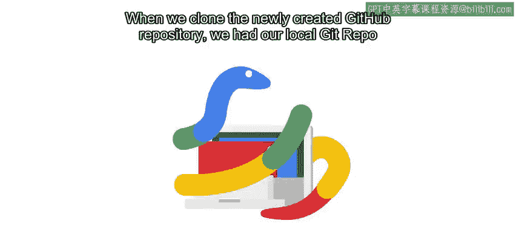
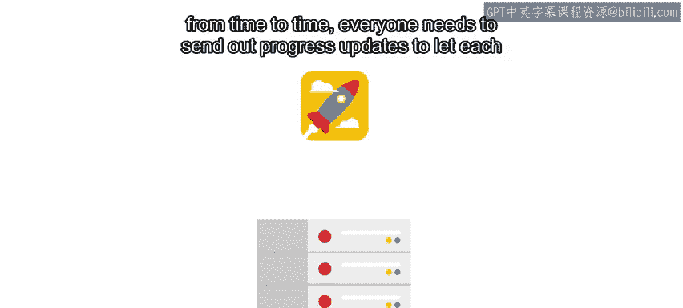
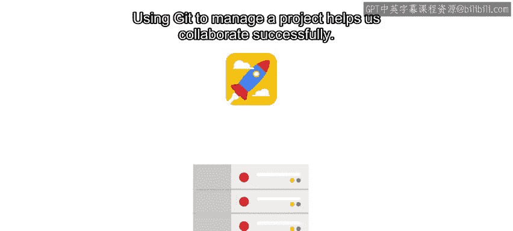
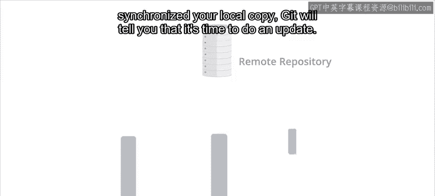
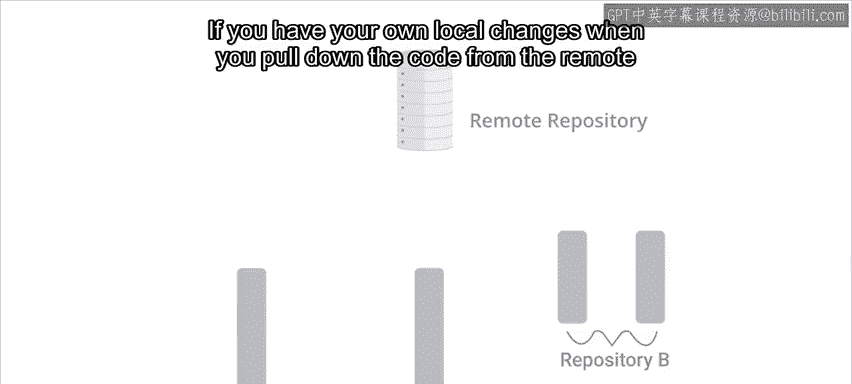
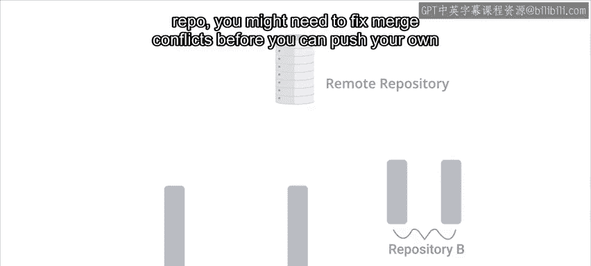
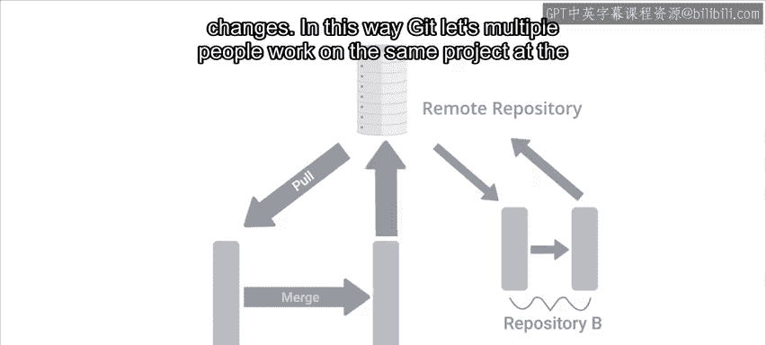
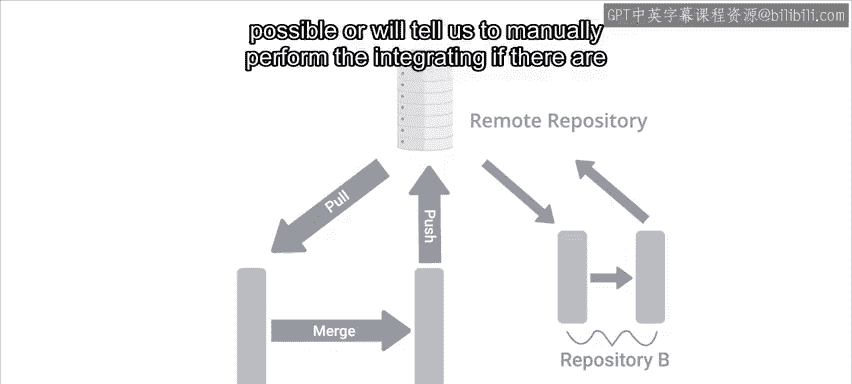
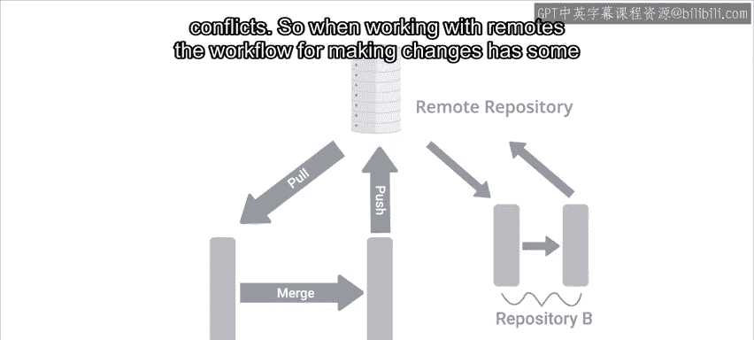

# 谷歌《用Python进行IT自动化办公3、4、5、6课（Git、debug、云端、实践）Google IT Automation with Python》中英字 - P34：33_什么是远程仓库.zh_en - GPT中英字幕课程资源 - BV1LW4y1F7XW

🎼。う。

When we clone the newly created GitHub repository。We had our local Git repo interact with a remote repository。

Remote repositories are a big part of the distributed nature of Git collaboration。

They let lots of developers contribute to a project from their own workstations。

 making changes to local copies of the project independently of one another。

When they need to share their changes， they can issue Git commands to pull code from a remote repository or push code into one。

There are a bunch of ways to host remote repositories。 As we called out。

 there is many internet based Git hosting providers like Gitthub， Bit bucketet or Gitlab。

 which offer similar services。We can also set up a Git server on our own network to host private repositories。

A locally hosted Git serverver can run on almost any platform， including Linux， Mac OS or Windows。

This has benefits like increased privacy， control and customization。

To understand remote repositories and get distributed nature a bit better。

 imagine you're working together with some friends to design a computer game。

Each of you has a different portion of the game you are responsible for。

 One person is designing the levels， another， the characters。

 while others are writing the code for the graphics， physics and gameplay。

All these areas will have to come together into a single place for the final product。

Although your friends might work on their parts by themselves， from time to time。

 everyone needs to send out progress updates to let each other know what they've been working on。

You will then need to combine their work into your own portion of the project to make sure it's all compatible using Git to manage a project helps us collaborate successfully。

Everyone will develop their piece of the project independently in their own local repositories。

 maybe even using separate branches。Occasionally， they'll push finished code into a central remote repository where others can pull it and incorporate it into their new developments。

So how does this work？Alongside the local development branches like Master。

 Git keeps copies of the commits that have been submitted to the remote repository and separate branches。

If someone has updated the repository since the last time you synchronized your local copy。

Git will tell you that it's time to do an update。

If you have your own local changes， when you pull down the code from the remote repo。

 you might need to fix merge conflicts before you can push your own changes。

In this way， Git lets multiple people work on the same project at the same time。

When pulling new code， it will merge the changes automatically if possible。

 or will tell us to manually perform the integrations if there are conflicts。

 So when working with remotes， the work for making changes has some extra steps。

We'll still modify， stage， and commit our local changes。After committing。

 we'll fetch any new changes from the remote repo， manually merge if necessary。

 and only then will push our changes to the remote repo。

Git supports a variety of ways to connect to a remote repository。

Some of the most common are using the HTTP， HTTPS， and SSH protocols， and their corresponding URLs。

HTTP is generally used to allow read only access to a repository。In other words。

 it lets people clone the contents of your repo without letting them push new contents to it。

Conversely， HGTPS and SSH both provide methods of authenticating users so you can control who gets permission to push。

If all this protocol talk is making your head spin。

You might want to review the video on these subjects made by my colleague Gion。

You'll find a link to this in the next reading。The distributed nature of the work means that there are no limits to how many people can push code into a repository。

It's a good idea to control who can push code to your repos and to make sure you give access only to people you trust。

Web services like GitHub offer a bunch of different mechanisms to control access to repositories。

Some of these are available to the general public， while others are only available to enterprise users。

Okay， by now you have an idea of what a remote repository is and how it interacts with local git repositories。

Up next， we'll dive into some of the commands that let us interact with remotes。

