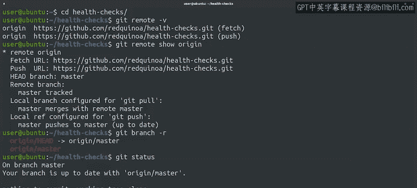

# 谷歌《用Python进行IT自动化办公3、4、5、6课（Git、debug、云端、实践）Google IT Automation with Python》中英字 - P35：34_使用远程仓库.zh_en - GPT中英字幕课程资源 - BV1LW4y1F7XW

When we call Git clone to get a local copy of a remote repository。

 Git sets up that remote repository with the default origin name。

We can look at the configuration for that remote by running Git ReoteV in the directory of the repo。

Here we see the URLs associated with the origin remote。There are two URLs。

 one will be used to fetch data from the remote repository and the other one to push data to that remote repo。

They'll usually point at the same place。But in some cases。

 you could have the fetcht URL use HTTP for Read Only Access。

 and the pushush URL use HTTPS or SSH for access control。

This is fine as long as the contents of the repo that you read when fetching are the same that you write to when pushing。

Remote repositories have a name assigned to them。 By default， the assigned name is origin。

This lets us track more than one remote in the same Git directory。

While this is not the typical usage， it can be useful when collaborating with different teams on projects that are related to each other。

We won't look at how to do that here， but we'll include a link for more information in the next reading。

If we want to get even more information about our remote， we can call Git Reote show originig。

There's a ton of information here， and we don't need all of it right now。

 We can see the fetch and push Uls that we saw before and the local and remote branches， too。For now。

 we only have a master branch that exists locally and remotely。

 So the information here seems a bit repetitive。Once you start having more branches。

 especially different branches in the local and remote repo。

 this information starts becoming more complex。So。What are these remote branches that we're talking about anyways？

Whenever we're operating with remotes， Git uses remote branches to keep copies of the data that's stored in the remote repository。

We could have a look at the remote branches that our Git repo is currently tracking by running Git branch R。

These branches are read only。We can look at the commit history like we would with local branches。

But we can't make any changes to them directly to modify their contents。

 we'll have to go through the workflow we called out before。First。

 we pull any new changes to our local branch。Then merge them with our changes and push our changes to the repo。

 Remember how we've been using Git status to check the status of our changes。

 We can also use git status to check the status of our changes in remote branches， as well。

Now that we're working with a remote repository， Git status gives us additional information。

It tells us that our branch is up to date with the origin slash master branch。

 which means that the master branch in the remote repository called Or has the same commits as our local master branch。

But what if it wasn't up to date。We'll talk about that in the next video。

