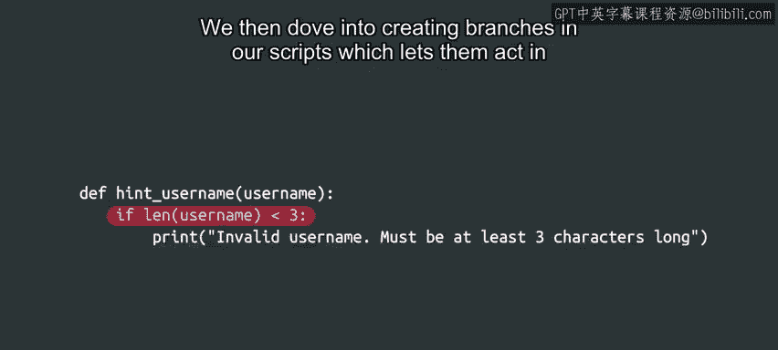

# 谷歌《用Python进行IT自动化办公1、2课（Python、控制操作系统）｜Google IT Automation with Python》中英字幕 - P35：34_基本语法总结.zh_en - GPT中英字幕课程资源 - BV1gw411E7E1

Woo， you just completed your second module and learned a whole lot about Python syntax。 congrats。

 we've learned how to operate with different data types and how to create our own variables and expressions。

 We've defined our first functions and learned how to make them return value so that they're more reusable。

😊，We then dove into creating branches in our scripts， which lets them act in different ways。

 depending on the values of our variables。 We've learned a lot of new and very powerful stuff。

 knowing how to structure your code and functions and how to make your code act in different ways。

 depending on the values is what allows us to tell our computer what to do。

 We'll keep using these tools throughout the course。

 as we move on to more complex and interesting things。 Next up。

 you can put everything you've learned to the test in the next graded assessment。

 Don't worry if you don't feel ready yet。 Remember that you can rewatch the videos and do the practice quizzes as many times as you need to make sure you' fully understand everything we've covered。

 When you're ready for the test。 Take your time。 And best of luck。

 I'll catch you after you've finished in the next module。 where we'll learn all about loops。😊。

See you there。