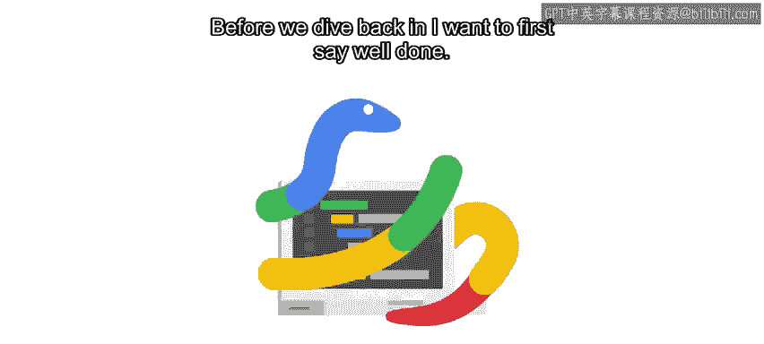
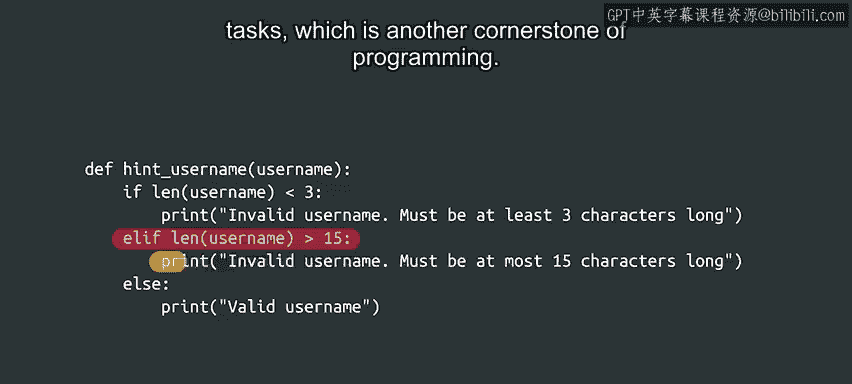
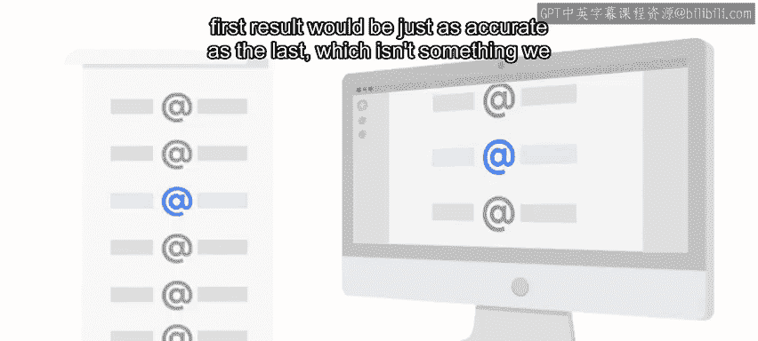

# 谷歌《用Python进行IT自动化办公1、2课（Python、控制操作系统）｜Google IT Automation with Python》中英字幕 - P36：35_循环介绍.zh_en - GPT中英字幕课程资源 - BV1gw411E7E1

。

Hi there。 And welcome back。 Before we dive back in。 I want to first say well done。

 We've learned a lot of new skills in a short amount of time and tackled some pretty tricky concepts。

 None of this stuff is easy， and you're doing so great。

 So we've got some fun concepts lined up for the next few videos。 So far。

 we've seen how to organize our code and functions。

 We've also made our code branch into different paths， depending on certain conditions。

 In this module， will learn how to get computers to do repetitive tasks。

 which is another cornerstone of programming。 As we've called out before。

 computers are great at repeating the same task over and over。

 They never get bored or making a mistake。 You could ask a computer to do the same calculation a thousand times。

 And the first result would be just as accurate as the last。

 which isn't something we can say about us humans。 Have you ever tried to do something a thousand times in a row。

 It'd be enough to drive you loopy。 which is why in this course。

 we're going to learn how to leave the loops up to the computer。

 The ability to accurately perform repetitive tasks。😊。

And never get tired is why computers are so great for automation。

 The automated task could be anything like copying files to a bunch of computers on a network。

 sending personalized emails to a list of users or verifying that a process is still running。

 It doesn't matter how complex the task is。 your computer will do it as many times as you tell it to。

 which leaves you time for more interesting things like planning future hardware needs or managing software rollouts。

 When the next few videos will explore three techniques for automating repetitive tasks。

 These are while loops， for loops and recursion。 Each of these techniques are used to tell the computer to repeat a task。

 But each takes a slightly different approach。😊，We're going to learn how to write the code for each and how to know when to use one technique instead of the others。

 So are you ready， Let's get started。😊。