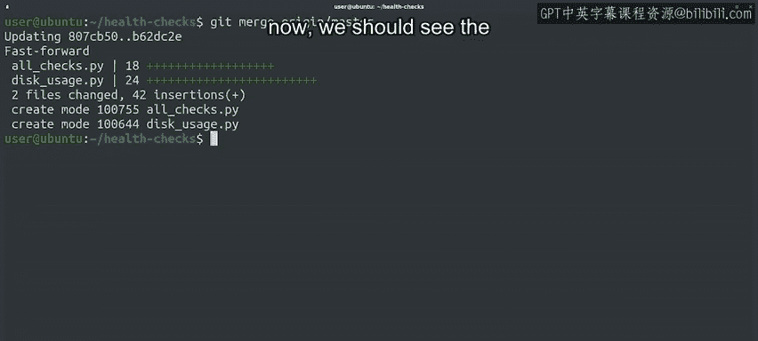

# 谷歌《用Python进行IT自动化办公3、4、5、6课（Git、debug、云端、实践）Google IT Automation with Python》中英字 - P36：35_获取新更改.zh_en - GPT中英字幕课程资源 - BV1LW4y1F7XW

While we were learning about remotes， our colleague Blue Kaale， added some files to our repo。

We could always use the GitHub website to browse the changes that were submitted。

 but we want to learn how to do it by interacting through the command line。

 because you might need to do it this way at your job。

 and itll work the same no matter which platform you use to interact with Git。So first。

 let's look at the output of the Git remote show origin command。

Check out how it says that the local branch is out of date。

This happens when there were commits done to the repo that aren't yet reflected locally。

Git doesn't keep remote and local branches and sync automatically。

It waits until we execute commands to move data around when we're ready。To sync the data。

 we use the Git fetchch command。This command copies the commits done in the remote repository to the remote branches so we can see what other people have committed。

Let's call it now and see what happens。Fetched content is downloaded to the remote branches on our repository。

 so it's not automatically mirrored to our local branches。

We can run Git checkout on these branches to see the working tree。

 and we can run Git log to see the commit history。Let's look at the current commits in the remote repo by running Git log originigin/lashmaster。

Looking at this output， we can see that the remote origin s branch is pointing to the latest commit。

While the local master branch is pointing to the previous commit we made earlier on。

Let's see what happens if we run Git statusus now。Git statusus helpfully tells us that there's a commit we don't have in our branch。

It does this by letting us know our branches behind the remote origin/lash masterster branch。

If we want to integrate the branches into our master branch， we can perform a merge operation。

 which merges the origin slash master branch into our local master branch。To do that。

 we'll call git mergege originigin/lashmaster。Great。

 we've merged the changes of the master branch of the remote repository into our local branch。

 See how Git tells us that the code was integrated using fast forward。

 It also shows that two files were added。 All checks and disk usage pi。😊。

If we look at the log output on our branch now， we should see the new commit。

We see that now our master branch is up to date with the remote origin slash master branch。

 and with that we've updated our branch to the latest changes。

We can use Git fetchch like this to review the changes that happen in the remote repository。

If we're happy with them， we can use Git mergech to integrate them into the local branch。

Fetching commits from a remote repository and merging them into your local repository is such a common operation and gi that there's a handy command to let us do it all in one action。

We'll check that out in our next video。