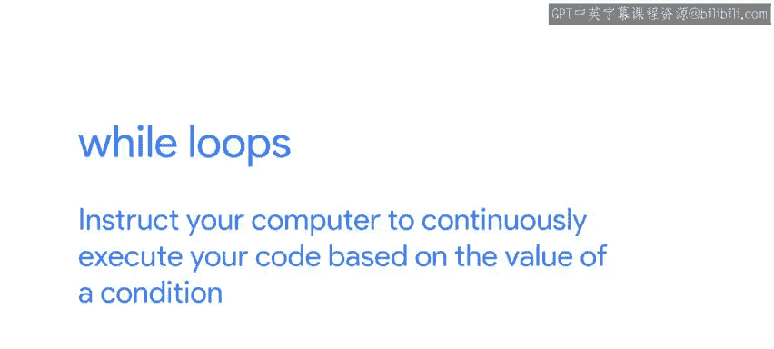
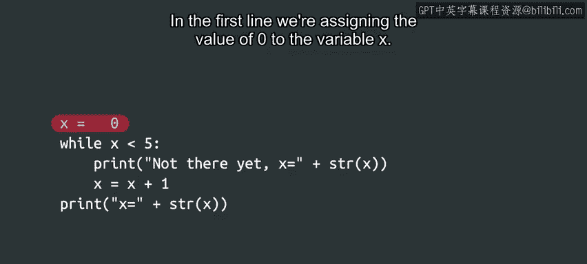
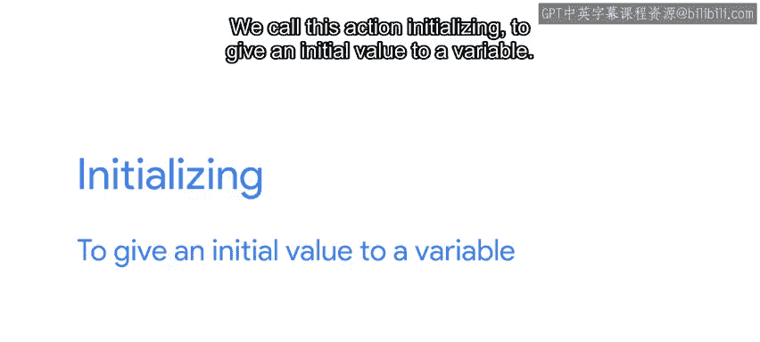
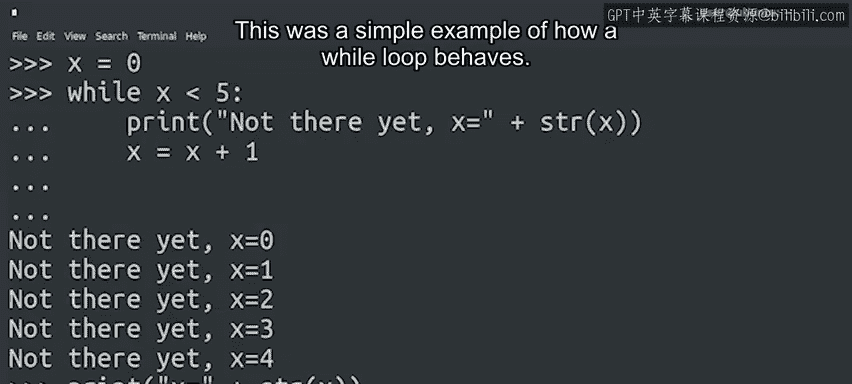

# 谷歌《用Python进行IT自动化办公1、2课（Python、控制操作系统）｜Google IT Automation with Python》中英字幕 - P37：36_什么是 while 循环.zh_en - GPT中英字幕课程资源 - BV1gw411E7E1

First off， we're going to talk about while loops。 while loops instruct your computer to continuously execute your code based on the value of a condition。

This works in a similar way to branching， if statements。

 The difference here is that the body of the block can be executed multiple times instead of just once。

 Check out this program。 Can you guess what it does。Before we execute it to find out。

 let's go through it together line by line。In the first line。

 we're assigning the value of 0 to the variable X。 We call this action initializing to give an initial value to a variable In the line after that。

 we're starting the while loop。 We're setting a condition for this loop that x needs to be smaller than 5。

 Right now， we know that x is 0。 since we've just initialized it。

 So this condition is currently true On the next two lines。

 we have a block that's indented to the right here。

 we can use what we learned about functions and conditionals to identify that this is the while loop's body。

😊。

There are two lines in the body of the loop。In the first line。

 we print a message followed by the current value of X。 In the second line。

 we increment the value of x。 We do this by adding one to its current value and assigning it back to X。

 So after the first execution of the body of the loop， X will be  one instead of 0。

Because this is a loop， the computer doesn't just continue executing with the next line in the script。

 Instead， it loops back around to reevaluate the condition for the while loop。

And because one here is still smaller than 5， it executes the body of the loop again。

 It then prints the message and once more increments x by one。 So the X is now2。

The computer will keep doing this until the condition isn't true anymore more。 In this example。

 the condition will be false when x is no longer smaller than 5。 Once the condition is false。

 the loop finishes and the next line is executed。And finally。

 the last line of our code prints the last value of x。So now that this code makes a bit more sense。

 what do you think will happen when we execute it？Ready to find out。

 Let's execute the code and see what happens。So we had five lines with the message， not there yet。

And that at the end of the script， the value of x was 5。

This was a simple example of how a while loop behaves。 As we've said before。

 we're learning the building blocks of programming。 Once you know those building blocks。

 you can combine them to create more complex expressions as an I T specialist。

 Why loops can be super helpful。 You can use them to keep asking for a username If the one provided isn't valid。

 or maybe try an operation until it succeeds。 knowing how to construct these expressions can help you get your computer to do a whole lot with only a little bit of code。

 It's pretty powerful stuff。 We're learning here。 Now that you've got an idea of how a while loop works。

 Let's spice it up with another example。😊。

