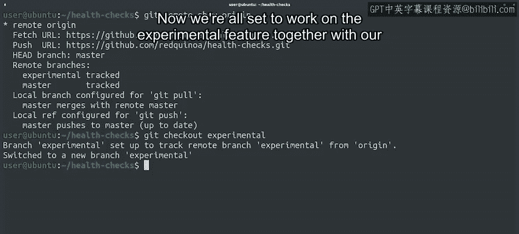

# 谷歌《用Python进行IT自动化办公3、4、5、6课（Git、debug、云端、实践）Google IT Automation with Python》中英字 - P37：36_更新本地仓库.zh_en - GPT中英字幕课程资源 - BV1LW4y1F7XW

Earlier， we took a look at the basic workflow for working with remotes when we want to fetch the changes manually。

Merge if necessary and only then push any changes of our own。

Since fetching and merging are so common， Git gives us the Git pull command that does both for us。

 runningning Git pull will fetch the remote copy of the current branch and automatically try to merge it into the current local branch。

Let's check if our friend Blue Kaale has made any new changes to the repo。

We'llre on Git pull and see what changes we get。If you look closely at this output。

 you'll see that it includes the output of the fetch and merge commands that we saw earlier。 First。

 get fetch the updated contents from the remote repository， including a new branch。

And then it did a fast forward merge to the local master branch。

We'll see that the All checks file was updated as well。

We can look at the changes by using Git log P1。We see that our colleague added a check disc full function that includes the code from the other disk usage P that we saw earlier。

So now I'll exit the editor with Q。When we called Git pull。

 we saw that there was also a new remote branch called Experimental。

Our friend Blue Kaale told us that they've started working on a new feature in that branch。

 Let's check out the output of Git remote show origin and see what it says about that new branch。

We see that there's a new remote branch called Expment， which we don't have a local branch for yet。

To create a local branch for it， we can run Git， check out， experimentalment。

When we checked out the experimental branch， get automatically copied the contents of the remote branch into the local branch。

 The working tree has been updated to the contents of the experimental branch。

Now we're all set to work on the experimental feature together with our colleague In this last example。

 we got the contents of the experimental branch together with those of the master branch when we called Git pull。

 which also merge new changes onto the master branch if we want to get the contents of remote branches without automatically merging any contents into the local branches。

 we can call Git remote update。

This will fetch the contents of all remote branches so that we can just call check out or merge as needed。

We've now seen a bunch of different ways that we can use to interact with remote repositories。

 We've seen how to check their status， how to push and pull changes into repositories。

 and even how to get new branches out of them。There's still more to come。

 but you're probably starting to see how useful this can be for collaborating with others。

 In our past examples， we've only looked at what happens with changes when they can be solved through fast forward in upcoming videos。

 We'll look at what happens when we try to push changes。

 especially when our changes generate conflicts。😊，But before we do that。

 check out the reading for the list of all the commands involved and then take the quiz to put this knowledge into practice。

