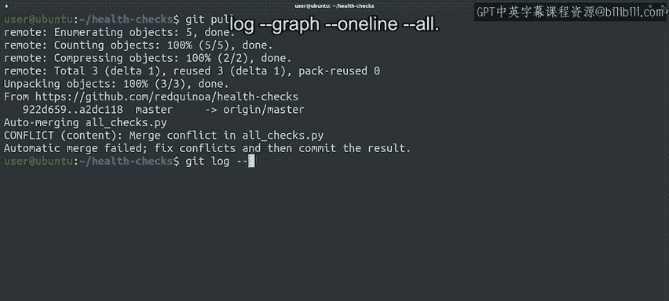
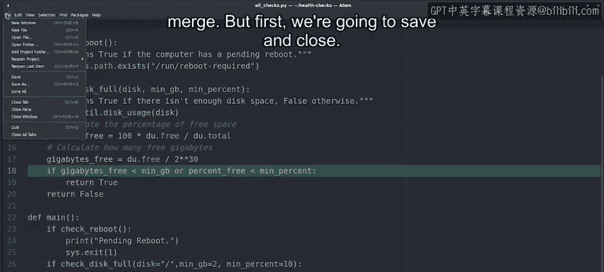
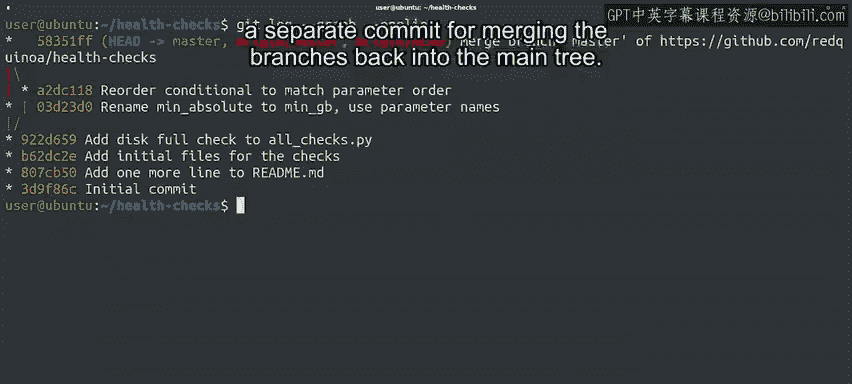

# 谷歌《用Python进行IT自动化办公3、4、5、6课（Git、debug、云端、实践）Google IT Automation with Python》中英字 - P38：37_拉取-合并-推送工作流.zh_en - GPT中英字幕课程资源 - BV1LW4y1F7XW

We've now looked at the details of fetching and pullinging data from remote repositories without any local changes。

We saw earlier how we can use the Git push command to send our changes to the remote repo。

 but what if when we go to push our changes， there are new changes to the remote repo。To find out。

 let's start by making a change to our all checks Pi script。

Remember way back at the beginning of the course when we fixed the bug and the function that checks the disk space。

 the one that was doing gigabyte conversion twice。Part of the reason why our code was so buggy was that we were passing numbers around without saying what those numbers were for。

We could have made our code clear by renaming our min absolute parameter to min GBB so that it's obvious that the function expects gigabytes。

With that， we have clarified the code of the function。 Another way we can make the code in clearer。

 We can use the name of the parameters in the call to the function。Like this。

By using the names of the parameters， our invocation is clear and we could even alter the order of the values and our code would still work。

All right， we've made the change。 Let's stage it and commit it as usual。

 We'll first use Git add dash P to look at the changes we made and accept them。

Then we'll create a commit message to show that we've renamed Min absolutes to MinGB and that we're using parameter names for the imvocation。

We've made our change， staged it， and committed it。We should be ready to push into the remote repo。

Except now we have a collaborator also making changes。

 Let's see what happens when we try running and get push。And it failed。

 Can you work out what went wrong here。There are a few hints。When we tried to push。

 get rejected our change。That's because the remote repository contains changes that we don't have in our local branch that Git can't fast forward。

 Maybe you remember when we talked about Git's merging algorithms， As usual。

 Git gives us some helpful information， along with the error message。

 especially the part about integrating remote changes with Git Pulp。

This means we need to sync our local remote branch with the remote repository before we can push。

We learned earlier that we can do this with Git pull， let's do this now。H。

 get tried to automatically merge the local and remote changes to all checks pie。

But found a conflict。Let's first look at the T of commits on all branches as represented by git log。

 graph，1 line， dash all。

This graph shows us the different commits and positions in the tree。We can see the master branch。

 the originig slash master branch， and the experimental branch。

The graph indicates that our current commit and the commit in the origin/lash master branch share a common ancestor。

But they don't follow one another。This means that we'll need to do a three way merge。To do this。

Let's look at the actual changes in that commit by running git logP originin/lashmaster。

So our colleague decided to reorder the conditional clauses in the function to match the order that the parameters are passed to the function。

They happened to change the same line that we changed when we renamed the Min underscore G B variable。

 which caused the conflict that Git couldn't resolve。

Let's fix it by editing the file to remove the conflict。 So first， let me exit with Q。

We see that the problem occurred in the conditional On the first line， we see our change。

 where men underscore absolute was renamed to men underscore GBB。In the second line。

 we see the old variable names with the checks done in a different order。

We need to decide what to do to this。 For example， we can keep the new order， but use min Gb。

One thing to notice is that Git will try to do all possible automatic merges and only leave manual conflicts for us to resolve when the automatic merge fails。

In this case， we can see that the other changes we made were merged successfully without intervention。

Only the change that happened in the same line of the file needed our input。

 we fixed the conflict here， and the file is short enough that we can very quickly check that there are no other conflicts。

For larger files， it might make sense to search for the conflict markers。Greater than。

 greater than greater then。In the whole file， this lets us check that there are no unresolved conflicts left。

Nice， now that we fix the conflict， you can finish the merch。Do you remember how to do it？

We need to add the all checks。 pi file and then call Git commitit to finish the merge。

 but first we're going to save and close。

The editor message shows that it's performing a merge of the remote branch with the local branch。

 We can add extra information to this message。 For example。

 we can say that we fix the conditional in the check disc usage function to use the new variable name and the new order。

Our merge is finally ready。 We can try pushing to the remote again。Yes， after fixing the conflict。

 we were able to push our work to the remote repo。 Let's look at the commit history of the master branch now by calling Git log dash dash graph dash dash1 line。

😊，We see that the latest commit is the merge， followed by the two commits that cause the merge conflict。

 which are on split paths in our graph。As we called out before。

 when Git needs to do a three way merge， we end up with a separate commit for merging the branches back into the main tree。

Now， we know how to successfully complete a pull， merge and push cycle。

 even when it means doing some manual merges。 This was a complex exercise。

 and it's O if something still seem a bit scary。 We all felt panic the first time we encountered a merge conflict。

 But don't worry， it gets easier with practice to practice dealing with merge conflicts。

 You want to have two copies of your repository in separate directories。

 then try editing the same lines of the same files。😊。

You can follow along with the examples shown here or come up with your own。Up next。

 we'll talk about using branches with remote repositories。

