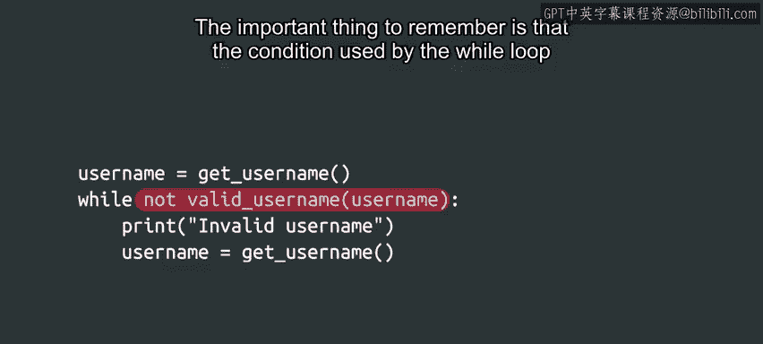

# 谷歌《用Python进行IT自动化办公1、2课（Python、控制操作系统）｜Google IT Automation with Python》中英字幕 - P38：37_更多 while 循环示例.zh_en - GPT中英字幕课程资源 - BV1gw411E7E1

In the last video， we saw a very simple example of a while loop。

We looked at a basic syntax of the loop and how it works。

 Let's now apply this knowledge to a similar example。 But this time。

 with a while loop inside a function。 Can you work out what this function does。In this example。

 we start out by initializing a variable called X。 In this case。

 we initialize it with a value of one。 Then we enter our while loop。

 which checks to see if the value inside of the x variable is less than the parameter N that the function received。

 If that comparison evaluates to true， then the code inside the while block is executed。

Say we pass a value of 5 as a parameter to this function In the first pass through the loop。

 X is always equal to 1。 So the comparison one smaller than or equal to 5 would be true。

 and we'd then enter the body of the loop。In the body。

 we first print a message indicating that the current attempt number。

 and then we increase the value of x by1。To increment the number。

 we're using a slightly different expression than before。

 X plus equal 1 is a shorthand version of x equals x plus 1。

You can use either expression since they both mean the same thing。

The process continues until the result of the comparison isn't true anymore。

 which happens when x is bigger than n。In our current example。

 this would be when the value of x is 6。 Let's see it in action。In these past examples。

 we've used the simple conditions of a number being smaller or smaller or equal than another number。

These are common conditions， but they're by no means the only conditions you can have in a while loop。

It's common， for example， to call a separate function that evaluates the condition like this。

In this case， there's a lot of code hidden behind functions， and it's doing stuff we don't see。

 There's a get username function that asks the user for a username and a valid username function that validates that username。

 And all this is happening in just a handful of characters。😊，As you can see。

 you can pack a lot of punch into just a short line of code in this case。

 the body of the while loop will be executed until the user enters a valid username。

The important thing to remember is that the condition used by the while loop needs to evaluate to true or false。

It doesn't matter if this is done by using comparison operators or calling additional functions。

 The conditions used in while loops can also become more complex if we use the logical operators that we encountered when looking into branching and or and not。

This lets us combine the values of several expressions to get the result we want。 Okay。

 we've now covered what a while loop is and learned its syntax and basic behavior。

 Some of the stuff can be a bit tricky， and you're doing great。 Keep sticking with it。😊，Next。

 we're going to do a rundown of some of the most common pitfalls that you may come across when writing your own loops。

 head on over to the next video to get started。