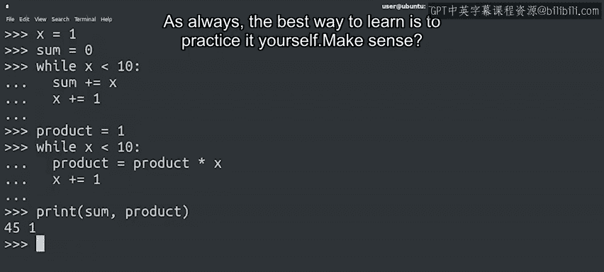
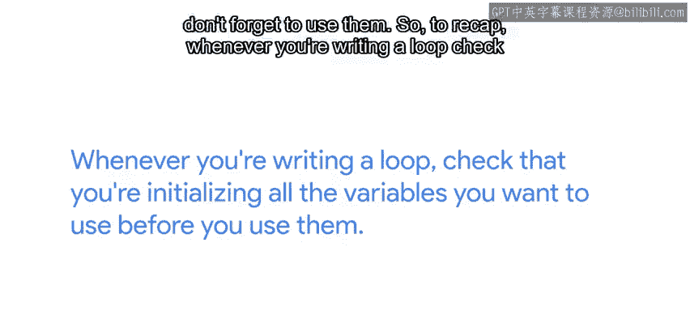

# 谷歌《用Python进行IT自动化办公1、2课（Python、控制操作系统）｜Google IT Automation with Python》中英字幕 - P39：38_为什么初始化变量很重要.zh_en - GPT中英字幕课程资源 - BV1gw411E7E1

As we've called out earlier， writing loops allows us to get our computer to do repetitive work for us。

 Since one of the main benefits of writing scripts and I T is to save time by automating repetitive tasks。

 loops are super useful。 So let's make sure you avoid some of the most common mistakes people make when writing loops。

 One of the most common errors is forgetting to initialize variables with the right value。

 We've all made this mistake when starting to code。

 Remember how in the earlier examples we initialized our variable X to 0 in one case and to one in the other。

 When we forget to initialize a variable， two different things can happen。

 The first possible outcome and the easiest to catch。

 is that Python might raise an error telling us that we're using a variable we haven't defined。

 Which looks like this。 As we've done with other errors we've come across。

 we can look at the last line to understand what's going on。😊，This error type is a name error。

 and the message that comes after it says we're using an undefined variable。

 It's straightforward to fix。 We just need to initialize the variable before using it like this。

Fixed。Now， there's a second issue we might face if we forget to initialize variables with the right value。

 We might have already used the variable in our program。 In this case。

 if we reuse a variable without setting the correct value from the start。

 it will still have the value from before。 This can lead to some pretty unexpected behavior。

 Check out this script。Can you spot the problem？In the first block。

 we correctly initialize x to 1 and sum to 0， and then iterate until x equals 10。

 summing up all the values in between。 So by the end of that block。

 some equals the result of adding all the numbers from 1 to 10 and X is 10 in the second part of the code。

 the original intention was to get the product of all the numbers from 1 to 10。

 But if you look closely， you can see that we're initializing product But forgetting to initialize X。

 So x is still 10。 This means that when the wild condition gets checked。

 X is already 10 at the start of the iteration。😊，The wild condition is false before it even starts。

 and the body never executes。 Let's see how this problem would look。In this case。

 it might be harder to catch the problem because Python doesn't raise an error。

 The problem here is that our product variable has the wrong value。

 If you have a loop that's gone rogue and not behaving as expected。

 it's a good idea to check if all the variables are correctly initialized。 In this example。

 we need to set X back to one before starting the second loop。As always。

 the best way to learn is to practice it yourself。

Makes sense。Remember， if you ever feel stuck or a little unsure about something。

 you can always ask for help in the discussion forums。

 These forums are there to let you get the help you need when you need it。

 So don't forget to use them。 So to recap whenever you're writing a loop。

 check that you're initializing all the variables you want to use before you use them。

And don't worry if you don't get it right the first time we've all been there when learning how to code as we've called out before。

 the way to master programming is to practice， practice， practice。

 keep practicing until you're comfortable， and even then it's still okay to make mistakes so don't feel like you can't Er loop back around to review and practice everything we've covered so far。

😡。