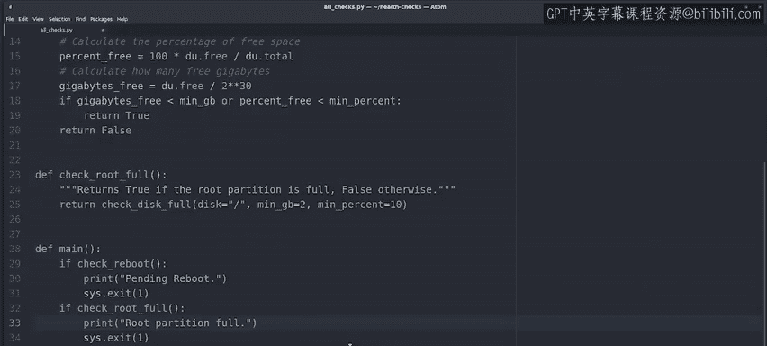
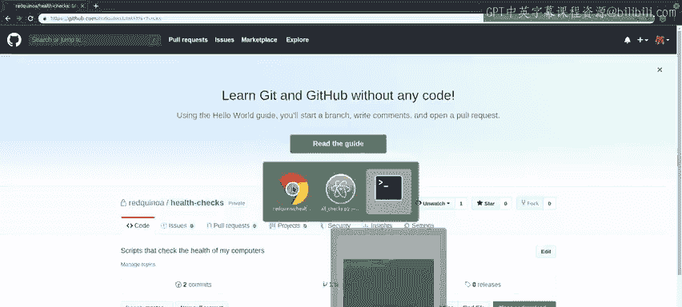
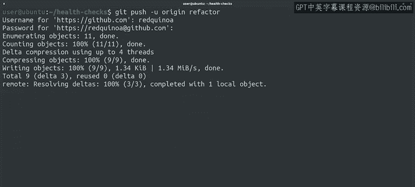

# 谷歌《用Python进行IT自动化办公3、4、5、6课（Git、debug、云端、实践）Google IT Automation with Python》中英字 - P39：38_推送远程分支.zh_en - GPT中英字幕课程资源 - BV1LW4y1F7XW

As we called up before， when using Git to work on a new feature or a big refactor of some kind。

 its recommended best practice to create separate branches。 There are many advantages to doing this。

 For example， it might take you a while to finish the new feature。 And in the meantime。

 there could be a critical bug that needs fixing in the main branch of the code。😊。

By having separate branches， you can fix the bug in the main branch， release a new version。

 and then go back to working on your feature without having to integrate your code before it's ready。

 Another advantage of working in separate branches is that you could even release two or more versions out of the same tree。

1 being the stable version and the other being the beta version。 That way。

 any disruptive changes can be tested on a few users or computers before they're fully released。

So let's start a new branch to work on a small refactor of our code。Do you remember how to do that？

You could create the branch first and then check it out。

 or we can just create it and check it out with get checkout B and the new branch name。

We're ready to start working on our refactor。 Let's open up the file and have a look at it。

We've noticed there's a pattern of repeating code and our all checks P script。

For each check that we call， we check if it returns true or false。When it returns true。

 we print an error and exit。If we add a new check， we'll have to repeat this pattern again on top of the repeated pattern。

 If a computer has more than one problem， only the error for the first one will be printed。

So let's refactor our code to avoid the duplication and print all relevant errors。

We'll do it step by step， making each commit self contained。

The first thing we'll do is create a function that checks if the disc is full without any parameters。

 so it matches the pattern。This new wrapper function will pass the right parameters for us。

And then we'll change the code to call this function instead。

 We'll also change the error message to something more accurate。We've changed the function。

 let's save and test our code。

Awesome， it's working。 Let's commit the change。😊，We're ready for the next step in our refactor to avoid code repetition。

 We'll create a list containing the names of the functions that we want to call and then message to print。

 if the function succeeds。 After that， we'll add a for loop that iterates over the lists of checks and messages。

 Then we'll call check。 and if the return value is true。

 print the message and exit with an error code of one。 After doing that。

 we can delete the old code that we've already replaced。😊， with this change made。

 let's save once again and test that our script still runs。Yes， it's still working。

 Let's commit the new change。By now， we've refactored our code to avoid code duplication。

 The current code does the same as the old code。 Once we're ready to add new checks。

 we can do that by adding the function name and error message to the list of checks。

The last change that we want to do is to let our script show more than one message。

 If more than one check is failing To do that， we add a Boolean variable called everything O before the iteration。

Change is variable to false if one of the checks finds a problem and then exit with an error code only after having done all the checks。

All right， one last time。 let's save and test to see if this works。

And let's now do a final commit for this change。With that。

 we have three commits in our refactor branch。 Before we merge any of this into the master branch。

 we want to push this into the remote repo so that our collaborators can view the code， test it。

 and let us know if it's ready for merging。The first time we push a branch to a remote repo。

 we need to add a few more parameters to the Git push command。

We'll need to add the dash U flag to create the branch upstream。

Which is another way of referring to remote repositories。

We'll also have to say that we want to push this to the origin repo and that we're pushing the refactor branch。

Whoa， that's a lot of information that gets giving us。 It's telling us if we want。

 we can create a pull request。 We'll talk more about pull requests later on。 For now。

 we're happy to see that new reffactor branch has been created in the remote repo。

 which is what we wanted。😊，This was a super complex example that incorporated a lot of concepts that we've learned about in this course and also carried out some interesting Python concepts。

If anything is still unclear， feel free to rewatch this video and follow along on your computer until you're comfortable with these steps。

So now that our branch is pushed to the remote repo， it can be reviewed by our collaborators。

 assuming they say it's okay。 How should this branch get merged back into the master branch。

We'll talk about that in our next video。