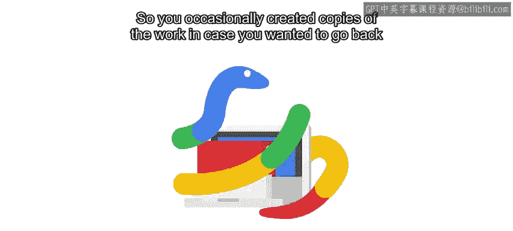
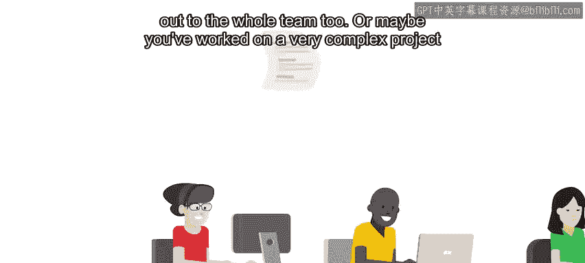
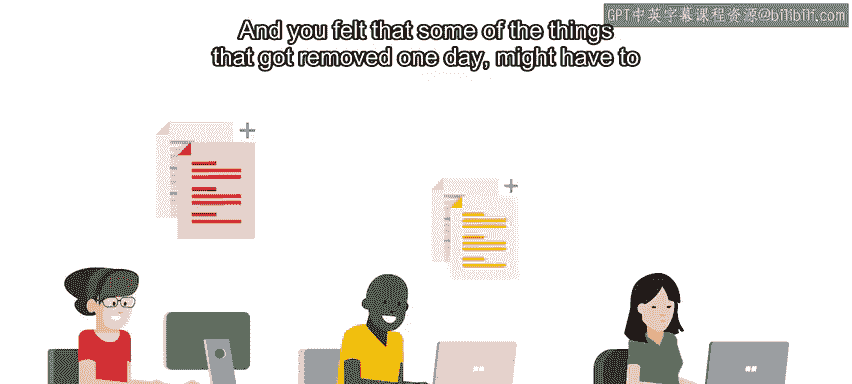
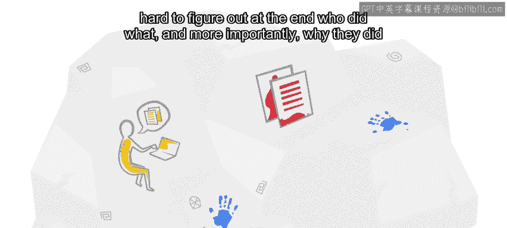
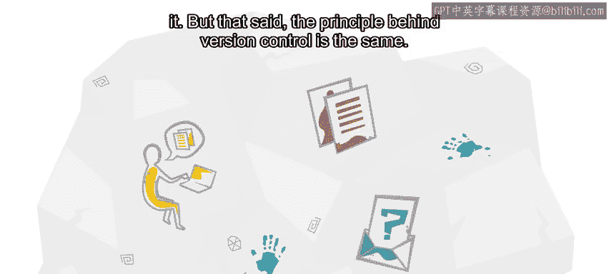
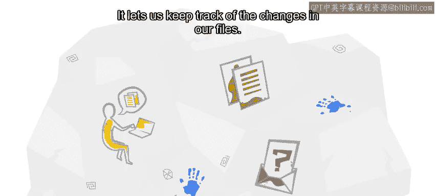

# 谷歌《用Python进行IT自动化办公3、4、5、6课（Git、debug、云端、实践）Google IT Automation with Python》中英字 - P3：2_保留历史副本.zh_en - GPT中英字幕课程资源 - BV1LW4y1F7XW

🎼。う。

Have you ever worked on a project that was developing over time。

 so you occasionally created copies of the work in case you wanted to go back to an earlier version。

Maybe you are working in a team and every day you'd email a part of the work to the rest of the team。

And then the other members on your team would add their own work and send it out to the whole team too。

Or maybe you've worked on a very complex project that kept changing directions。

 And you felt that some of the things that got removed one day might have to be added later on。

So anytime you were about to delete a significant part。

 you made a copy of the whole thing just in case。If any of this sounds familiar。

You've already worked on the most primitive form of version control， keeping historical copies。

 These copies let you see what the project was like before and go back to that version if you end up deciding that the latest changes were wrong。

They also let you see the progress of the changes over time。

And maybe even help you understand why a change was made。

We say that this is primitive because it's very manual and not very detailed。 First。

 you need to remember to make the copy。 Second， you usually make a copy of the whole thing。

 even if you're only changing one small part。

In third， even if you're emailing your changes to your colleagues。

 it might be hard to figure out the end， who did what and more importantly， why they did。

But that said， the principle behind version control is the same。

It lets us keep track of the changes in our files。These files can be code， images， configuration。

 or even a video editing project。Whatever it is you're working with。Throughout this course。

 we'll see the many ways that Git helps us keep track of our changes and also how we can use it to collaborate with others or revert changes。

 We'll use a bunch of terms that have special meanings in the world of version control。

But don't let those intimidate you。 In the end， all we're doing is having better control over our historical copies。

So say you have two copies of the same code made at different points in time。

How can you compare them？Hop on over to the next video and you'll find out。

