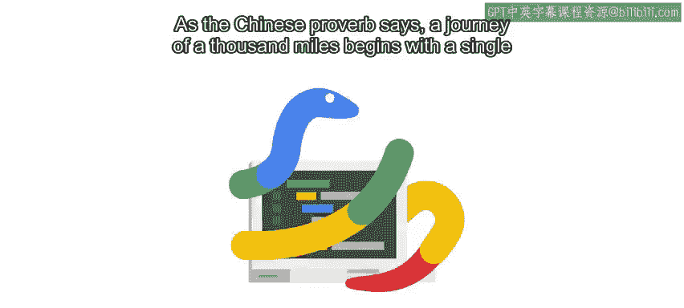

# 谷歌《用Python进行IT自动化办公1、2课（Python、控制操作系统）｜Google IT Automation with Python》中英字幕 - P3：2_开始编程之旅.zh_en - GPT中英字幕课程资源 - BV1gw411E7E1

。

As the Chinese proverb says， a journey of a thousand miles begins with a single step。

Today's a big day。 You're taking your first step in your journey to learn how to write scripts in Python。

 It's going to be a little challenging at times， but really， it's not that scary。

 We'll go slow and give you everything you need to fully grasp each concept before we move along in the next few videos。

 we'll discover the fundamental concepts of computer programming。

 You'll learn what a programming language is， what scripting is。

 what languages are out there other than Python and how this all relates to it。

 We'll also have you coding before you know it with small coding exercises we've cooked up to give you handson practice with Python。

 This will include writing your very first Python script。

 But always keep in mind if at any point along the way you feel lost or confused。 Don't panic。

 You can watch the videos is many times is you need to let the concept sink in。 Plus。

 you can ask questions in the discussion forums， which is one of the best ways to find extra information and connect with other learners。

 When I was asked to participate in this program。 It made me think about when I first started to code。

 If I could give that younger version of myself a piece。😊，advicedvice， this is what I would tell her。

 It never works the first time。 Seriously， as a newbie， I expected it all to work like magic。

 I thought that following the rules and getting it right the first time would prove my value as a coder。

 But that's just not true。 Not even the best of the best。

 If you expect to write perfect code on the first shot， you're going to be disappointed。

 You hear that younger self。Try not to feel overwhelmed by the details。

 Connecting the dots only comes with experience。 So best way to learn is to just jump in。

 The truth is， everyone learns at their own pace。 If you already know some of these concepts。

 feel free to skip ahead to the parts that interest you the most。 If you're starting from scratch。

 take as long as you need for each concept， The assessments will be right there waiting for you when you're done。

 And if at any point you start downing yourself。 Remember even the most advanced programmers started thinking。

 Python， what's Python。😊，Well， we're about to learn all about it， so let's dive in Next up。

 we'll be doing a rundown of what programming is。😡。

