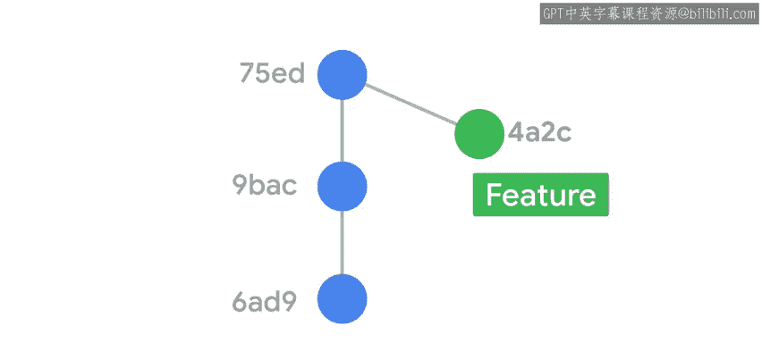
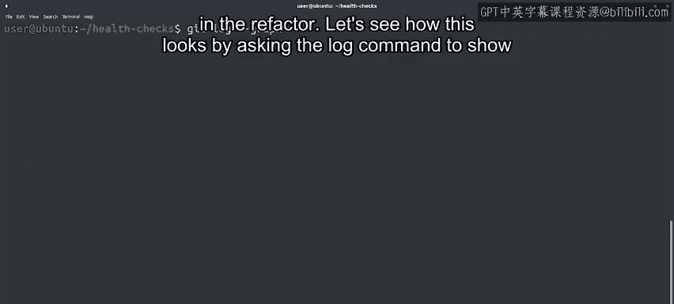

# 谷歌《用Python进行IT自动化办公3、4、5、6课（Git、debug、云端、实践）Google IT Automation with Python》中英字 - P40：39_变基你的更改.zh_en - GPT中英字幕课程资源 - BV1LW4y1F7XW

In our last video， we mentioned that once our branch has been properly reviewed and tested。

 it can get merged back into the master branch。This can be done by us or by someone else。

One option is to use the Git merge command that we discussed earlier。

Another option is to use the Git rebase command。Rebasing means changing the base commit that's used for our branch。

To understand what this means， let's quickly recap what we've learned about mergers up till now。

As we've seen in a lot of our earlier examples， when we create a branch at a certain point in the repos history。

 Git knows the latest commit that was submitted on both branches。

 If only one of the branches has new changes when we try to merge them。

 Git will be able to fast forward and apply the changes。

 But if both branches have new changes when we try to merge。

 Git will create a new merge commit for the three way merge。

The problem with threeway merges is that because of the split history。

 it's hard for us to debug when an issue is found in our code。

 and we need to understand where the problem was introduced。

By changing the base where our commits split from the branch history。

 we can replay the new commits on top of the new base。 This allows Git to do a fast forward merge。

 and keep history linear。

So how do we do it？We run the command Git rebase followed by the branch that we want to set as the new basease When we do this。

 Git will try to replay our commits after the latest commit in that branch。

 this will work automatically if the changes are made in different parts of the files。

 but will require manual intervention if the changes were made in other files。

Let's check out this process by rebasing our refactor branch onto the master branch。 First。

 we'll check out the master branch and pull the latest changes in the remote repo。

Git tells us that it's updated the master branchch with some changes that our colleague had made。

At this point， the changes that we have in the refactor branch can no longer be merged through fast forwarding into the master branch。

That's because there's now an extra commit in the master that's not present in the refactor。

Let's see how this looks by asking the log command to show us the current graph of all branches。

It might take a bit to follow everything that's going on with this graph。

But it can be really useful to understand complex history trees。 As you can see。

 the refactor branch has three commits before the common ancestor with the current commit that's at the head of the master branch。

 If we merged our branch now， it would cause a three way merge。

 but we want to keep our history linear。We will do this with a rebase of the refactor against master。

As usual， Git gives us a bunch of helpful information。

It says that it rewound head and replayed our work on top of it， and luckily， everything succeeded。

Let's look at the output of Git logGph1 line for our branch right now。

Now we can see the master branch in linear history with our list of commits。

 We're ready to merge our commits back onto the main trunk of our repo and have this fast forwarded。

To do that， we'll check out the master branch and merge the refactora branch。Awesome。

 we are able to merge our branch through a fast forward merge and keep our history linear。

We're now done with our refactor and can get rid of that branch， both remotely and locally。

To remove the remote branch， we'll call git push dash dash delete origin Refactor To remove the local branch。

 we'll call Git branch dash D Reffactor。Yes， we're done with our refactor。

 we can now push changes back into the remote repo。All right。

 we've just gone through an example using the Git rebase command。

 we had a feature branch created against an older commit from master。

 so we rebased our feature branch against the latest commit from master and then merged the feature branch back into master。

That was a complicated exercise。 So if you're still confused about what's going on。

 take your time to review and maybe come up with your own examples when you'd use a rebase。Up next。

 we'll look at another example of how to use rebase。

