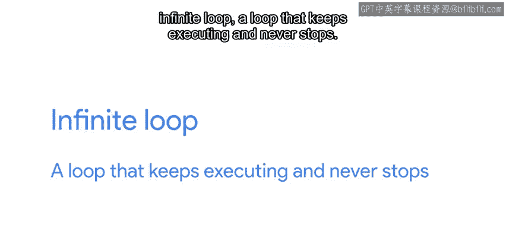
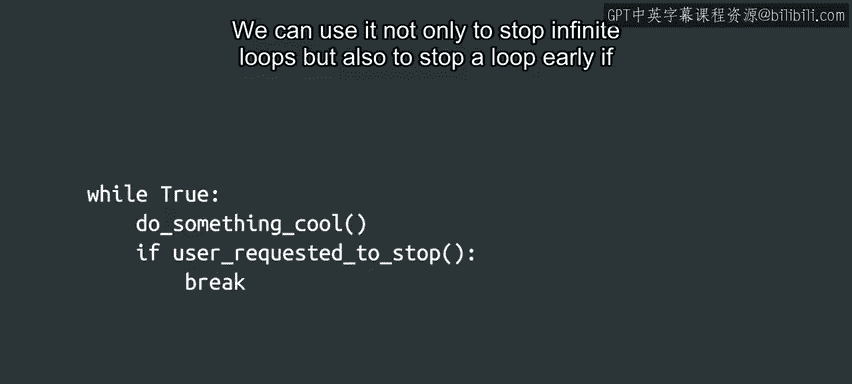

# 谷歌《用Python进行IT自动化办公1、2课（Python、控制操作系统）｜Google IT Automation with Python》中英字幕 - P40：39_无限循环及如何中断.zh_en - GPT中英字幕课程资源 - BV1gw411E7E1

You may remember by now that while loops use a condition to check when to exit。

 The body of the wire loop needs to make sure that the condition being checked will change。

 If it doesn't change， the loop may never finish and we get what's called an infinite loop。

 a loop that keeps executing and never stops。

Check out this example， it uses the modo operator that we saw while back。

This cycle will finish for positive and negative values of x。 But what would happen if x was 0？

 The remainder of 0 divided by 2 is 0。 so the condition would be true。

And the result of dividing 0 by 2 would also be 0。 So the value of x wouldn't change。

 This loop would go on forever ever。 And so we'd get an infinite loop。

If our code was called with X having the value of 0。

 the computer would just waste resources doing a division that would never lead to the loop stopping。

 The program would be stuck in an infinite loop， circling back around endlessly。

 And we don't want that。 All that looping might make your computer dizzy。To avoid this。

 we need to think about what needs to happen for a loop to be successful。 In this example。

 we said that x needs to be different than 0。 so we could nest this Y loop inside an if statement。

 just like this。With this approach， the Y loop is executed only when x is not zero。Alternatively。

 we could add the condition directly to the loop using a logical operator， like in this example。

This makes sure we only enter the body of the loop for values of x that are both different than 0 and even。

Talking about infinite loop reminds me of one of the first times I used while loops myself。

 I wrote a script that emailed me as a way of verifying that the code worked。

 and while some condition was true，I forgot to exit the loop。

 Turns out those emails get sent faster than once per second。 As you can imagine。

 I got about 500 emails before I realized what was going on。

Infinitely grateful for that little lesson。When you're done laughing at my story， remember。

When you're writing loops， it's a good idea to take a moment to consider the different values a variable can take。

This helps you make sure your loop won't get stuck。

If you see that your program is running forever without finishing。

 have a second look at your loops to check there's no infinite loop hiding somewhere in the code。

While you need to watch out for infinite loops， they're not always a bad thing。

 sometimes you actually want your program to execute continuously until some external condition is met。

If you've used the ping utility on Linux or Macos system or ping dash T on a window system。

 you've seen an infinite loop in action， this tool will keep sending packets and printing the results to the terminal unless you send it the interrupt signal。

 usually pressing control C。 If you were looking at the program' source code。

 you'd see that it uses an infinite loop to do this。

 with a block of code with instructions to keep sending the packets forever。

 One thing to call out is it should always be possible to break the loop by sending a certain signal。

 In the ping example， That signal is the user pressing control C。In other cases。

 it could be that the user pressed a button on a graphical application or that another programme sent a specific signal。

 or even that a time limit was reached in your code。

 You could have an infinite loop that looked something like this。In Python， we use the brake keyword。

 which you can see here， to signal that the current loop should stop running。

We can use it not only to stop infinite loops， but also to stop a loop early if the code has already achieved what's needed。

So quick refresh。How do you avoid the most common pitfalls when riding while loops。First。

 remember to initialize your variables。 And second， check that your loops won't run forever。 Wow。

 all this talk of loops is making me feel a little loopy。

 I'm going have to go and lie down while you do the next practice quiz。

 Best of luck and meet me over in the next video when you're done。😊。

