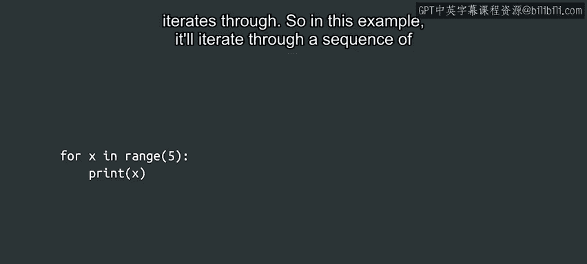
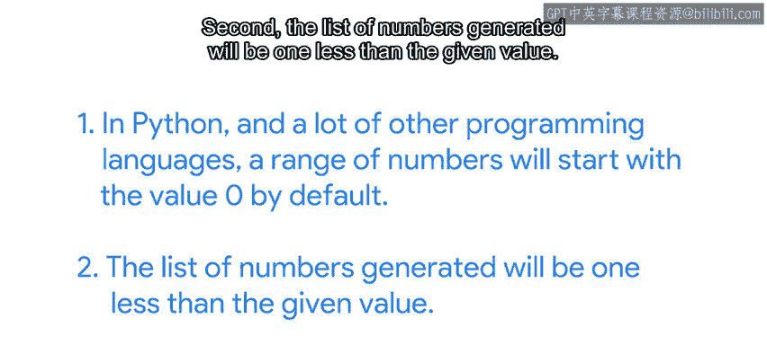
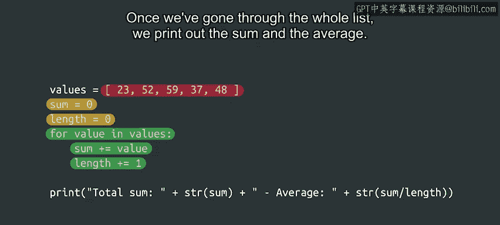
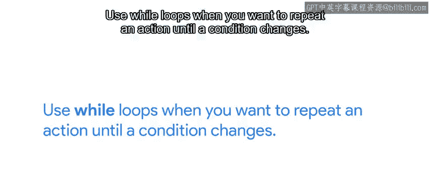

# 谷歌《用Python进行IT自动化办公1、2课（Python、控制操作系统）｜Google IT Automation with Python》中英字幕 - P41：40_什么是 for 循环.zh_en - GPT中英字幕课程资源 - BV1gw411E7E1

Okay， how are you doing？If all this talk of loops is starting to make your head spin。

 remember that there is nothing wrong with looping background and reviewing what you've learned。

 It's the quickest way to stop feeling like you're running in circles。 Al right， feeling good。 Great。

 Then we're ready for a different type of loop In this video。 We're going to meet the four loop。

 A four loop iterates over a sequence of values。😊，A very simple example of a for loop is to iterate over a sequence of numbers like this。

Notice how this structure is kind of similar to the structures we've already seen。

 The first line indicates the distinguishing keyword。 In this case， that's4。

 and it ends with a colon。 The body of the loop is indented to the right。

 like we saw in the while loop， the if block and the function definitions。

What's different in this case is that we have the keyword in。Also。

 between the four keyword and in keyword， we have the name of a variable。

 This variable will take each of the values in the sequence that loop iterates through。

 So in this example， itll iterate through a sequence of numbers generated using the range function。

There are two important things I want to call out about this range function first in Python and a lot of other programming languages。

 a range of numbers will start with the value zero by default。Second。

 the list of numbers generated will be one less than the given value。

In the simple example here， x will take the values 0， 1，2， 3， and 4。Let's check this out。

So there we have a very basic for loop， it iterates over a sequence of numbers generated by the range function。

When using a for loop， we point the variable defined between4 and in， in this case。

 x at each element of the sequence。This means on the first iteration， x points at1。

 on the second iteration， it points at2 and so on。Whatever code we put in the body of the loop will be executed on each of the values。

 one value at a time。As we said earlier， the loop's body can do a lot of things with the values it iterates。

 For example， you could have a function to calculate the square of a number and then use a four loop to sum the squares of the numbers in a range。

😊，Iterating over numbers looks very similar to the while loop examples we showed before。

 So you may be wondering， why have two loops that look like they do the same thing。 Well。

 the power of the four loop is that we can use it to iterate over a sequence of values of any type。

 not just a range of numbers。 Think all the way back to our very first Python example in this course。

 remember our trusty high friends script in it， we saw a four loop that iterated over a list of strings。

 It looks like this。😊，We'll talk a lot more about lists later on。 But for now。

 you only need to know that we can construct lists using square brackets and separate the elements in them with commas。

In this example， we're iterating a list of strings。

 and for each of the strings in the list were printing a greeting。

The sequence that the four loop iterates over could contain any type of element， not just strings。

 For example， we could iterate over a list of numbers to calculate the total sum and average。

 Here's one way of doing this。Here， we're defining a list of values。 After that。

 we're initializing two variables， sum and length that will update in the body of the for loop。

In the for loop， we're iterating over each of the values in the list。

 adding the current value to the sum of values， and then also adding one to length。

 which calculates how many elements there are in the list。 Once we've gone through the whole list。

 we print out the sum and the average。

We'll keep using four loops in our examples every time we want to iterate over the elements of any sequence and operate with them。

 Some examples of sequences that we can iterate are the files in a directory， the lines in a file。

 the processes running on a machine。 And there's a bunch of others。 So as an I T specialist。

 you'll use four loops to automate tons of stuff。For example。

 you might use them to copy files to machines， process the contents of files。

 automatically install software， and a lot more。A few weeks ago。

 I had to update a lot of files with different values， depending on their contents。

 So I used a for loop in a script to iterate over all the files。

 Then my script took different actions based on an if condition and updated all of those files for me。

 It would have taken me forever if I had done this manually file by file。

 If you're wondering when you should use four loops and when you should use while loops。

 there's a way to tell， use four loops when there's a sequence of elements that you want to iterate。

 Use while loops when you want to repeat an action until a condition changes。

And if whatever you're trying to do can be done with either four or while loops。

 just use whichever one's your favorite。 I'm more of a wild gal myself， but totally your call。

 Next up， weve put together more examples to help get you more practice with four loops and discover some of the cool things you could do with them。

😊。