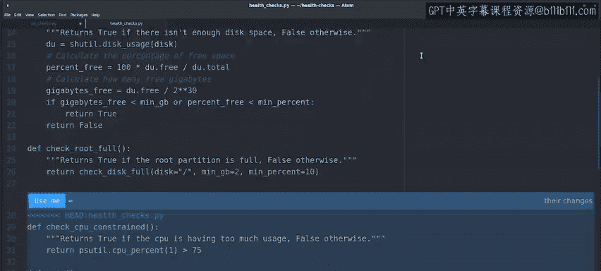
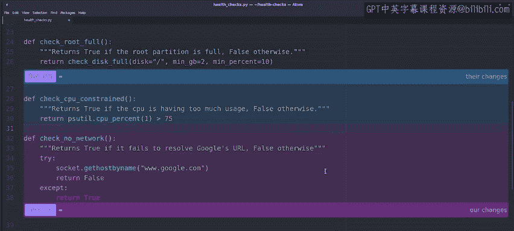
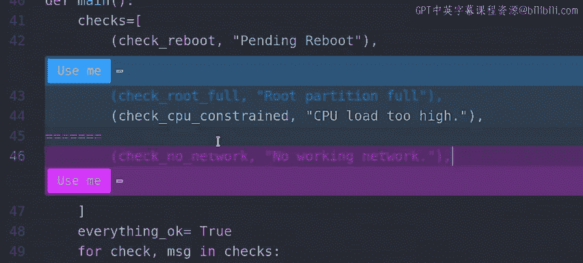
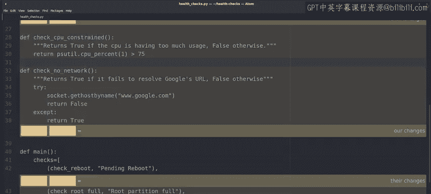
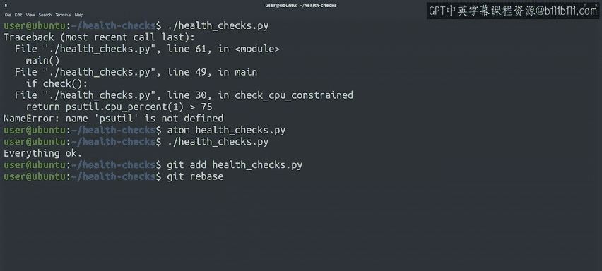

# 谷歌《用Python进行IT自动化办公3、4、5、6课（Git、debug、云端、实践）Google IT Automation with Python》中英字 - P41：40_另一个变基示例.zh_en - GPT中英字幕课程资源 - BV1LW4y1F7XW

In our last video， we looked at an example use case for Git rebase。

 where we used it to rebase a feature branch so that it could be cleanly integrated。

There are many other possible uses of rebase。One common example is to rebase the changes in the master branch when someone else also made changes and we want to keep history linear。

This is a pretty common occurrence when you're working on a change that's small enough not to need a separate branch。

 and your collaborators just happen to commit something at the same time。

Let's check out how this would work in practice。First， we'll make a change to our script。

Now that we've made it easy to add new checks， we'll add a check to warn when there's no working network。

 There's a ton of things to check for this， but for now we'll keep it simple and just check whether we can resolve the Google。

com URL。To do this， we'll use this socket module。We' add a new function called check no network that will return true if it fails to resolve the euro and false。

 if it succeeds。 the socket dot get host by name function raises an exception on failure。

So we'll use a try except block to wrap the call to the function and return false when the call succeeds or true when it fails。

With this new function defined， we can now add the check to our list of checks。

We'll just add the name of the function and the message will be no workinging network。Okay。

 we've made the change， let's save it and commit it。Once more。

 we'll use the Git commitmit A shortcut and pass a message saying that we've added a simple network connectivity check。

We want to check if one of our teammates also made a change in the master branch while we were working on our change。

 and an earlier video， we showed how to do that by running Git pull。

 which will automatically create a three way merge if necessary。In this example。

 we want to look at a different approach to keep our project history linear。

 So we'll start by calling Git fetchch， which you might remember will put the latest changes into the origin slash master branch。

But we won't apply them to our local master branch。We see that weve fetch some new changes。

 This means that if we tried to merge our changes， we'd end up with a three way merge。 Instead。

 we'll now run git rebase against our origin slash master to rebase our changes against those made by our colleague and keep history linear。

呃。We've got a conflict and we'll need to fix it。Gitt is giving us a lot of info on what it tried to do。

 including what worked， what didn't work， and what we can do about it。Since we asked it to rebase。

 it tried to rewind our changes and apply them on top of what was in the origin/ masterster branch。

The first commit made by our colleague renamed all check Stop Pi to Health check Stop Pi。

Get detected this and automatically merged our changes into the new file name。

But when trying to merge our changes with the changes made by our colleague in the file。

 there was a merge conflict。The output gives us a bunch of instructions on how to solve this。

 we could fix the conflict， skip the conflicting commit， or even abort the rebase completely。

In this example， we want to fix the conflict。So let's do that。

We'll start by looking at the current state of the Health Checks P file。

We see that while we were adding the connectivity check。

 our colleague was adding a check for the CPU being constrained。

 We want both functions in the end result， so let's remove the conflict markers。

 cleaning up our file。

Alright， this looks good。 Let's save and test our script out。

h so close。 It looks like our colleague forgot to import the PSU till module。 Let's do that now。

All right， let's hope this works。Yes， we fixed the conflict and our script is working again。

We now need to add the changes made to the Health checks P file and continue with the rebase。

Now the rebase has finished successfully。Let's check out the output of Git log dash dash graph。

 dash1 line to see what the history looks like at this point。

We see that we've applied our change on top of the other changes without needing a three way merge。

What we did just now to resolve the conflict is very similar to what we did earlier to merge our changes。

The difference is that the commit history ended up being linear instead of branching out。

 we're now ready to push our new check to the remote repo。In this example。

 we've seen how we can use the fetch， rebase push workflow to merge our changes with our collaborators changes while keeping the history of our changes linear。

 As we called out， keeping history linear helps with debugging。

 especially when we're trying to identify which commit first introduce a problem in our project。

We've now seen two examples of how to use the Git rebase command。

 one for merging feature branches back into the main trunk of our code。

 and one for making sure that our commits made in the master branch apply cleanly on top of the current state of the master branch。

And it doesn't stop there， we can also use git rebase to change the order of the commits or even squash two commits into one。

This is a very powerful tool， but don't worry， you don't need to memorize all of its possible uses。

 You'll learn them as you need them。Up next， we'll do a roundup of some of the best practices for operating with Git when collaborating with others。

