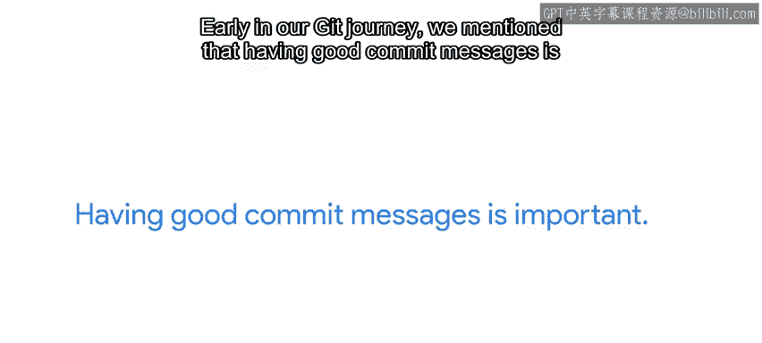

# 谷歌《用Python进行IT自动化办公3、4、5、6课（Git、debug、云端、实践）Google IT Automation with Python》中英字 - P42：41_协作的最佳实践.zh_en - GPT中英字幕课程资源 - BV1LW4y1F7XW

Over the past few videos， we've looked at a lot of things we can do with Git and remote repositories。

It's worth spending some time talking about best practices for collaborating with others。

 It's a good idea to always synchronize your branches before starting any work on your own。😊。

That way， whenever you start changing code， you know that you're starting from the most recent version and you minimize the chances of conflicts or the need for rebasing。

Another common practice is to try and avoid having very large changes that modify a lot of different things。

Instead， try to make changes as small as possible as long as they're self contained。For example。

 if you're renaming a variable for clarity reasons。

 you don't want to have code that adds new functionality in the same commit。

It's better if you split it into different commits。

This makes it easier to understand what's going on with each commit。On top of that。

 if you remember to push your changes often and pull before doing any work。

 you reduce the chances of getting a conflict。We called out already that when working on a big change。

 it makes sense to have a separate feature branch。This lets you work on new changes while still enabling you to fix bugs in the other branch。

To make the final merge of the feature branch easier。

 it makes sense to regularly merge changes made on the master branch back onto the feature branch。

This way， we won't end up with a huge number of merge conflicts when the final merge time comes around。

If you need to maintain more than one version of a project at the same time。

 it's a common practice to have the latest version of the project in the master branch and a stable version of the project on a separate branch。

You'll merge your changes into the separate branch whenever you declare a stable release。

When using these two branches， some bug fixes for the stable version may be done directly on the stableable branch if they aren't relevant to the latest version anymore。

In the last couple of videos， we looked at how we can use Rebase to make sure our history is linear。

Rebasing can help a lot with identifying bugs， but use it with caution。Whenever we do a rebase。

 we're rewriting the history of our branch， the old commits get replaced with new commits。

 so they'll be based on different snapshots than the ones we had before。

 and they'll have completely different hash sums。This works fine for local changes。

 but can cause a lot of trouble for changes that have been published and downloaded by other collaborators。

So as a general rule， you shouldn't rebase changes that have been pushed to remote rebos。

The Git server will automatically reject pushes that attempt to rewrite the history of the branch。

It's possible to force Git to accept the change， but it's not a great idea unless you really know what the implications will be。

In our feature branch example， we rebs the branch， merged it to the master。

 and then deleted the old one。That way， we didn't push the rebase changes to the refactor branch。

 only to the master branch that hadn't seen those changes before。Early in our GitT journey。

 we mentioned that having good commit messages is important。

It's already important when you're working alone， since good commit messages help the future you understand what's going on。

 but it's even more important when youre collaborating with others。

 since it gives your collaborators more context on why you made the change and can help them understand how to solve conflicts when necessary。

So commit to being a good collaborator and remember to add those commit messages。

Whenever we collaborate with others， there's bound to be submerged conflicts and they can sure be a pain。

I've definitely been frustrated when encountering complex merge conflicts and trying to debug the results。

 If I'm dealing with this type of merge conflict， my first step is to work backward and disable everything I've done and then see if the source still works。

 Then I slowly add pieces of code until I hit the problem。

That usually gets me through the tough times and has definitely highlighted some weird occurrences。

Up next， we have a reading that puts together all the commands related to solving conflicts and then a quick practice quiz。

