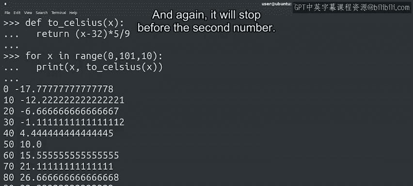

# 谷歌《用Python进行IT自动化办公1、2课（Python、控制操作系统）｜Google IT Automation with Python》中英字幕 - P42：41_更多 for 循环示例.zh_en - GPT中英字幕课程资源 - BV1gw411E7E1

In the last video， we talked about the range function and how it generates a sequence of numbers starting with 0。

 Sometimes， though， we don't want to start with 0 for these situations。

 the range function also allows us to specify the first element of the list to generate。

 We do that by passing two parameters to the function instead of one。 like in the next example。

Product equals1。For n in range。1 to 10。Product equals。Product。And。Print product。In this example。

 we're calculating the product of all numbers from one to9。For this operation。

 it's important that we start with one and not with zero， if wed started with zero。

 the whole product would be zero。Additionally， we can specify a third parameter to change the size of each step。

 This means that instead of going one by one， we could have a larger difference between the elements。

 Let's check out this example of when you might want to do something like this。First。

 we're defining a function that converts a temperature of value from Fahrenheit to Celsius。

And we're simply using a conversion formula to do that。

 Then we have a  four loop that starts at 0 and goes up to 100 in steps of 10。

 Notice that we're using 101 for the upper limit instead of 100。

 We're doing this because the range never includes the last element。

 and we want to include 100 in our range。 The body of the four loop prints the value in Fahrenheit and the value in Celsius creating a conversion table。

 Let's see this in action。That example got you feeling the heat， don't worry。

 there's a quick rundown of what we've learned。The range function can receive one，2。

 or three parameters if it receives one parameter， it will create a sequence。

 one by one from0 until one less than the parameter received。If it receives two parameters。

 it will create a sequence one by one from the first parameter until one less than the second parameter。

 Finally， if it receives three parameters， it will create a sequence starting from the first number and moving towards the second number。

 But this time， the jumps between the numbers will be the size of the third number。 And again。

 it will stop before the second number。😊。

This might sound like a lot to remember， but don't panic。 As we've said before。

 you don't have to try to memorize it all。 Just keep practicingractising。

 It soon become second nature。