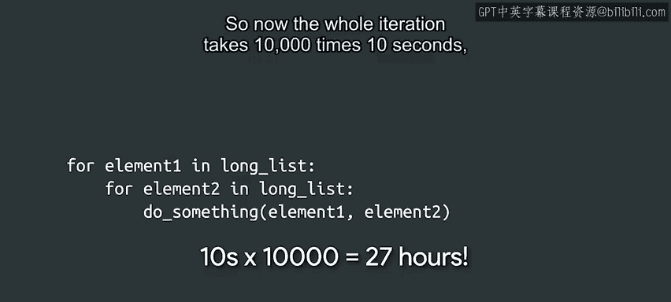

# 谷歌《用Python进行IT自动化办公1、2课（Python、控制操作系统）｜Google IT Automation with Python》中英字幕 - P43：42_嵌套的 for 循环.zh_en - GPT中英字幕课程资源 - BV1gw411E7E1

You're doing great。 Getting your head around all these loops。

 I think you're ready for something a little bit more complex。

 We're going to explore what happens when you get loops inside of loops。

 Does that make your heads spin。 Don't worry， we're about to break it down for you with a couple of examples。

 Have you ever played dominoe's before。 There's a bunch of fun games you can play with these tiles。

 In case you're not familiar。 Each domino tile has two numbers represented by a collection of dots carved on each half of the tile。

 The numbers go from 0 to 6。 tiles can be rotated so that each combination of numbers as represented only once in a set of domino tiles。

 In other words， the two，3 tile is the same as the three，2 tile。 And there's only one pers set。😊，Now。

 imagine we wanted to write a program that prints each domino tile in a set。

 If we take all of the tiles that have 0 on the left。

 we can print tiles with numbers from 0 to 6 on the right。

 That should be easy to do with the four loop。 What about tiles that have one on the left。 Well。

 we need to skip the 1，0 tile。Because that one was already printed as 01。

So we could print a list of tiles with one on the left and numbers from one to6 on the right。

When we look at 2， we would need to skip both 0 and 1 and so on。Are you following along？

How do you think we'd write the code for this？Turning this into code means that we'd need to write two for loops。

1 inside the other。 This is what we call nested for loops。

Check out how this looks in Python code for left in range7。For right in range left。7even。Print。

I'm going to do left bracket。Plus， S T R left。Plus。Pippe。Plus， SR。Right。Plus。Close bracket。

And equals space。And print。In this code， we're using a new parameter that we pass to the print function。

 This parameter is called end。Normally， once print has taken the content we passed and written it to the screen。

 then it writes a special character that creates a new line called the new line character。😊。

If we want print to write something else instead of the new line character， we use the end parameter。

 like we see in this example。Notice how the second for loop iterates over a different number of elements each time it's called as the value of left changes。

Depending on what you want to achieve with your nested loops。

 you may want both loops to always go through the same number of elements。

 or you might want the second loop to connect to the first one。Let's look at a different example。

 Let's say you run a local girls basketball league in your town。

 You have four teams that will play against each other in the league。 both at home and away。

 You've stored the names of the teams in a list like this。😊。

We want to write a script that will output all possible team pairings for this。

 The order of the names matters because for each game， the first name will be the home team。

 and the second name is the away team。And of course。

 what we don't want to do is have a team playing against itself。

 So what statement do we need to use to avoid that。To do this。

 we need to use a conditional that makes sure we only print the pairing when the names are different。

Check out what this looks like。4our。Home team。In teams。For away team in teams。If。🤢，Home team。

Not equal to a away team。Print。Home team。Versus。Aaiiting。Success。As you can see。

 nested loops are super useful for solving certain problems like pairing teams。

What it doesn't solve is the question who would win in a face off between dragons and unicorns。

 If only there were some code for that。Anyway， we've seen that nested loops are a handy tool。

 but we need to be careful not to just blindly apply them to any problem。 Why， well。

 because the longer the lists your code needs to iterate through。

 the longer it takes your computer to complete the task。

 Let's say your manager asks you to do an operation that will run through a list of 10000 elements。

 If the operation takes 1 millisecond per element， the whole loop would take 1 millisecond times 10000 to complete。

 which is 10 seconds。Now， imagine we add a nested loop that has to go over the same 10，000 elements。

This means that each iteration of the outside loop would do a full iteration of the inside loop。

 which， again， would take 10 seconds to go through the whole list。

 So now the whole iteration takes 10000 times 10 seconds， which is 100000 seconds。

That's over 27 hours。I have the patience of anat， so that would definitely not work for me。

This doesn't mean we shouldn't use nested loops。 They're a useful tool in solving problems that require them。

 but we need to be careful of where and how we use them。Throughout this course and ones coming up。

 we'll look at a lot of techniques that can help us pick the right tool to use for each type of problem。

 Up next， we'll look into some common errors that you might come across when writing your for loops and what to do about them。

