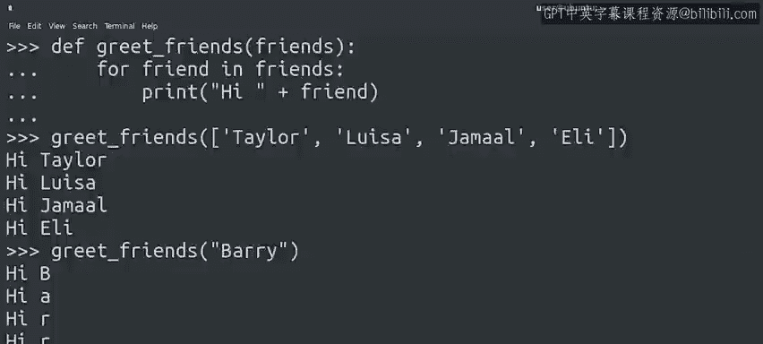

# 谷歌《用Python进行IT自动化办公1、2课（Python、控制操作系统）｜Google IT Automation with Python》中英字幕 - P44：43_for 循环中的常见错误.zh_en - GPT中英字幕课程资源 - BV1gw411E7E1

We've now seen how to write four loops， combineine them with functions。

 N a for loop inside a different loop， and even combine a nested loop with conditionals。 Nice job。

 You're chugging right along。😊，But before we're done with four loops。

 let's check out some common mistakes you may come across while trying this yourself。

 As we've called out already， four loops iterate over sequences。

 The interpreter will refuse to iterate over a single element。 As you see here，4 x in 25。Print X。

In this example， we're trying to iterate over the number 25 Python prints of type error telling us that integers are not iterable。

 There are two solutions to this problem， depending on what we're trying to do。

 If we want to go from 0 to 25， then we use the range function， So4 x in range 25。Print X。

But if we're trying to iterate over a list that has 25 as the only element。

 then it needs to be a list。 And that means writing it between square brackets。4 x in。List，25。

Prince X。You might be wondering why you'd ever want to iterate over a list of one element。

 And that's a good question。 Well， this kind of issue usually happens when you have a function with a for loop inside it。

 which is iterating over the elements of a list received by parameter。 Sa， for example。

 you have a function that fixes the permissions of a list of files received by parameter。

 And you want to call this function to fix the permissions of just one specific file to do that。

 You need to pass the file as the single element of a list Let's check this out with some code we're familiar with。

 Our friendliest of Python examples。 Hi friends。😊，We're going to modify it to have the greetings inside a function。

We've defined a greet friend's function that receives a list by parameter and iterates over that list。

 greeting each friend。😊，But what if we only want to greet one friend instead of four。Well。

 we still need to define a list， but with only one element。But first。

 let's see what would happen if we don't do that。Greet friends。Mary。哈。Not what we expected， right。

 well， what's going on here？This happens because strings are iterable。

 The for loop will go over each letter of the string and do the operation we asked it to do。

 which in this case， print a greeting。Depending on what you're trying to do。

 you may actually want to iterate through the letters of a string。 but in this case， we don't。

So to sum it up， if you get an error that a certain type isn't iterable。

 you need to make sure the for loop is using a sequence of elements and not just one。

 And if you find your code iterating through each letter of a string when you want it to do it for the whole string。

 you probably want to have that string be a part of a list。

We've now learned how to write while loops and for loops。

 You might remember four loops are best when you want to iterate over a known sequence of elements。

 But when you want to operate while a certain conditioners true。 W loops are the best choice。

 Next up， we've got a super useful cheat sheet for you that puts all this into one handy resource。

 After that， head over to the practice quiz to test your knowledge and check in on how you're doing。

😊。