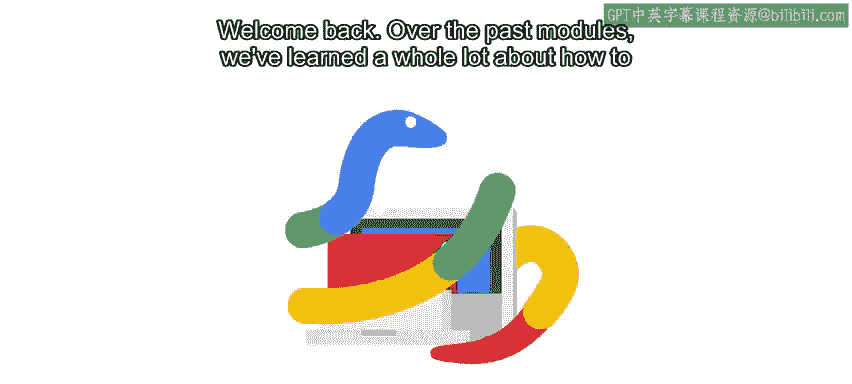

# 谷歌《用Python进行IT自动化办公3、4、5、6课（Git、debug、云端、实践）Google IT Automation with Python》中英字 - P44：43_模块 4 协作介绍.zh_en - GPT中英字幕课程资源 - BV1LW4y1F7XW

🎼。う。

Welcome back。Over the past modules， we've learned a whole lot about how to interact with Git。

We've covered how to use it both locally and remotely。We've seen how to roll back bad changes。

 solve conflicts when collaborating with others and a bunch of other little nifty things in this module。

 we'll keep exploring the collaboration tools available and Git we'll learn about tools that allow us to send changes to projects that we aren't a member of。

Help us improve the quality of our code and let us track our work better。

 Some of these tools will be specific to Gitthub， but most of the Git repository hosting services have similar tools。

 So the concepts will still apply if you decide to use a different platform。In recent years。

 GitHub has become a super popular platform for collaboration across many projects。

It's used heavily for open source projects。These are projects that allow anyone to use， copy。

 and modify their code。Having the code published online means that anybody in the world can learn from what the project is doing and even collaborate on fixes and extra features。

It also helps us learn from each other because we can look at how others have solved the problem that we're tackling。

I regularly use GitHub to look up code snippets for things that I'm interested in Most recently。

 I looked up examples for a movie theater seat finder because I was working on a similar feature for a personal project of mine。

If you're trying to learn a new technology， it's a great idea to practice your skills by contributing to a project that uses that technology。

To do that， you'll need to know how to interact with the project。This includes how to send bug fixes。

 how to make sure that your fixes are applied， and even how to figure out which fixes are needed。

In this module， we'll cover that in a lot more。Sorry excited。 I mean， I'm excited。 Let's get started。

