# 谷歌《用Python进行IT自动化办公3、4、5、6课（Git、debug、云端、实践）Google IT Automation with Python》中英字 - P45：44_在 GitHub 上进行简单的拉取请求.zh_en - GPT中英字幕课程资源 - BV1LW4y1F7XW

🎼。う。

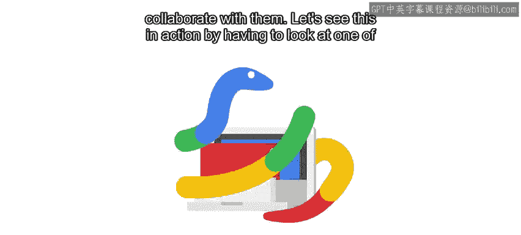

As we called out， we can use GitHub to look at other people's code and collaborate with them。

 Let's see this in action by having a look at one of the projects from our colleague Blue Kaale。

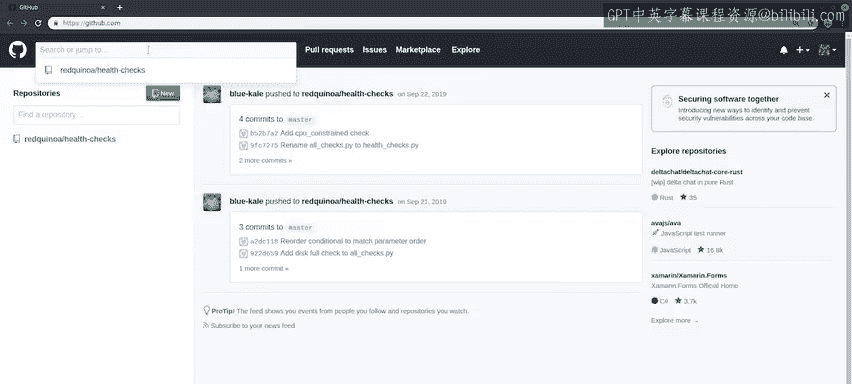

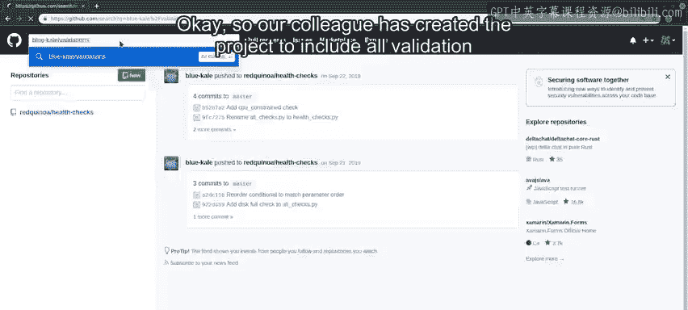

Okay， so our colleague has created a project to include all validation functions。

 Let's have a look at the validations P file。

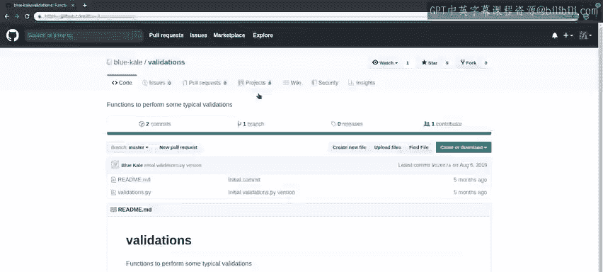

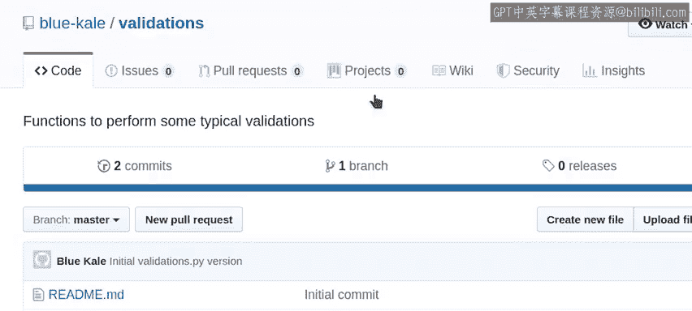

We can see the code of a function that validates a username， but oh。

 if you look closely at the functionss documentation， you might notice that there's a typo。

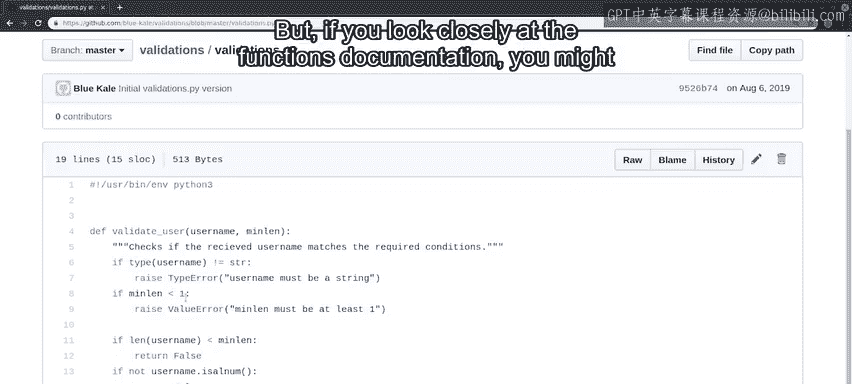

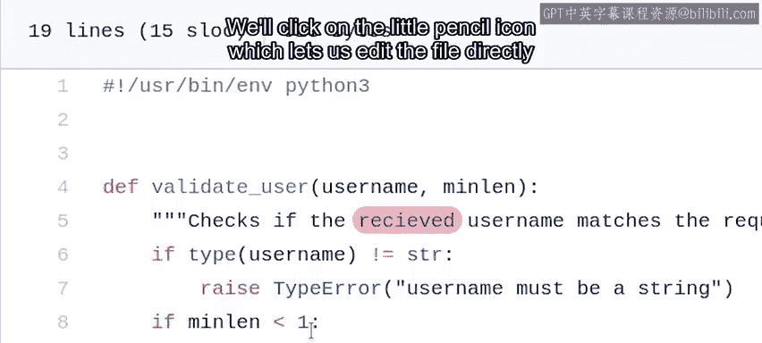

We can improve our colleagues code by fixing that typo。 Let's do that。

 We'll click on the little pencil icon， which lets us edit the file directly from the web interface。

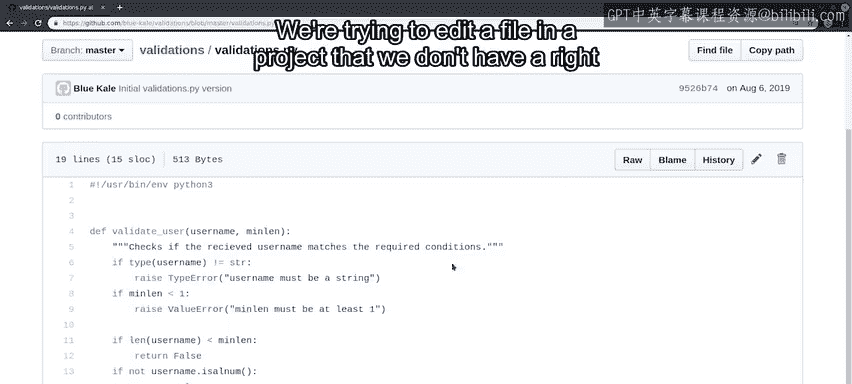

We're trying to edit a file in a project that we don't have right access to。

 GitHub tells us it created a fork of this project for us， which we can commit our changes to。

 and if we submit changes to this file， it will create a new branch so that we can send a pull request。

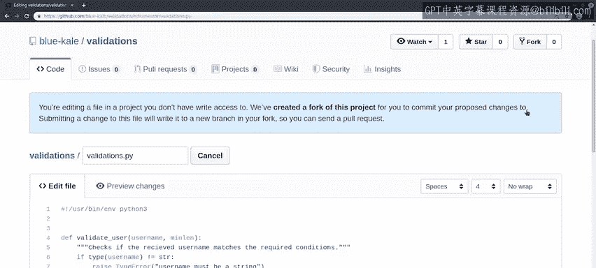

But what exactly is a fork？Forking is a way of creating a copy of the given repository so that it belongs to our user。

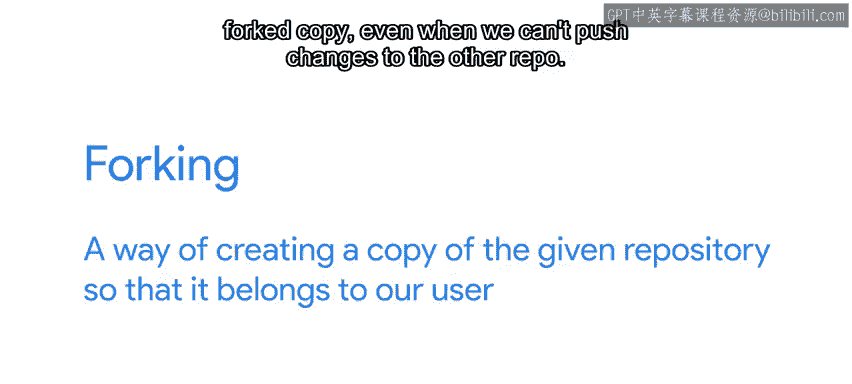

In other words， our user will be able to push changes to the fork copy。

 even when we can't push changes to the other Repo， when collaborating on projects hosted on GitHub。

 the typical workflows first create a fork of the repo and then work on that local fork。

A forked repo is just like a normal repo， except Gitthub knows which repo it forked from so we can eventually merge our changes back into the main repo by creating a pull request。

A pull request is a commit or series of commits that you send to the owner of the repository so that they incorporate it into their tree。

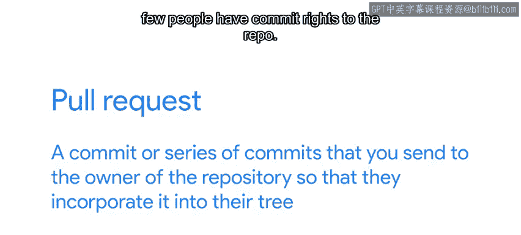

This is a typical way of working on GitHub because in most projects。

 only a few people have commit rights to the repo， but anybody can suggest patches， bug fixes。

 or even new features by sending poll requests that people with commit access can then apply。

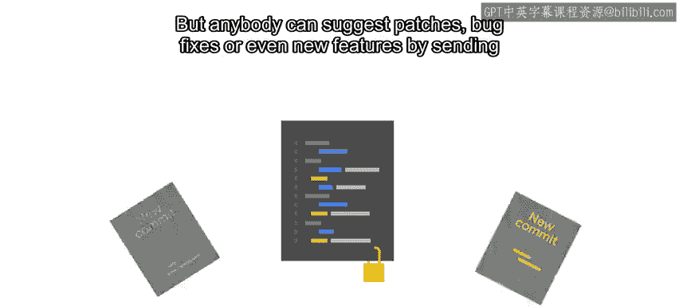

Typically， the owners of the repo will review the changes before merging them。

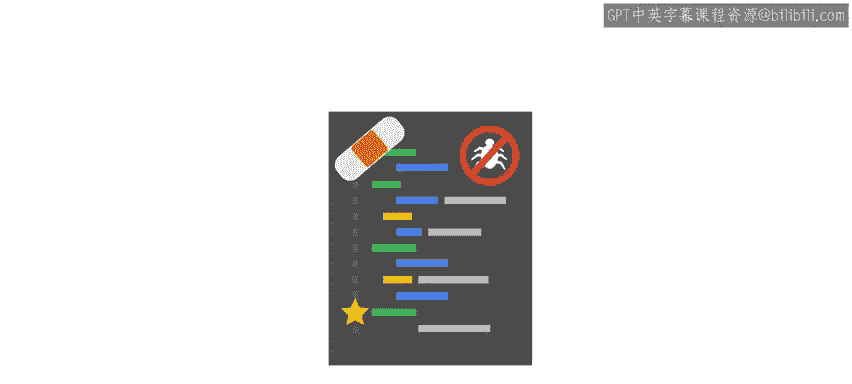

Checking that they match the development guidelines for the project and that the license is valid and so on。

Let's fix the typo in the file to see what the pull request looks like。

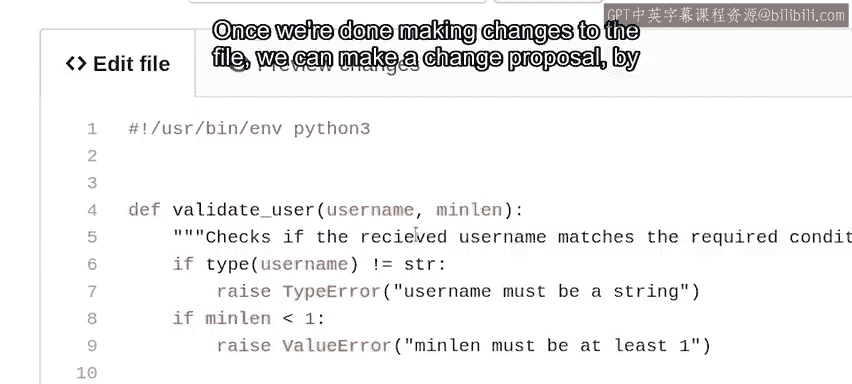

Once we're done making changes to the file， we can make a change proposal by scrolling down and filling in the description of the change。

In this case， we fixed the  Typo in the function documentation。

Clicking on the proposed file change button will create a commit in our Forked repo so that we can send the change to our colleague Let's do that now。

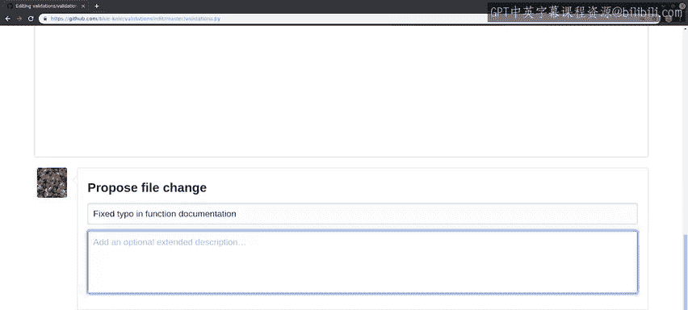

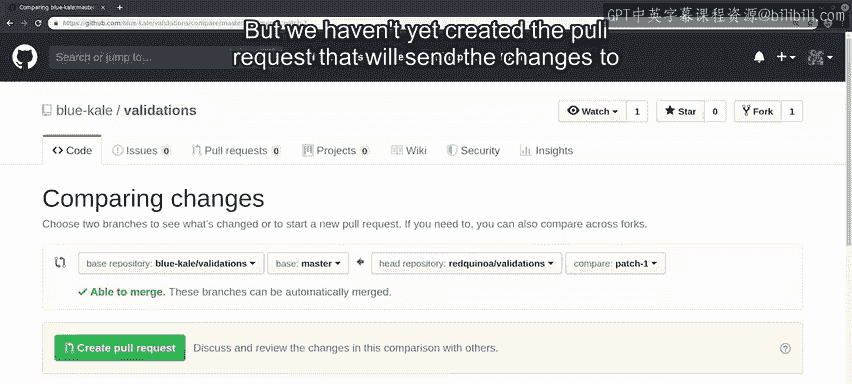

We've created a commit on our Forked repo。But we haven't yet created the pull request that will send the changes to the owner of the original repo。

On this screen， we can see a lot of information about our change。

 we can see what repositories and branches are involved in the creation of the pull request。

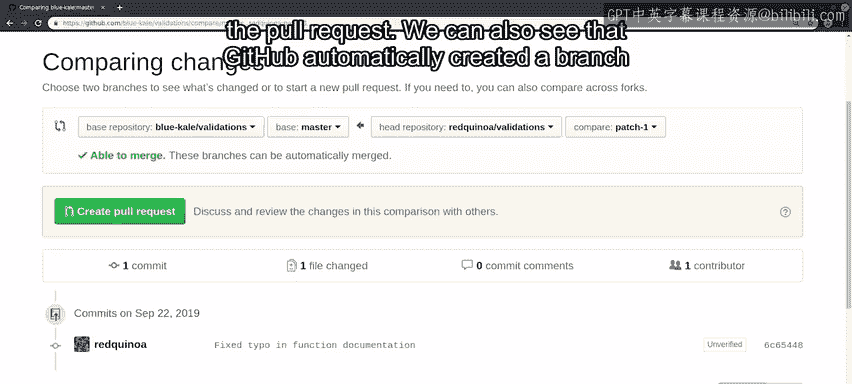

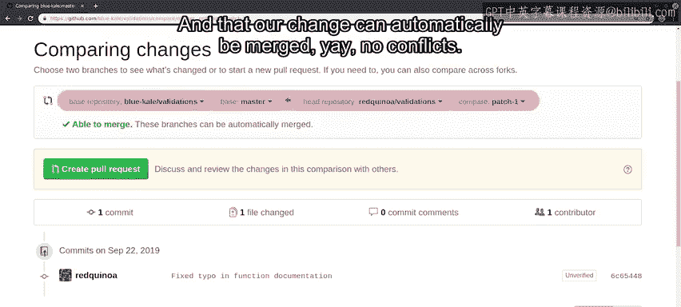

We can also see that GitHub automatically created a branch called patchch Dash1 for us and that our change can automatically be merged。

Yay， no conflicts。This window also lets us review the change before we create an actual pull request Once we're ready。

 we just click the Cate pull request button。

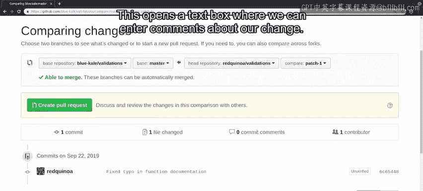

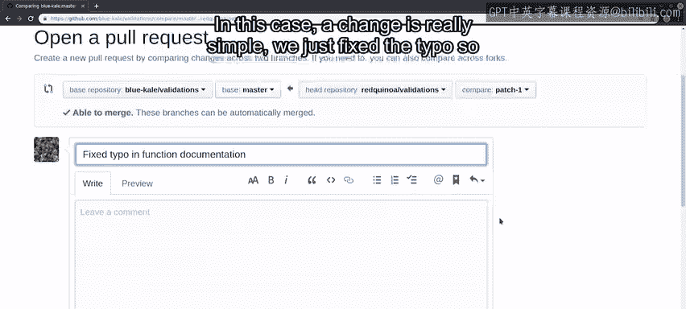

This opens a text box where we can enter comments about our change。In this case。

 our change is really simple。 We just fixed the typo， so there's nothing extra to add。

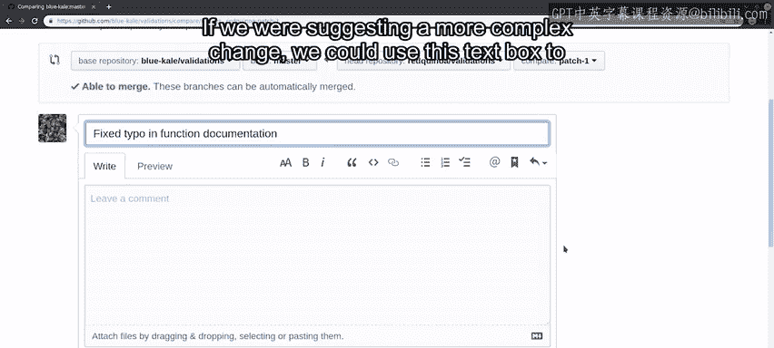

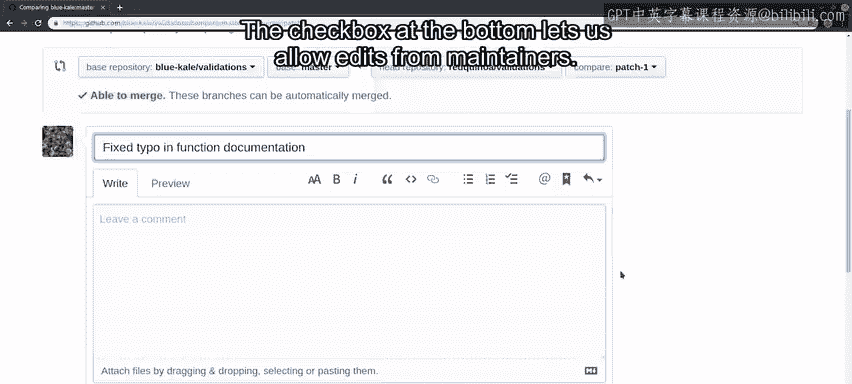

If we were suggesting a more complex change， we could use this text box to provide more context。

The checkbox at the bottom lets us allow edits from maintainers。This can be useful， for example。

 if by the time a project maintainer gets around emerging our change。

 there's been more commits and our change needs rebasing by allowing edits。

 the maintainer can do it themselves instead of asking us to do it less work。Yes， please。Okay。

 we're ready。Let's click createreate pullll Re。

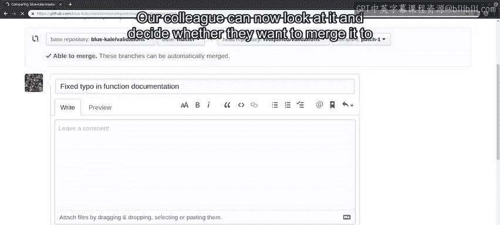

Cool， we've created a pull request with our change。

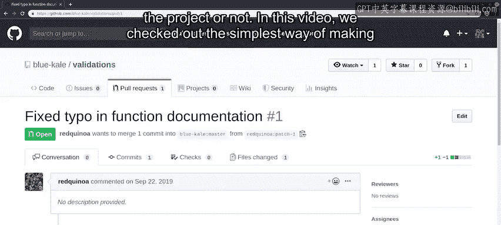

Our colleague can now look at it and decide whether they want to merge it to the project or not In this video。

 we checked out the simplest way of making pull requests。

 which is doing them directly through the GitHub interface。 By using this workflow。

 you can already start contributing the projects on Github。

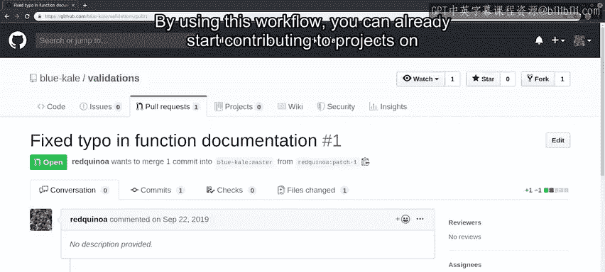

Up next， we'll see how to do more complex pull requests。

