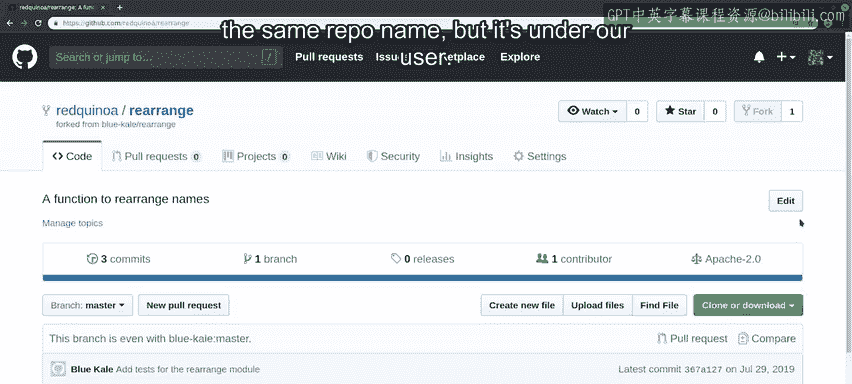
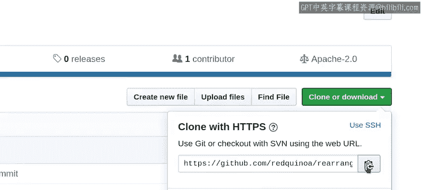
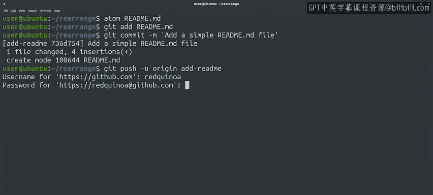
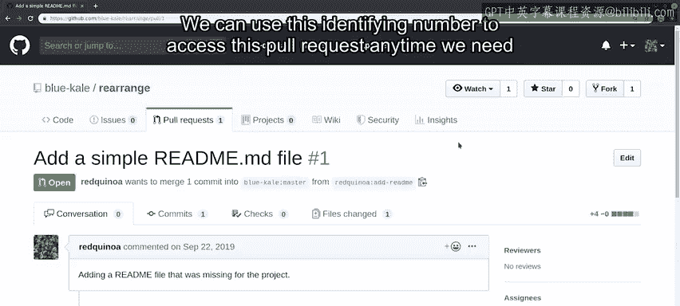

# 谷歌《用Python进行IT自动化办公3、4、5、6课（Git、debug、云端、实践）Google IT Automation with Python》中英字 - P46：45_GitHub 上的典型拉取请求工作流.zh_en - GPT中英字幕课程资源 - BV1LW4y1F7XW

In our last video， we saw how to create pull requests directly on GitHub by using the web interface to edit files。

This works for simple changes like fixing typos or adding documentation to a function。

But it's not so great for making larger changes that we want to preview or test to do that。

 we'll normally have a local copy of the repo in our computer and work with the forked repo as a remote。

We need to use all the Git commands that we've learned up till now to do this Let's check out this process by creating a fork of another repo。

On top of the validations repo， our colleague Blue Kaale has created a rearrange repo and we want to help them out。

 we'll go to their rearrange repo and create a fork by pressing the Fork button。

It takes a few seconds to create a copy of the repo for our user。

The copy will contain the current state of the repo， including files and commit history。

Once the forks created were shown a page that corresponds to the same repo name。

 but it's under our user。 See how it shows that it's a forked repo by stating the original repo under the name。

All right， we've created a forked version of the Repo on GitthHub。

We can now get a local copy of the repo on our computer by copying the URL and then calling the Git cloneone command with it。

We now have a new directory called rearrange with the contents of the repo。

We can look at the contents by changing into that directory and listing all files。

And we can look at the commit history using our old friend Gitlog。

Now that we have a local copy of the repo， we can make any changes we'd like to it。For example。

 this project doesn't currently have a readme。md file。

Let's improve the documentation by creating that。To do that。

 we'll create a new branch called Add or Read Me。Do you remember how to create new branches？

We do it by running Git， check outB。Add dash read me。All right， we can now start editing the Readme。

md file。The MD extension indicates that we're using markdown， which is a lightweight markup language。

 We can use it to write plain text files that are then formatted following some simple rules。

In this case， we'll start with a title with the module's name and a brief description that says it's used to rearrange names。

All right， our readme file is small， but it'll do for now。 Let's save it and commit it。Now。

 to push the change to our forked repo， we need to create the corresponding remote branch。

Do you remember the command for that？Yep， it's get push dash you origin， add dash read me。

So when we push the change to the new branch， we got a message that we can create a pull request if we want to。

We'll do that in a minute。 First， let's check out how our file looks when rendered。Yes。

 our Readme file rendered successfully。We're ready to create a pull Que for our change。To do that。

 let's look at the top of the project page。GitHub tells us that our branch is ahead of the original repository's master branch by one commit。

Which is the commit we just made。We can start our pull request by clicking on the pull request link。

As we called out， before creating a pull request， it's always important to check that the code will merge successfully。

GitHub tells us that our change can be automatically merged， which is great news。

If this wasn't the case， we'd need to rebase our change against the current branch of the original repo so that it could be merged。

The window is showing us the text box where we can enter comments about our change。

As we mentioned before， we should use this to explain why we're creating this pull request。

This lets the person that will approve the change， understand why they should merge the change into the main tree。

Are we fixing a bug， is this a new feature to let the project support more use cases？

How will the project benefit from including our change？Whatever info might be useful to the improver。

 record it here。We can also use this box to explain how the change was tested。

 if the project includes automatic test infrastructure。

 our pull request should include a test for our changes， and we can state that all tests still pass。

 but if there's no automatic testing， then we can use this box to explain how we tested the change manually。

In this case， we've just added a readme file that the project was missing before。

 so we'll just say we're adding a readme file that was missing for the project。

We should also check that the change we're sending looks correct。

And it's always a good idea to double check that we're sending the right change To do that。

 let's look at the diff that appears at the bottom of the page。Yep， that's exactly what we want。

 All right， we're ready。 Let's click the create pull request button。Awesome。

 we've created our second pull request， the number next to the name of our pull request is the identifier that's used in GitHub to track issues and pull requests。

We can use this identifying number to access this pull request anytime we need it。

But why would we need to access a pull request after we send it？

It's pretty common for project maintainers to come back with questions， comments。

 or even ask us to fix our pull requests。Imagine you just finished preparing a pull request for a great new feature and you get a comment saying that it's missing some documentation。

What would you do？We'll talk about that in our next video。

