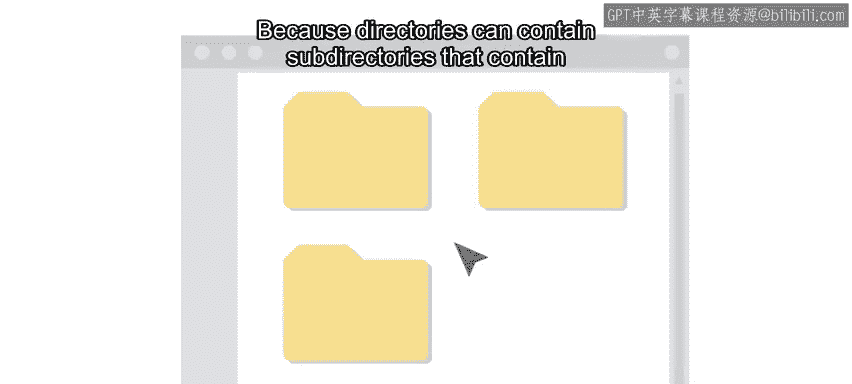
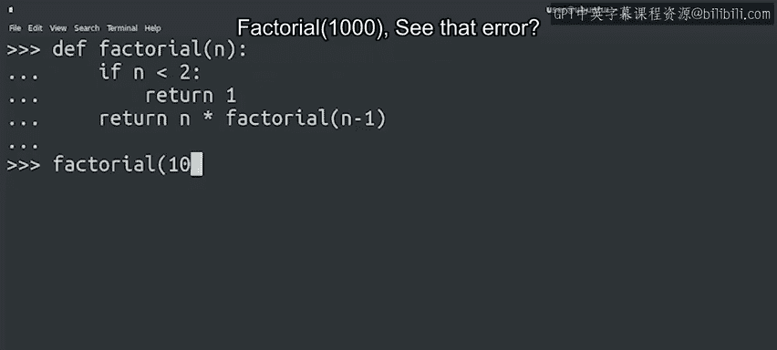

# 谷歌《用Python进行IT自动化办公1、2课（Python、控制操作系统）｜Google IT Automation with Python》中英字幕 - P46：45_在 IT 背景下的递归实践.zh_en - GPT中英字幕课程资源 - BV1gw411E7E1

By now， you've seen what a recursive function looks like。

 how to write a base case and a recursive case。 You might be wondering。

 why do we need recursive functions if I can just use a four or while loop。 Well。

 solutions to some specific problems are easier to write and understand when using recursive functions。

 A lot of math functions like the factorial or the sum of all the previous numbers are good examples of this。

 If a math function is already defined in recursive terms。

 It's straightforward to just write the code as a recursive function。

 but it's not just about math functions。 Let's check out a couple of examples of how this could help an I T specialist trying to automate tasks。

 Let's say that you need to write a tool that goes through a bunch of directories in your computer and calculates how many files are contained in each。

 When listing the files inside a directory， you might find subdirecties inside them。

 and you'd want to count the files in those subdirecties as well。😊。

This is a great time to use recursion。 The base case would be a directory with no subdirecties。

 For this case， the function would just return the amount of files。😊。

The recursive case would be calling the recursive function for each of the contained subdirecties。

 The return value of a given function call would be the sum of all the files in that directory。

 plus all the files in the contained subdirecties。 A directory of files that can contain other directories is an example of a recursive structure because directories can contain subdirecties that contain subdirecties that contain subdirecties and so on。

😊。

When operating over a recursive structure， it's usually easier to use recursive functions than four or bi loops。

Another I T focused example of a recursive structure is anything that deals with groups of users that can contain other groups。

 We see the situation a lot when using administrative tools like active directory or Ldap。

Say your group management software allows you to create groups that have both users and other groups as their members。

 and you want to list all human users that are part of a given group Here。

 you would use a recursive function to go through the groups。

 The base case would be a group that only includes users， listing all of them。

 The recursive case would mean going through all the groups contained。

 listing all the users in them and then listing any users contained in the current group。😊。

It's important to call out that in some languages。 there's a maximum amount of recursive calls you can use in Python。

 by default， you can call a recursive function 1000 times until you reach the limit。

 That's fine for things like subdirecties or user groups that aren't thousands of levels deep。

 but it might not be enough for mathematical functions like the ones we saw in the last video。

 Let's go back to our factorial example from the last video and try to call it with n equals 1000。

Factorial。1000。

See that error， it's telling us that we've reached the maximum limit for recursive calls。

 so while you can use recursion in a bunch of different scenarios。

 we only recommend using it when you need to go through a recursive structure that won't reach 1000 nested levels。

All right， we've just added recursion to your growing scripting toolbox。

 they're ready for you whenever the situation calls for it。

