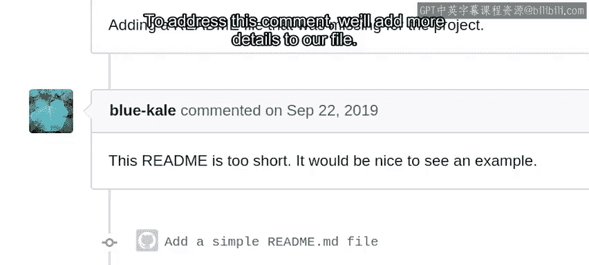
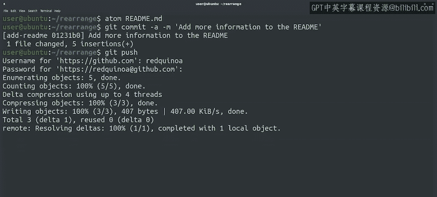
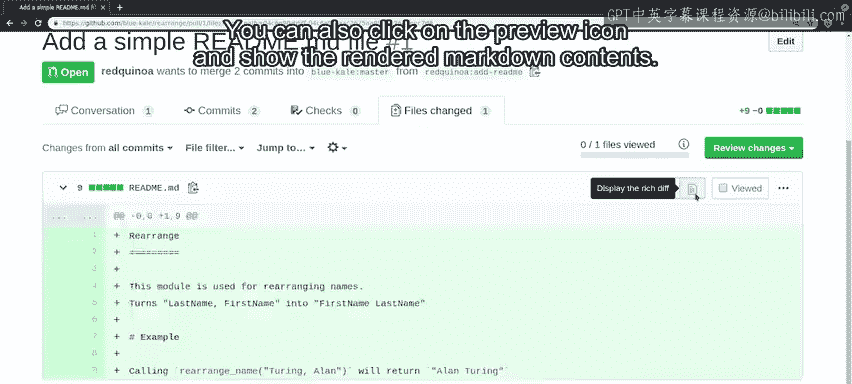

# 谷歌《用Python进行IT自动化办公3、4、5、6课（Git、debug、云端、实践）Google IT Automation with Python》中英字 - P47：46_更新现有的拉取请求.zh_en - GPT中英字幕课程资源 - BV1LW4y1F7XW

When we send a pull request， it's pretty common to receive some comments from the project maintainers asking for some improvements。

The improvement could be to add documentation or tests。

Or maybe we need to make sure that change works for all cases or that it follows the project style guidelines。

There's nothing wrong with getting these comments。 It actually shows the project maintainers are interested in our change。

To get our change approved， it's important that you address the comments。

 So if we're asked to add documentation， for example， we go and do it。

So back to our change looks like we got a comment from one of our colleagues。

We got a comment saying that our readme was too short and they'd like us to add an example。

To address this comment， we'll add more details to our file。

We'll start by explaining that the function rearranges last name first name into first name last name。

And then we'll add an example， we'll say that calling rearrange name with Tring Allen。As a parameter。

 we'll return Alan Tring。Okay， we fleshed out the Readme file a bit。

Now we can add our changes and commit them to the repo as usual。

 Let's run Git commit and pass a commit message saying that we've added more information to the readme。

And after that， we'll push the change to the repo。

All right， now that we've pushed our change back to the repo， let's check our pull request in GitHub。

In the commits tab， we can see our two commits。Our commit now shows up as a part of the same pull request。

 it's important to notice here that we just pushed our commit to the same branches before and GitHub automatically added it to the pull request。

If we wanted to create a separate pull request， we would need to create a new branch instead。

If we go to the Fi Change tab， we can see all files affected by the pull request。

 no matter which commit they were changed in， When we look at the diff generated by a commit or a chain of commits。

 GitHub will show a colored diff for the changes that we've made。

It'll use green for new lines and red for lines that were deleted。If only a part of the line changed。

 it will highlight that specific part of the line。In this case， it's a new file。

 so all the lines are additions。Check out how we see only one file。

 even when there are two separate commits。What we're seeing is the difference between our repo and the original repo we created the pull request for。

We can also click on the preview icon and show the rendered markdown contents。

GitHub renders our file and highlights the changes。

Keep in mind that each project in GitHub may work slightly differently。

Some projects may ask you to have only one commit in your pull request。

 other projects may ask you to rebase against the latest master branch when your pull request is ready to be merged back into the main tree。

GitHub allows projects to set their contribution guidelines。

You'll find a link to them whenever you create a new pull request or issue in a project。

So make sure you've read these guidelines and that your pull requests match them。In this video。

 we saw how to update our pull requests by doing new commits in our local Git repository and pushing them to the remote repository。

We'd seen before how to use the GitWeb interface to create new pull requests。

 and we can use this interface to update a pull request。

This can be handy when the change that we want to make is small。

 like fixing a typo or adding an extra sentence to the documentation。Up next。

 we'll talk about what to do if you're asked to squash your changes into a single commit。

