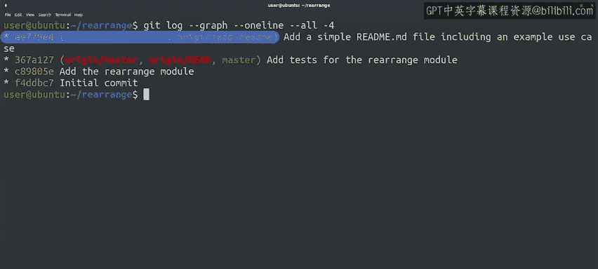
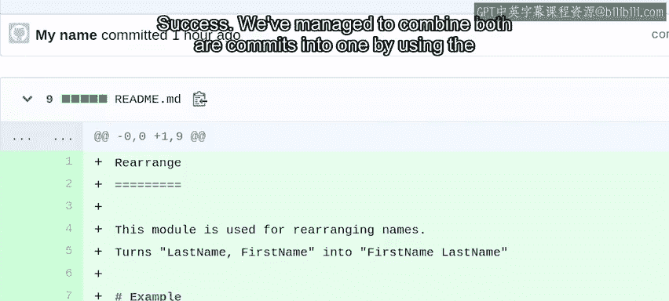

# 谷歌《用Python进行IT自动化办公3、4、5、6课（Git、debug、云端、实践）Google IT Automation with Python》中英字 - P48：47_压缩更改.zh_en - GPT中英字幕课程资源 - BV1LW4y1F7XW

As we've called out before， you shouldn't rewrite history when the commits have been published。

That's because someone else may have already synchronized their repo with those contents。

This rule is waived with pull requests， since it's usually only you who have cloned your fork of the repository。

 So say the project maintainers ask us to create a single commit that includes both changes and a more detailed description than the one we submitted。

We can do that by using the interactive version of the rebase command called Rebase s I。

As the parameter to the command will' pass the master branch。So we'll call Git rebate s I master。

When we call an interactive rebase， a text editor opens with a list of all the selected commits from the oldest to the most recent。

By changing the first word of each line， we can select what we want to do with the commits。

The default action here is P， which takes the commits and rebaases them against the branch we selected。

This is what we did with Git rebase in an earlier video when we called it without the dash eye flag。

 but now we can change the action to something else。

The comments in the file tell us all the different commands we can use for our commits。For example。

 we can reword a commit message， keeping the changes as they are， but modifying the commit message。

We can also edit the commit to add or remove changes from it we have two options for combining commits。

 squash and fix up。In both cases， the contents of the selected commit are merged into the previous commit in the list。

The difference is what happens with the commit messages。When we choose sququaash。

 the commit messages are added together and an editor opens up to let us make any necessary changes。

When we choose FixU， the commit message for that commit is discarded。For our example。

 we want to use sququaash so that we can combine both commits。

 but also modify the commit description。So let's change the pick command in the second line to squash it into the first one。

Then we'll save and exit the editor as usual。Once we've told Git that we want to squash a commit onto the one before it。

 we're given another file to edit， in this case， it's the combined commit message。As usual。

 Git shows us some helpful information in the comments。

 including which files are modified and what commits are being combined。

We want to improve the description by adding more info about our change。

Let's add we're including an example use case。All right。

 now that our commit contains the right information， we can save and exit as usual。Yes。

 our rebase worked。 Let's check the output of Git show to see the latest commit and the changes in it。

Success， we got exactly what we wanted here。 Our two changes have been combined into one that contains the whole new file and the right commit message。

Before we try to push this change to our repo， let's call Git status to check the info that Git gives us about the current state。

Gt tells us that our local branch has one commit。Which is the rebase we just did。

It also tells us that the origin/ add dash readme branch has two commits。

These are the two commits we had already pushed to the repo let's look at the graph history of our commits by calling git。

 log， dash dash graph， dash1 line， dash dash all for all branches and dash4 for just the latest four commits。

We can see that the two commits pushed to the origin/lash add dash readme branch show up in a different path than the commit that's currently in our local add dash readme branch。

This is expected whenever we do a rebase because the old commits are in the remote repo and we have a different commit in our local repo。

What do you think will happen when we call get pushush？Let's try that out。As we expected。

 Git doesn't like us trying to push our change because it can't be fast forwarded。But in this case。

 we don't want to create a merge instead we want to replace the old commits with the new one。

To do this， we will call Git pushush dash F to force skit to push the current snapshot into the repo as is。

Woo， this time our push completed successfully。Git tells us here that we forced an update。

Let's look once again at our history graph by running git log， dash graph，1 line， all，4。This time。

 it's just one commit on top of master。

The divergence is gone。Now let's look at the contents of the pull request。Suc Sas。

 we've managed to combine both our commits into one by using the interactive version of Git rebase。

 Nice job in making it through these first videos。😊。

You now know how to create a pull request on GitHub， how to update a pull request。

 and squash changes。These tools are all super helpful when using GitHub。Up next。

 you'll find a reference of the commands we used and links to where you'll find more information。

After that， there's a quick quiz to check that everything's making sense。

