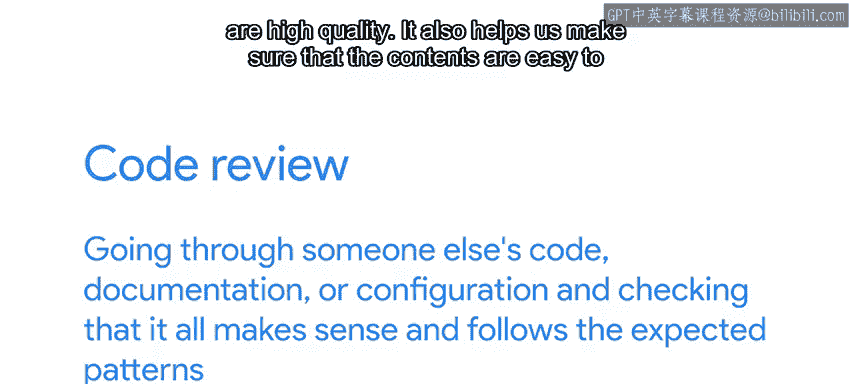
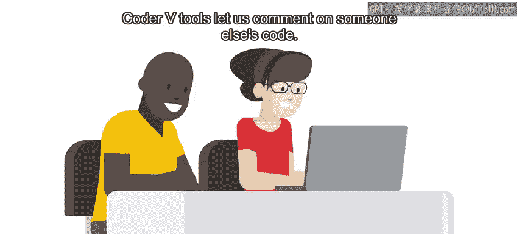
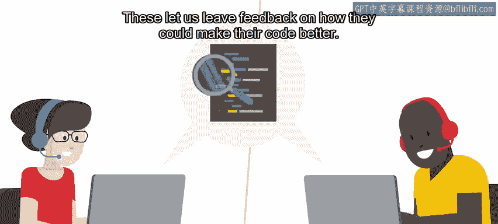
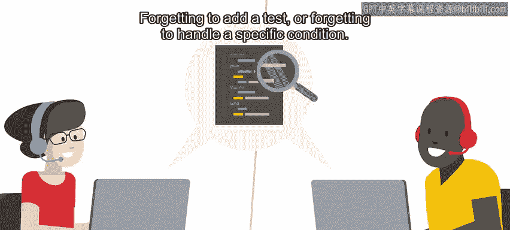
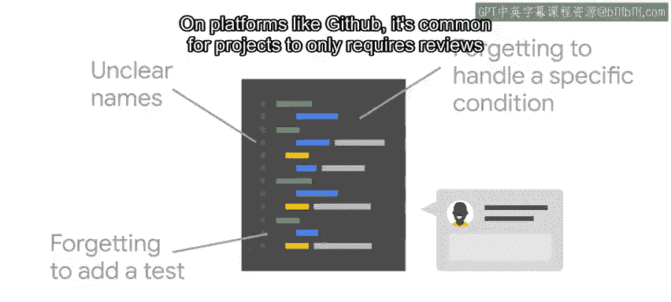

# 谷歌《用Python进行IT自动化办公3、4、5、6课（Git、debug、云端、实践）Google IT Automation with Python》中英字 - P49：48_什么是代码评审.zh_en - GPT中英字幕课程资源 - BV1LW4y1F7XW

🎼。う。

GitHub and other repository hosting services offer tools for doing code reviews on their platform。

And while this is called code reviews， we can actually use the same tool and process to do reviews of any text file。

 including configuration and documentation。Doing a coder review means going through someone else's code。

 documentation or configuration and checking that it all makes sense and follows the expected patterns。

 The goal of a coder review is to improve the project by making sure that changes are high quality。

It also helps us make sure that the contents are easy to understand that the style is consistent with the overall project and that we don't forget any important cases。

 Reviews increase the number of eyes that have checked the code。

 This increases the code quality and reduces the amount of bugs。

It doesn't mean that there will be no bugs， but at least the most obvious bugs will be caught Also this helps spread knowledge since both the code writers and the code reviewers now know what the code is doing。

When we work in the same office as our teammates， we can do reviews in person by looking together at the changes and discussing how the contents fit together。

But when the person that we're working with is in a different office or time zone。

 we're better off using a coder view tool。

Coode or View tools let us comment on someone else's code。

This lets us leave feedback on how they could make their code better。

Common code issues are unclear names that make the code hard to understand， forgetting to add tests。

Or forgetting to handle a specific condition。

If we're writing documentation， our reviewer can help us catch typos and things that aren't totally clear。

On platforms like GitHub， it's common for projects to only require reviews for people that don't have commit access。

 while the project maintainers can commit directly。

 but doing code reviews improves the code's overall quality。Today。

 some open source projects and lots of companies require court reviews for everybody。

This isn't because they don't trust them， but because they want the highest quality code。

 and coder reviews are how they get there。 One thing to always remember。

 coder reviews are not about us being good or bad coders。 They're about making our code better。

 and not only that specific review， but in general。By getting feedback。

 we can keep improving our code techniques， and by reviewing other people's code。

 we can also learn new and different ways of achieving results。Like everybody else。

 after toiling for hours on a problem and finally solving it。

 all I want to do is submit my code and be done with it。But this rarely happens。

Coder views usually send me back to the drawing board with small errors and nitpicicks。

 But that's a good thing。 These coder views point out things that we might have missed along the way and ensure that our code makes sense to others。

One example that springs to mind is back when I was writing a script for an Android bug report parser。

After hours of fiddling with the code and writing tests to back up what I did。

 I finally sent it to her coder view and thought I was done。

Turns out I had a bunch of little style guide errors that my reviewer wouldn't let me get away with。

More importantly， while fixing the style errors， I noticed I had forgotten a major use case in my script that would have stopped my code from working。

So I fixed both the style errors and the missing use case and could submit my change with a smile。

At Google， we believe deeply in the value of reviewing everything we do。

Even the contents of these courses have been reviewed by lots of people。

These reviews make sure that the contents make sense。

 are technically correct with no significant gaps and follow the established guidelines。

Shout out to my colleagues for keeping us on our toes and making sure that these videos are top rate Up next we'll talk about the typical reviewing workflow and how to get the most from the review process。

