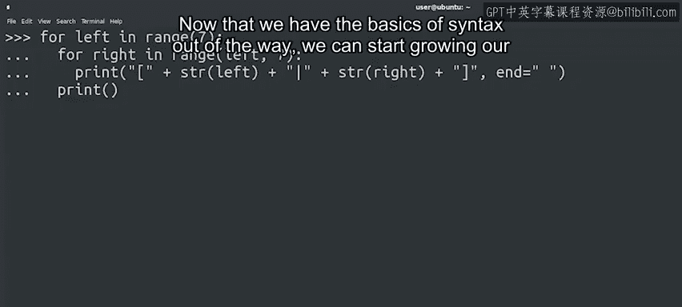

# 谷歌《用Python进行IT自动化办公1、2课（Python、控制操作系统）｜Google IT Automation with Python》中英字幕 - P49：48_基本结构介绍.zh_en - GPT中英字幕课程资源 - BV1gw411E7E1

🎼Yeah。

Welcome back。 And congratulations on getting this far。

 I sure I glad we didn't lose you in all those loops we covered in the last module。

 You're doing great in making tons of progress。 In earlier videos。

 we covered the basic elements of Python syntax。 We talked about how to define functions。😊。

How to make your computer act differently based on conditionals？

And how to make it perform operations repeatedly using while and for loops and recursion。

Now that we have the basics of syntax out of the way， we can start growing our Python knowledge。

 which will let us do more and more interesting operations。 Remember。

 one of our main goals in this course is to help you learn to write short Python scripts that automate actions。

 You've made big steps towards getting there。 And in the upcoming videos。

 we're going to learn a bunch of new super useful skills to add to your programming toolbox。😊。

We'll check out some data types provided by the Python language to help us solve common problems with our scripts。

 In particular， we'll do a deep dive into strings， lists and dictionaries。 It's up。

 While we've used strings in our scripts already。 We barely scratch the surface of all the things we can do with them in Python。

 We also ran into a few lists and some examples， but there's a lot more of them， we haven't seen yet。

 And dictionaries are a whole new data type for us to dig our teeth into。

 These are all data types or data structures that are super flexible。

 We're going to use them to write all kinds of scripts in Python。

 So it's a good idea to spend some time getting to know them and learning when to use them and how to make the most out of them。

 We've got a lot of new and exciting concepts to discover。 So let's get right to it。😊。

