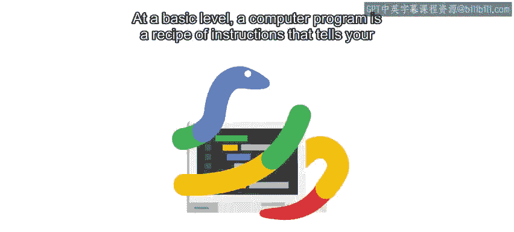
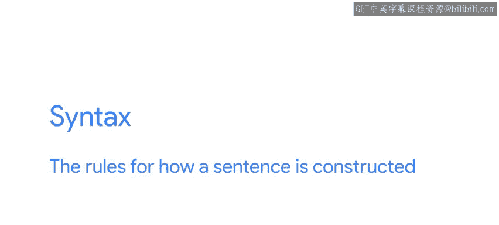
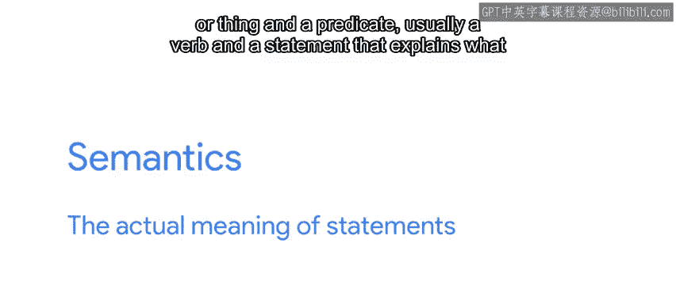
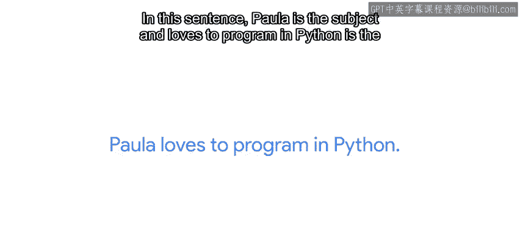
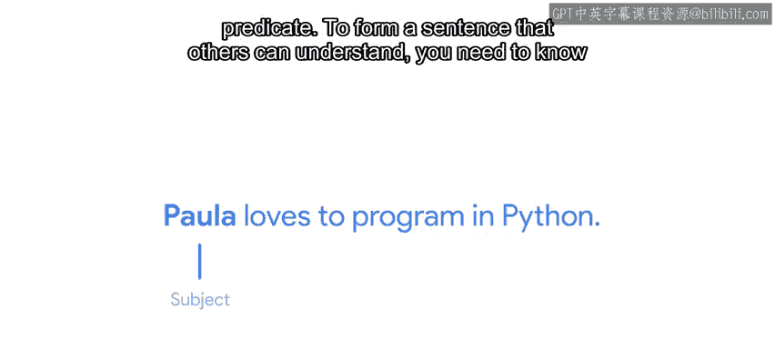
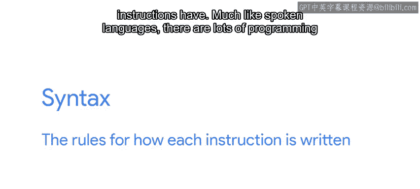
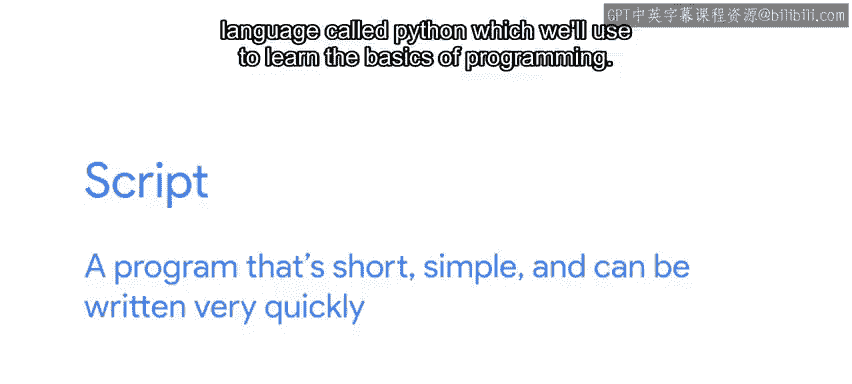

# 谷歌《用Python进行IT自动化办公1、2课（Python、控制操作系统）｜Google IT Automation with Python》中英字幕 - P4：3_什么是编程.zh_en - GPT中英字幕课程资源 - BV1gw411E7E1

🎼Yeah。

At a basic level， a computer program is a recipe of instructions that tells your computer what to do。

 When you write a program， you create a step by step recipe of what needs to be done to complete a task。

 And when your computer executes the program， it reads what you wrote and follows your instructions to the letter。

 How nice is that。The recipe is written in a code called programming language。

 Programing languages are actually similar to human spoken languages since they have a syntax and semantics。

 Now， if it's been a while since your last grammar class。

 here's a quick refresher on syntax and semantics。In a human language。

 syntax is the rules for how a sentence is constructed。

 while semantics refers to the actual meaning of the statements。

In English， sentences generally have both a subject。 That's a person， place or thing and a predicate。

 usually a verb and a statement that explains what the subject is doing。 Let's take the sentence。

 Paula loves to program in Python as an example。 In this sentence， Paula is the subject。

And loves to program in Python as the predicate。To form a sentence that others can understand。

 you need to know both the syntax that constructs the sentence and the semantics that gives it meaning。

 The same applies to programming languages in a programming language like Python。

 the syntax is the rules for how each instruction is written。

 and the semantics is the effects the instructions have。

Much like spoken languages。 there are lots of programming languages to choose from。

 Each has its own history features and applications， but they all share the same fundamental ideas。

 So once you understand the basic concept in one programming language。

 it becomes much easier to learn another。 And lastly， computers always do exactly what they're told。

 So when you write a program， It's important to be super clear about what you want the computer to do。

 Learn the syntax and semantics of the programming language you choose will allow you to do just that。

 Make sense， before we continue， let's spend a moment on terminology。 In the next few videos。

 you'll hear the term script being used a bunch。 So what's the difference between a script and a program。

 The line between the two can be a bit blurry。 And in this course will use the terms interchangeably。

 In general， you can think of scripts as programme with a short development cycle that can be created and deployed rapidly。

 In other words， a script is a program that is short， simple and can be written very quickly。😊。

In this course， we'll focus on a specific scripting language called Python。

 which we'll use to learn the basics of programming。 We'll learn about the Python syntax。

 the rules of how to write a Python program and the semantics or meaning of the different pieces involved。

 Before we start learning how to code and having you write your first Python script。

 Let's talk more about what automation is and why it's useful。

