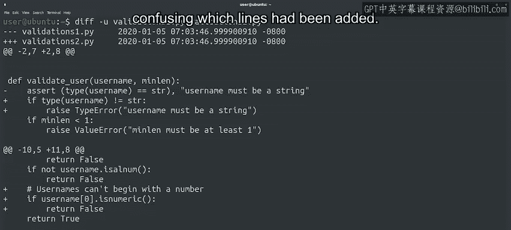

# 谷歌《用Python进行IT自动化办公3、4、5、6课（Git、debug、云端、实践）Google IT Automation with Python》中英字 - P4：3_比较文件差异.zh_en - GPT中英字幕课程资源 - BV1LW4y1F7XW

Imagine you had two copies of some code and you wanted to see what the difference was between them。

Howd you do it？You could open both files in an editor side by side， look at one。

 then look at the other to spot the differences。 but that's super error prone。 We're human。

 and by comparing with our eyes， we're bound to miss some differences， right。Fortunately。

 there's a better way， you can use some nifty tools that will do this automatically。

We can use the DF command line tool to take two files or even two directories and show the differences between them in a few formats。

Let's check it out with an example。We have two files， rearrange 1 dot pi and rearrange 2 do pi。

 which contain two different versions of the same function。Let's take a look at them using CA。

Can you spot the difference？Maybe you can， but it's not super obvious。

 Let's use the diff command so that we don't have to strain our eyes trying to spot it。

When we call the DF command， we get only the lines that are different between two files。

It's much easier to find the difference when we just have two lines， right？

See the symbols at the beginning of each of those lines。

The less than symbol tells us that the first line was removed from the first file。

 and the greater than symbol tells us that the second line was added to the second file。

 In other words， the old line got replaced by the new one。In this example。

 we had one line that was replaced with a new one This is a common change in modifying code。

 but not the only possibility。Let's check out another example。Here there are more changes going on。

We can see that diff splits the changes in two separate sections。

 The section that starts with 5 c 5 comma 6 shows a line in the first file that was replaced by two different lines in the second file。

The number at the beginning of the section indicates the line number in the first and second files。

 The C in between the numbers means that a line was changed。The section that starts with 11 A13。

 comma 15 shows three lines that are new in the second file。The a stands for。 You guessed it added。

 but that block looks a bit strange， doesn't it， It seems like we're adding a return and an if condition。

 but no body for the if block。 What's up with that To understand this better。

 we can use the dash U flag to tell diff to show the differences in another format。

 Let's check that out。This unified format is pretty different from the one that we saw before。

It shows the change lines together with some context。

 using the minus sign to mark lines that were removed and the plus sign to mark lines that were added。

The extra context， lets us better know what's going on with the change that we're diing。

 We can see that the new file actually has a completely new if block。

 that's part of a chain of conditionals that looks very similar。

 And that's why with the diff output that we saw before。

 It was a little confusing which lines had been added。

 There are a lot of tools out there to compare files。 Dff is the most popular one。

 but not the only one available。 For example， W。 diff highlights the words that have change in a file instead of working line by line like diff does。

To help us even more， there are a bunch of graphical tools that display files side by side and highlight the differences by using color。

Some examples of this include MELD， Kdiff3， or VMDF。

We can use these tools to give better context to the changes that we see Okay。

 we've talked about how we can see differences between two files Now how can we use those differences to apply changes？

That's coming up in the next video。