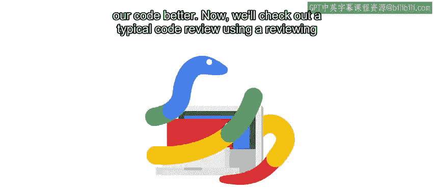
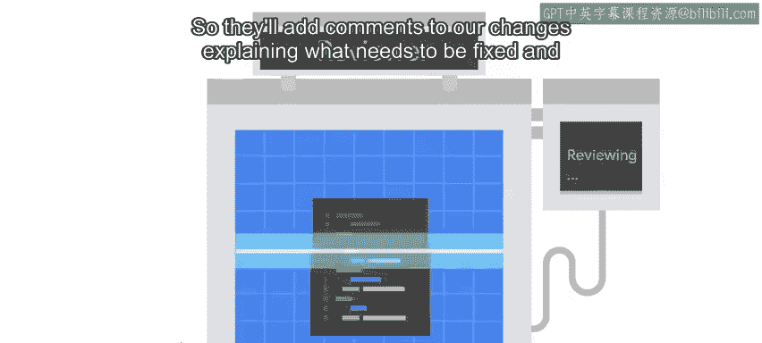
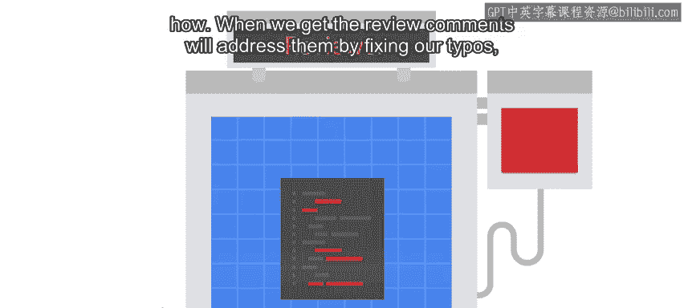
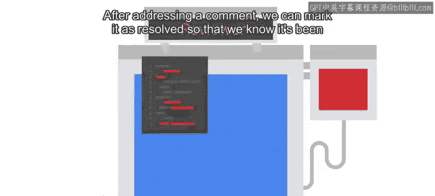
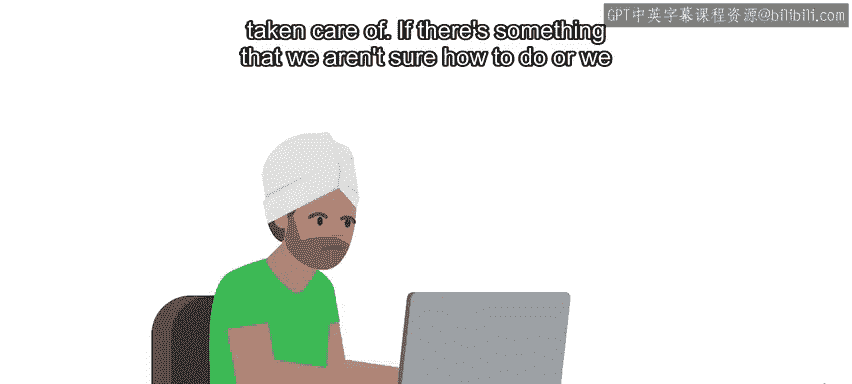
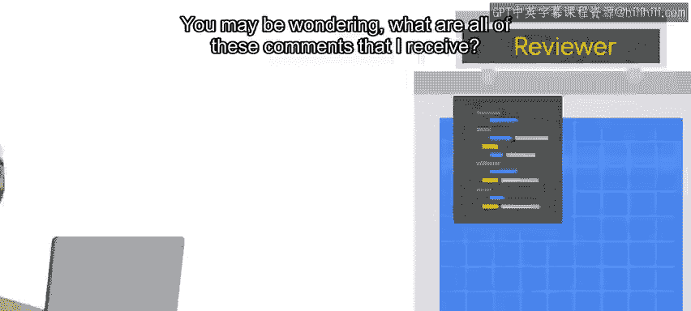
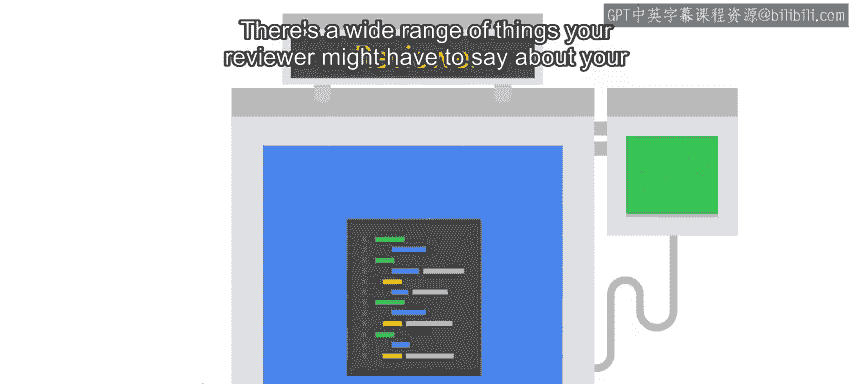

# 谷歌《用Python进行IT自动化办公3、4、5、6课（Git、debug、云端、实践）Google IT Automation with Python》中英字 - P50：49_代码评审工作流.zh_en - GPT中英字幕课程资源 - BV1LW4y1F7XW

🎼。う。

In our last video， we explain what code reviews are and how they can make our code better。

Now we'll check out a typical code review using a reviewing tool。

Imagine we've just finished a bunch of code changes。 Now we'll ask our reviewer to look at our code。

The reviewer might say that everything is okay and our change is approved。

 but usually they'll find something that needs improving。

So they'll add comments to our changes explaining what needs to be fixed and how when we get the review Common。

 we'll address them by fixing our typos， adding any missing tests， and so on。

After addressing a comment， we can mark as resolved so that we know it's been taken care of。

If there's something that we aren't sure how to do or we think a different approach might be better。

 we can reply to the comments and ask our reviewer for more information without marking the comment as resolved。

Once all comments have been resolved and our reviewer is satisfied with the results。

They'll approve the change and well be able to merge it。

You might be wondering， what are all these comments that I'll receive？

There's a wide range of things your reviewer might have to say about your code。

Sometimes you might have forgotten to take into account something important and you'll need to do significant work to fix it。

Sometimes your reviewer might point out something small， that's not really critical。

 and the comment is mostly a suggestion for making the code better。

These comments are usually prefixed saying that it's a knit Whatever it is。

 it's important that you take the time to understand what the comment is and what you need to do to address it。

 For example， if you've written a piece of code and your reviewer asks you to explain why or how the code is doing something。

 it might be tempting to just answer their question in the comment and mark it as resolved。

But this isn't a great idea。Because only the reviewer gets to see your answer。Instead。

 it's better to take this as an opportunity to make the code clearer。 For example。

 you could do this by using better variable names or splitting a large piece of code into smaller functions On top of that。

 you can add comments to the code and documentation to your functions to make sure that the how and why are clearly explained。

It's common for code reviews to include several comments about the style of the code。

To avoid a lot of back and forth， it's a good idea to refer to a style guide that explains the preferred coding style for the project。

 For example， lots of Python projects use the PEP8 style guide。

 If the project you're contributing to doesn't include a style guide。

 make sure that you ask for one and in case you need inspiration。

 we've included links to some common style guides in the next reading。

There are a bunch of code reviewing systems out there， and while they all follow the same patterns。

 they don't all work exactly the same way。In some code reviewing tools。

 you'll need one of the project maintainers to approve your code before it's submitted。

In other tools， you'll just need to get a couple plus ones from contributors to the project before you can submit。

The goal is to always ensure that your code has been reviewed by people who are familiar with the project so that it's ready to be submitted。

Can you think of a project you've worked on in the past where code reviews could have been helpful？

Maybe you worked as a part of a team and had trouble making sure that everyone agreed on how things should be done。

Or maybe you are learning how to use a new tool and you would have benefited from a second pair of eyes on your work。

No matter how simple or complex a project is， it can always be improved with good code reviews。

Up next， we'll dive into how this code reviewing process works on GitHub。

