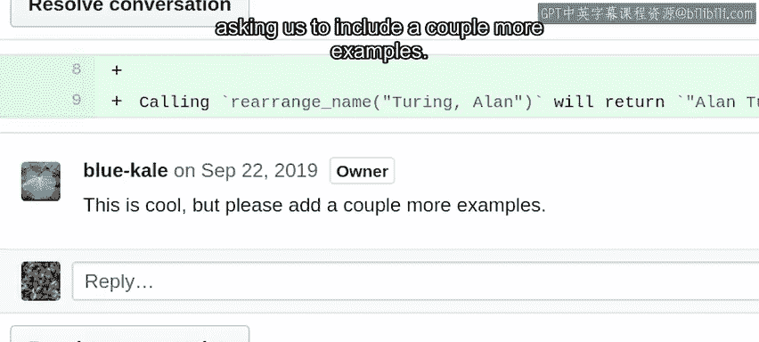
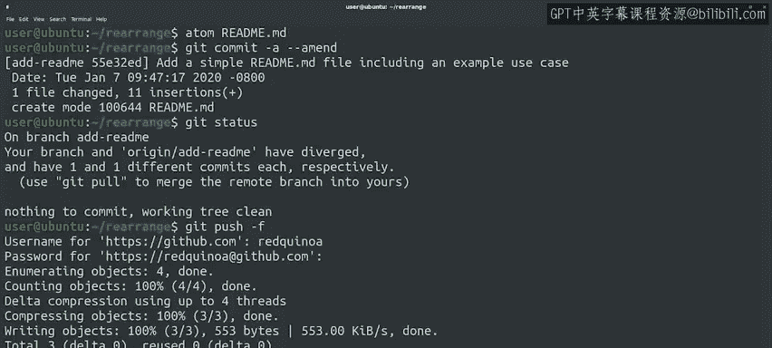
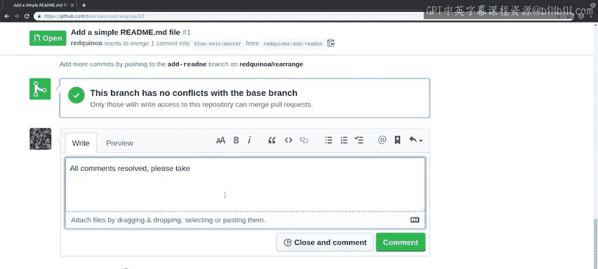

# 谷歌《用Python进行IT自动化办公3、4、5、6课（Git、debug、云端、实践）Google IT Automation with Python》中英字 - P51：50_在 GitHub 上如何进行代码评审.zh_en - GPT中英字幕课程资源 - BV1LW4y1F7XW

Up till now， we've talked about the general process of doing code reviews。

This process applies to any platform with code reviewing tools。

Now let's check out how this process looks on GitHub specifically， remember。

 a while back in this module， we created a pull request that added a read me file。Conveniently。

 our colleague just replied with a few comments， let's have a look。

The coder review has one overall comment， and line by line comments highlighting the things that we need to get done。

We can view all changes requested for the file we created by clicking on the View Change button。

Our reviewer made three comments about our file。 The first one is asking us to add a period at the end of the sentence。

The second one asks us to add another hashtag， which will make the title render in a smaller font。

The last will require a bit more work since it's asking us to include a couple more examples。

Let's fix these。We'll add a period at the end of the second sentence and then add a second hashtag before the example title and finally add a few more examples。

To do that， we'll use the star character， which is another feature of the Markdown language that lets us easily create bullet points。

 so we'll add a couple more lines with the same format and say that Hopper comma Grace M turns into Grace M Hopper。

 and that Voltaire stays as Voltre。All right， we've addressed all the comments in our code review。

Let's save our file and then commit the changes。Since we want this change to be a part of the previous commit。

 we'll call Git commit A with the dash amend flag， which will edit the original commit。

Once we've done that， let's call Git status to see what Git has to say about our repo。

Just like before， we see that our change has diverged from the origin/ master branch。

You might remember that Git commit dash amend modifies commits。

 so it's not safe to do with commits that have been pushed to the repo。

Using amend is pretty much the same as creating a new commit and then using an interactive rebase to fix up a change。

So the commit gets replaced by a completely new commit with a completely different commit ID。

This means that to push it， we'll need to use the dash F flag again。

Remember that forcing pushness is fine for pull request branches because nobody else should have cloned it。

But this isn't something that we want to do with public reos。All right。

 we've done what our colleague asked， let's now go back to look at the pull request and resolve the comments。

See that comment that says outdated。That's because we've pushed a new version since we've made the change。

 but since we've taken care of the request， we can ignore the outdated comment and just resolve the conversation。

Cool， we've addressed all the comments。We can leave a message in our conversation to let our reviewer know that we've resolved all the comments and asked them to take another look。

Our reviewer can now check out the new changes and approve them if they're satisfied。

As with lots of other topics we've covered， making the most out of the code or V process will require some practice。

It's great to have some tips， but in the end we need to learn by experience。

 so don't be afraid to practice， practice， practice。Up next。

 you'll find some resources to learn more about code reviews and a quiz to put this knowledge into action。

After that， you can try out doing a code review on GitHub。

