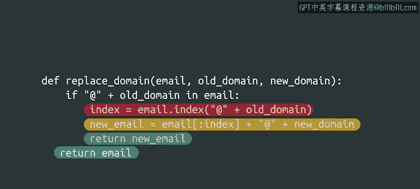

# 谷歌《用Python进行IT自动化办公1、2课（Python、控制操作系统）｜Google IT Automation with Python》中英字幕 - P52：51_创建新字符串.zh_en - GPT中英字幕课程资源 - BV1gw411E7E1

In the last video， we saw how to access certain characters inside a string。 Now。

 what if we wanted to change them， Imagine you have a string with a character that's wrong。

 and you want to fix it like this one。Taking into account what you learned about string indexing。

 you might be tempted to fix it by accessing the corresponding index and changing the character。

Let's see what happens if we try that。Oops， these pesky type errors， right？In this case。

 we're told that strings don't support item assignment。

 This means that we can't change individual characters because strings in Python are immutable。

Which is just a fancy word， meaning they can't be modified。

What we can do is create a new string based on the old one like this。Nice， we fix the typo。

But does this mean the message variable can never change？Not really。

 we can assign a new value to the same variable， let's do that a couple of times to see how it works。

😡，What we're doing here is giving the message variable a whole new value。

 We're not changing the underlying string that was assigned to it before。

 We're assigning a whole new string with different content。If this seems a bit complex， that's okay。

 you don't need to worry about this right now。 We'll call this out whenever it's relevant for the program we're writing。

 So we figured out how to create a new message from the old one。

 But how are we supposed to know which character to change。 Let's try something different。

In this case， we're using a method to get the index of a certain character。

A method is a function associated with a specific class。

We'll talk a lot more about classes and methods later for now。

 what you need to know is that this is a function that applies to a variable。

 and we can call it by following the variable with a dot。 Let's try this a few more times。

So the index method returns the index of the given substring inside the string。

 The substring that we pass can be as long or as short as we want。

What if there's more than one of the substring。Here we know there are two S characters。

 but we only get one value。That's because the index method returns just the first position that matches。

 And what happens if the string doesn't have the substr we're looking for。

The index method can't return a number because the substr isn't there。

 So we get a value error instead。We said that if the substr isn't there， we would get an error。

 So how can we know if a substr is contained in a string to avoid the error。 Let's check this out。

We can use the keyword in to check if a substr is contained in a string。

 We came across the keyword in when using four loops。 In that case， it was used for iteration here。

 it's a conditional that can be either true or false。

It'll be true if the substr is part of the string and false， if it's not。 So here。

 the dragon's substr isn't part of the string。 And sadly， we can't have a dragon as a pet。All right。

 We just covered a bunch of new things， and you're doing awesome。

 Let's put all this stuff together to solve a real world problem。😊。

Imagine that your company has recently moved to using a new domain。

 but a lot of the company email addresses are still using the old one。

 You want to write a program that replaces this old domain with the new one in any outdated email addresses。

 The function to replace the domain would look like this。

This function is a bit more complex than others。 So let's go through it line by line。First。

 we define the replace domain function， which accepts three parameters。

 The email address to be checked。 the old domain and the new domain。

Having all these values as parameters instead of directly in the code makes our function reusable。

 We aren't just changing one domain to the other。 We have a function that will work with all domains。

 Pretty sweet。😊，In the first line of the body of the function。

 we check if the concatenation of the at sign and the old domain are contained in the email address using the keyword in。

We check this to make sure the email has old domain on the portion that comes after the at sign。

If the condition is true， the email address needs to be updated to do that。

 we first find out the index where the old domain， including the at sign， starts。

 We know that this index will be a valid number because we've already checked that the substr was present。

 So using this index， we create the new email。This is a string that contains the first portion of the old email up until the index we have calculated。

 followed by the@ sign and the new domain。Finally， we return this new email。

If the email didn't contain the new domain， then we can just return it。

 which is what we do in the last line。

Wow， that was a really complex function with a lot of new things in it。

 so don't worry if you're finding it a bit tricky。 rewatch the video and take your time if there's a specific part that's tripping you up。

 remember， you can always ask your fellow learners for help in the discussion forum。

You may even find that someone one has asked and got the answer to the same question already。

 When you feel ready to move on， meet me over in the next video where we're going to learn a lot more handy string methods。

😊。