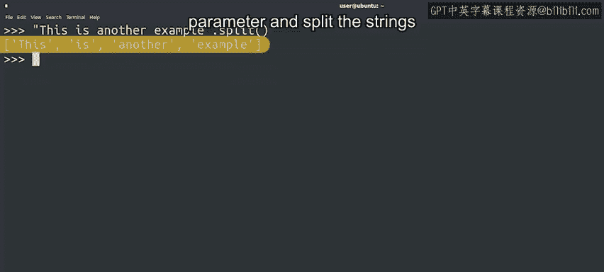

# 谷歌《用Python进行IT自动化办公1、2课（Python、控制操作系统）｜Google IT Automation with Python》中英字幕 - P53：52_更多字符串方法.zh_en - GPT中英字幕课程资源 - BV1gw411E7E1

We said earlier that we had a lot of new， exciting concepts coming up。 Well。

 I'm not going to string you along any more。 We're going tie up our lessons on strings with a bunch of fun methods for transforming our string text。

 I know I know。 My jokes are pretty terrible。 So let's get back to the good stuff。 So far。

 we've seen ways you can access portions of strings using the indexing technique。

 createate new strings by slicing and concatenating。

 find characters in strings using the index method and even test if one string contains another on top of all this string processing power。

 The string class provides a bunch of other methods for working with text。

 Now we'll show you how to use some of these methods。 Remember。

 the goal is not for you to memorize all of this。 Instead。

 we want to give you an idea of what you can do with strings and Python。 Some string methods。

 let you perform transformations or formatting on the string text， like upper and its opposite lower。

😊，These methods are really useful when you're handling user input。

Let's say you wanted to check if the user answered yes to a question。

 How would you know if the user typed it using upper or lowercase， You don't need to。

 You just transformed the answer to the case you want， like this example。

Another useful method when dealing with user input is the strip method。

 This method will get rid of surrounding spaces in the string。If we ask the user for an answer。

 we usually don't care about any surrounding spaces。

 So it's a good idea to use the strip method to get rid of any white space。

This means that strip doesn't just remove spaces。 It also removes tabs and new line characters。

 which are all characters we don't usually want in user provided strings。

 There are two more versions of this method。 L stripip and R strip to get rid of the white space characters just to the left or to the right of the string instead of both sides。

😊，Other methods give you information about the string itself。

The method count returns how many times a given substr appears within a string。The method ends with。

 returns whether the string ends with a certain substr。The method is numeric。

 returns whether the strings made up of just numbers。Adding to that。

 if we have a string that is numeric， we can use the int function to convert it to an actual number。

In earlier videos， we showed that we can concatenate strings using the plus sign。

The join method can also be used for concatenating。To use the join method。

 we have to call it on the string that'll be used for joining。 In this case。

 we're using a string with a space in it。 The method receives a list of strings and returns one string with each of the strings joined by the initial string。

 Let's check out another example。Finally， we can also split a string into a list of strings。😊。

The split method returns a list of all the words in the initial string。

 and it automatically splits by any white space。 It can optionally take a parameter and split the strings by another character。

 like a comma or a dot。😊。

Are you starting to see how these string methods could be useful in your I T job。Okay。

 so we've just learned a bunch of new methods， but there are tons more that you can use on strings。

 We've included a list with the ones we talked about and some new ones in the next cheatee sheet。😊。

You'll also find a link to the full Python documentation there。

 which gives you all the info on each available method。 As we've said before。

 don't worry about trying to memorize everything。 You'll pick these concepts up with practice。

 And the documentation is always there。 If you need it。 All right。

 Last up in our string of string videos。 We're going to check out how to format strings。😊。

