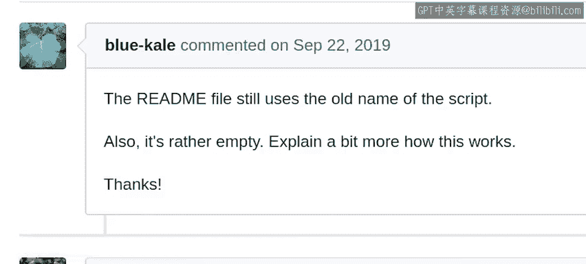
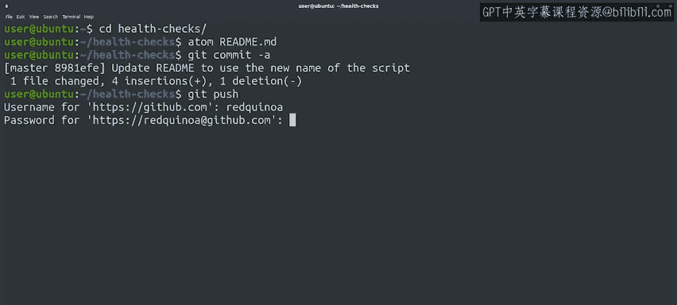
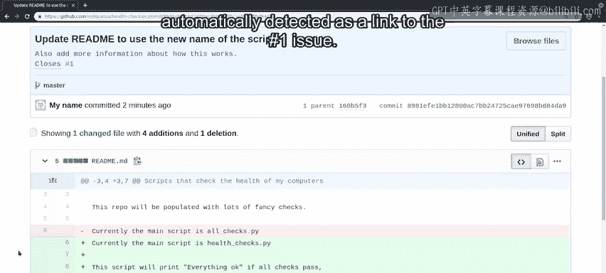

# 谷歌《用Python进行IT自动化办公3、4、5、6课（Git、debug、云端、实践）Google IT Automation with Python》中英字 - P53：52_跟踪问题.zh_en - GPT中英字幕课程资源 - BV1LW4y1F7XW

Deciding who's going to do what is critical when collaborating with others。With no coordination。

 two or more people might spend time working on the same part of the project。

 while nobody works on the other critical parts。Imagine that you and your colleagues decided that you'd work on building automation software for keeping the computers on your network up to date。

But then instead of dividing the task into smaller pieces and assigning them to different people。

You just randomly started working on some part of the infrastructure。

The result would probably be total chaos with different pieces of software that won't work well together and lots of gaps that nobody worked on。

For small teams， it's usually easy enough to discuss in person who's going to be working on what。

But as soon as the group starts growing， talking about responsibilities and what to do next becomes more of a hassle。

That's when a tool like an issue tracker or bug tracker can help us coordinate our work better。

 an issue tracker tells us the tasks that need to be done， the state they're in。

 and who's working on them。The system also lets us add comments to the issue。

 These comments can be super helpful。They can give us more details about the problem。

 explain a way to solve it， or detail how to test if it's been solved。

Issue trackers aren't just useful for people actively working on projects。

They also let users report bugs when they come across them。

 even if they don't know how to solve the problem。Sometimes users come across problems that we never even thought possible。

And having them report these issues through a bug tracker can help make our projects better。

And the tracker can also help volunteers that want to start contributing to the project。

Having a clear， visible list of the pending work lets new contributors figure out how to help and where to jump in。

There are a bunch of different solutions to track bugs or issues。

There's a popular bug tracker called bugzilla， which is used by quite a few open source projects。

On the flip side， platforms like GitHub have an issue tracker baked in。

So if you're hosting your project there， it can be very handy to track work on your project。

Like the problems to solve the features to add and the use cases to include。Let's check it out。

This is the list of issues for our health checks projects。 For now。

 it only has one issue asking us to update our documentation。

One of our colleagues suggested that we create a new health check that verifies if there are any critical error messages inside the system logs。

 like Kern log or cislog。Errors that appear there might help troubleshoot some interesting problems。

So this sounds like a good idea for a new check。Let's create an issue for this feature by clicking on the new issuesue button。

For the title of the issue， we'll say that we want to check for critical errors in system logs。

And for the issues description， we'll say that the new check should go through Var/ log/ current log。

And vr slash log， slash cislog。And check if there are any critical errors that need attention。

When writing an issue description， it's a good idea to include all the information that we have about the problem or missing feature and any ideas on how to solve it。

And if new information comes up later on， it can be added as additional comments on the same issue。

Great， we're now ready to submit the new issue。Okay。

 we now have the new list in our list of issues to solve The issues in the list all have numbers that identify them。

As we called out in an earlier video， in GitHub， each issue or pull request in a project has a unique number associated with it。

So if we have a pull request with the ID5， there won't be an issue with ID5。

GitHub will automatically reference issues and pull requests and comments when we mention them using the hashtag number format。

For example， if we use hashtag 2 in a comment， it will automatically reference the issue we just created。

If you're fixing an issue through a pull request， it's possible to automatically close the issue directly once the code is merged。

To do this， you need to include a string likeCs Col hashtag4 in your commit message or as a part of the description of your pull request。

Once the code gets merged into the main tree， GitHub will automatically close the issue with the message。

 linking it to the new commit。Let's try this out by updating the documentation like the hashtag one issue requested。

This issue seems easy enough to fix。 We need to update the Readme file to use the new file name and explain a bit more about how our script works。

Before we start working on this， let's get the issue assigned to us。

Assigning issues to collaborators helps us track who's working on what by assigning the bug to yourself。

 you can let others know that you're working on it so they don't need to。All right。

 let's update the documentation。So。We're still using the old name of the main file， all checks pie。

We renamed that file a while back to Health checksp。

Let's change our readme to use the new file name using inverted quotes to show monospace text。

Then we'll add that this script will print everything OK if all checks pass and it will print the corresponding error messages if something fails。

We've updated the documentation。Let's save the file and commit this change。This time。

 we'll call Git commitmit A so that we can edit the commit message in the text editor。

We'll say that we've updated the Read Me to use a new name of our script。

And in the longer description， we'll add that we've included more info about how the script works。

Finally， we'll wrap up by adding the string， closes hashtag 1 so that the issue will get automatically closed once this commit is integrated into the main tree。

Our commit message looks good。 Let's save it and push it to the repo。

Now let's go back to the issue that we were addressing。

We see that our issue is automatically closed with the commit we pushed。

 We we can click on the commit ID to see the full commit。

So here's the commit message we created with the associated change。

See how the hashtag1 that we included as a part of the commit message is automatically detected as a link to the hashtag1 issue。

There's a bunch more to learn about tracking issues， but this should be enough to get you started。

Feel free to experiment on your own and try more ways to interact with the system。

