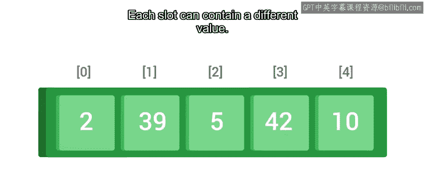
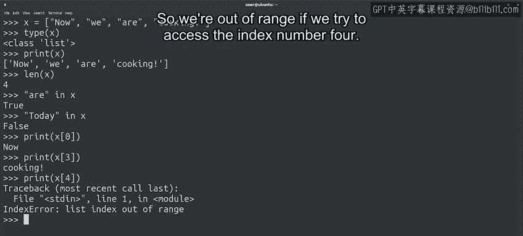
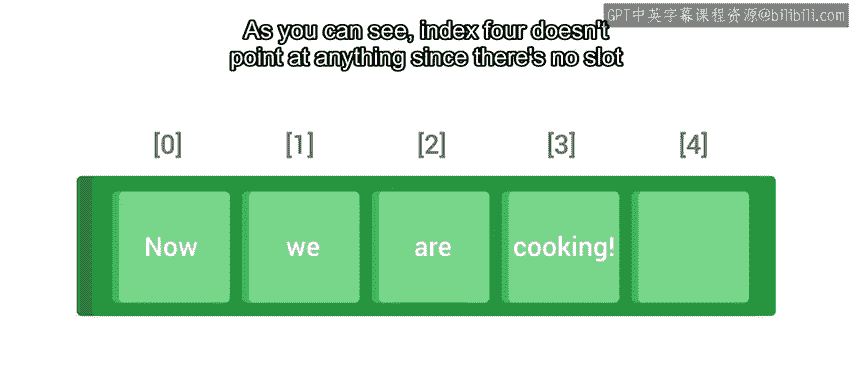
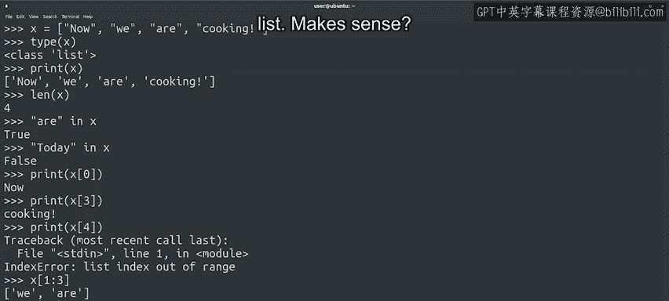

# 谷歌《用Python进行IT自动化办公1、2课（Python、控制操作系统）｜Google IT Automation with Python》中英字幕 - P55：54_什么是列表.zh_en - GPT中英字幕课程资源 - BV1gw411E7E1

As you know by now， Python comes with a lot of ready to use data types。 We've seen integers， floats。

 Booleions and strings in detail， but those data types can only take you so far。 Eventually。

 in your scripts， you'll want to develop code that manipulates collections of items like a list of strings representing all the file names in a directory or a list of integers representing the size of network packets。

 This is where the list data type comes in handy。 You can think of lists as long boxes with the space inside the box divided up into different slots。

😊，Each slot can contain a different value。

Like we mentioned earlier， when we first came across the list in Python。

 we use square brackets to indicate where the list starts and ends。 Let's check out an example。😊。

Here we've created a new variable called X and set its contents to be a list of strings。

 We can check the type of x using the type function we saw a little while ago。Nice。

 Python tells us this is a list in the same way we've done with other variables。

 we can show the contents of the whole list using the print function。😊。

The length of the list is how many elements it has to get that value。

 We'll use the same lens function we used for strings。That's right。 Our list has four elements。

When calling Len for the list， it doesn't matter how long each string is on its own。

 What matters is how many elements the list has。To check if a list contains a certain element。

 you can use the keyword in， like in these examples。Again， like when we use this with strings。

 the result of this check is a boolean， which we can use as a condition for branching or looping。

 We can also use indexing to access individual elements。

 depending on their position in the list to do that。

 We use the square brackets and the index we want to access exactly like we did with strings。😊。

Remember that the first element is given the index 0。

 This means the last index of the list will be the length of the list，-1。

What happens if we try to access an element after the end of the list？

You might have seen this coming。 We get an index error。 We can't go over the end of the list。

Remember that because list indexes start at 0， accessing the item at index 4 means we're trying to access the fifth element in the list。

 There are only four elements， so we're out of range if we try to access the index number 4。

Does this seem a bit confusing If it does， this visualization might help you out。As you can see。

 index 4 doesn't point at anything since there's no slot 4 in our list。

As with strings， we can also use indexes to create a slice of the list For this。

 we use ranges of two numbers separated by a colon。 Again。

 the second element isn't included in the slice。 So the range goes to the second index-1。

Here we start at index1 and go up to one less than3， which is 2。

 We can also leave out one of the range indexes empty。The first value defaults to 0。

 and the second value to the length of the list makes sense。

If all this sounds really familiar to what we said about strings。

 then this course is working is intended。 That's because strings and lists are very similar data types In Python。

 stringings and lists are both examples of sequences， There are other sequences， too。

 and they all share a bunch of operations like iterating over them using four loops。

 indexing using the lens function to know the length of the sequence using plus to concatenate two sequences and using in to verify if the sequence contains an element。

😊，So this is great news while understanding indexing is hard once you know it for one data type you've pretty much mastered it for every data type。

 so you actually know way more than you thought Wow now we're really cooking next up we're going to look at some more list operations this time actually specific to lists。

