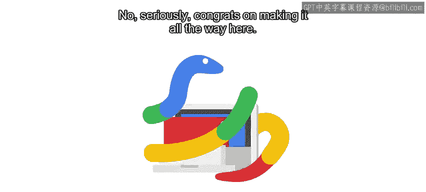

# 谷歌《用Python进行IT自动化办公3、4、5、6课（Git、debug、云端、实践）Google IT Automation with Python》中英字 - P55：54_模块 4 总结 - 协作.zh_en - GPT中英字幕课程资源 - BV1LW4y1F7XW

🎼。う。

Yes， you've made it to the end of the last module。 No， seriously。

 congrats on making it all the way here。😊，Wow， we've learned so much over the last few videos。

 we've checked out a lot of tools for better collaboration through GitHub。

 we looked at the typical workflow for pull requests like how to update and squash changes。

 we learned how code reviews make our code better by helping us catch bugs。

 tyypos and other problems， finally， we looked into some advanced tools for collaboration。

 like issue trackers or continuous integration services。

All this builds on the other tools and techniques for version control that we've covered throughout the course。

 like checking the change history， rolling back a bad change， and merging other people's changes。

You've learned a lot over this course， and you should be really proud of what you've achieved。

The first time I used the VCS was during my first role at Google。

 and once I understood what it could do for me， I mainly felt one thing。Relief。

I was so amazed how it made it so easy to look through code and figure out exactly who contributed to the project and what they did。

And if I ever had any questions， all I had to do was message the person who last touched the code and sit down with them to learn。

I hope that you're also starting to experience the power of having control of your code and that you're excited to use a version control system for all your upcoming projects Up next we have the last assessment in the course you'll need to interact with GitHub to forca Repo。

 push to your own repo and then create a pull request from your change。Best of luck， and remember。

 you got this。