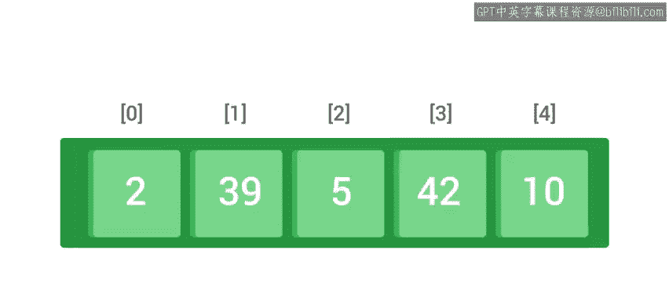
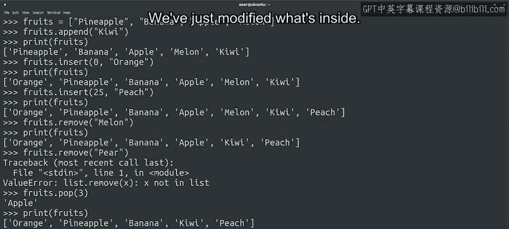

# 谷歌《用Python进行IT自动化办公1、2课（Python、控制操作系统）｜Google IT Automation with Python》中英字幕 - P56：55_修改列表内容.zh_en - GPT中英字幕课程资源 - BV1gw411E7E1

One of the ways that lists and strings are different is that lists are mutable。

 which is another fancy word to say that they can change。This means we can add。

 remove or modify elements in a list。 Let's go back to our example of thinking of a list as a long box。

Changing the list means we keep the same box and we add。

 remove or change the elements inside that box。

Will now go through the methods that let us modify the list 1 by one。

 If all these details seem a little overwhelming， that's okay， As usual。

 there will be a cheat sheet at the end， and you'll have lots of chances to practicerac each of these methods as we go along。

 You don't need to learn all those by heart。 And， of course。

 you can always review anything that isn't clear。 So don't worry， we've got your back。

We'll start with the simplest change， adding an element to a list， using the append method。

Let's check this out in the tastiest example yet。The append method adds a new element at the end of the list。

 It doesn't matter how long the list is。 The element always gets added to the end。

You could start with an empty list and add all of its items using a pen。

If you want to insert an element in a different position instead of at the end。

 you can use the insert method。The insert method takes an index as the first parameter and an element as the second parameter。

 It adds the element at that index in the list to add it as the first element。 we use index 0。

 and we can use any other number。😊，What happens if we use a number larger than the length of the list？

Woo， no errors。 You can say that it even worked just peachy。

If we use an index higher than the current length， the element just gets added to the end。

 You can pass any number to insert， but usually you either add at the beginning using insert at the0 index or at the end using aend。

We can also remove elements from the list。 We can do it using the value of the element we want to remove。

 Can you guess what method we would use。You got it， use the remove method。

The remove method removes from the list the first occurrence of the element we pass to it。

 What happens if the elements is not in the list。Oh， that went pear shaped。

We got a value error telling us the element isn't in the list。

 Another way we can remove elements is by using the P method， which receives an index。

The P method returns the element that was removed at the index that was passed。

And the last way to modify the contents of a list is to change an item by assigning something else to that position like this。

Wow， the contents of our fruits variable have changed a lot since we started this video。

 but it's always the same variable。 the same box。 We've just modified what's inside。

 modifying the contents of lists will come up in tons of scripts as we operate with them。

 If the list contains hosts on a network。 you could add or remove hosts as they come online or offline。

 If the list contains users authorized to run a certain process。

 You could add or remove users when permissions are granted or removed and so on。😊。

You've now seen a number of methods that let us modify the contents of a list， adding。

 removing and changing the elements that are stored inside the list。

Whenever you need to write a program that'll handle a variable amount of elements， you'll use a list。

 What if you need a sequence of a fixed amount of elements that's coming up in our next video。

