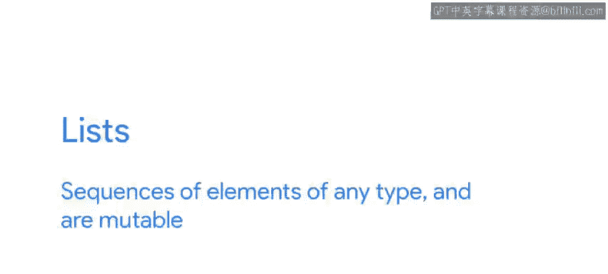
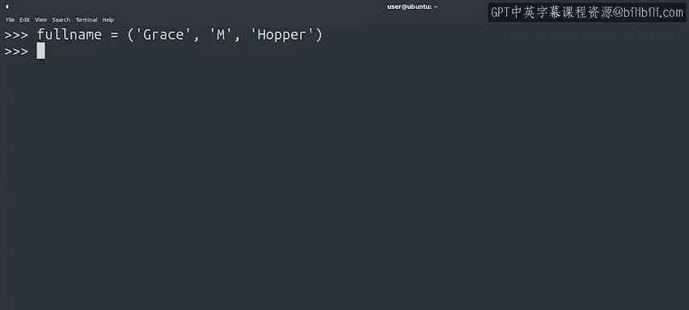
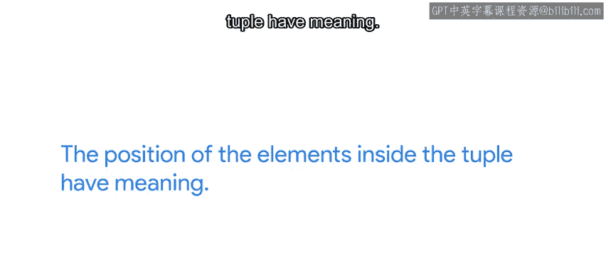
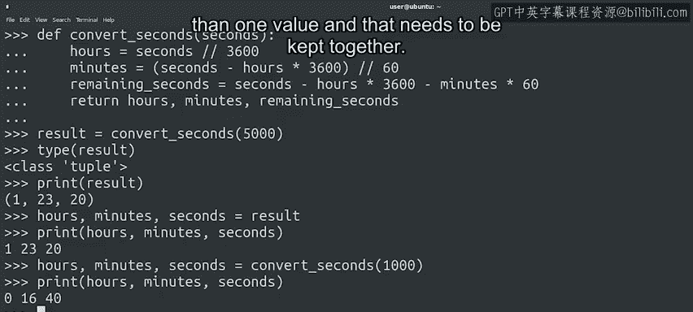

# 谷歌《用Python进行IT自动化办公1、2课（Python、控制操作系统）｜Google IT Automation with Python》中英字幕 - P57：56_列表和元组.zh_en - GPT中英字幕课程资源 - BV1gw411E7E1

As we called out before， there are a number of data types in Python that are all sequences。

 Strs are sequences of characters and are immutable。Listists are sequences of elements of any type。

 and are mutable。

A third data type that's a sequence and also closely related to lists is the tuple。

 Tups are sequences of elements of any type that are immutable。We write tus and parentheses。

 instead of square brackets。You might be wondering， why do we even need another sequence type。

 Wen't lists great， Yes， lists are great。 They can hold any number of elements， and we can add。

 remove and modify their contents as much as we want。

 But there are cases when we want to make sure an element in a certain position or index refers to one specific thing and won't change。

 In these situations， lists won't help us。 Thanks for nothing lists。 In our example。

 we have a tuple that represents someone's full name。

 The first element of the tuple is the first name。 The second element is the middle initial。

 And the third element is the last name。😊，If we add another element somewhere in there。

 what would that element represent， it would just be confusing and our code wouldn't know what to do with it。

 and that's why modifying isn't allowed。😡。

In other words， when using tuples， the position of the elements inside the tuple have meaning。

Tuples are used for lots of different things in Python。

 One common example is the return value of functions。 When a function returns more than one value。

 it's actually returning a tuple。 Remember the function to convert seconds to hours。

 minutes and seconds that we saw a while back。 Here it is to remind you。

This function returns three values。 In other words， it returns a tuple of three elements。

 Let's give it a try。We see the result as a tuple。 What if we print it？

We see that it has the three elements we expect it to have。 And remember， since this is a tuple。

 the order matters。 The first element represents the hours。 The second one represents the minutes。

 and the third represents the seconds。One interesting thing we can do with tus is unpack them。

 This means that we can turn a tuple of three elements into three separate variables。

 And because the order won't change， we know what those variables represent like this。😊。

So now we've split the tuple into three separate values。

 We've seen before that we can also do this directly when calling the function without the intermediate result variable。

In Python， it's really common to use tus to represent data that has more than one value and that needs to be kept together。

For example， you could use a tuple to have a file name and its size。

 or you could store the name and email address of a person or a date and time and the general health of a system at any point in time。

 Can you see how these different data types could help you automate some of your I T work。

 Pretty cool， right。😊，Knowing when to use tuples and when to use lists can seem a little fuzzy at first。

 but don't worry it'll get clearer as we tackle more examples。

